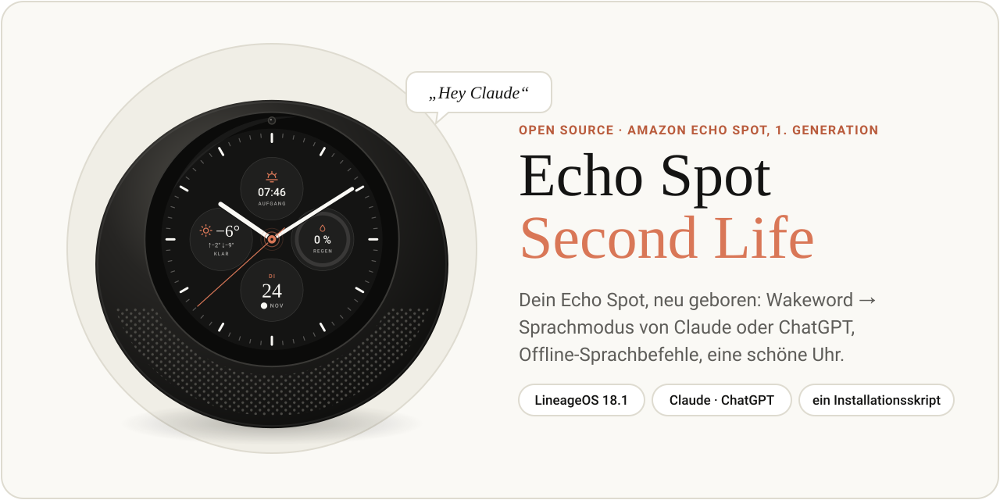
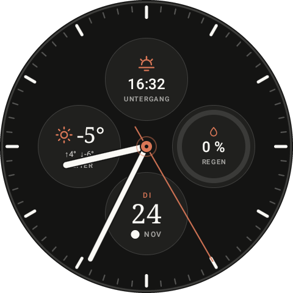
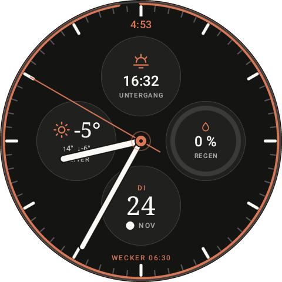
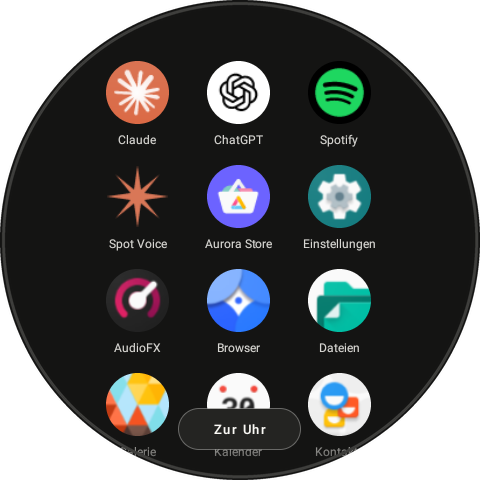
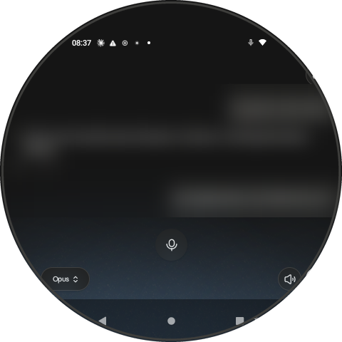
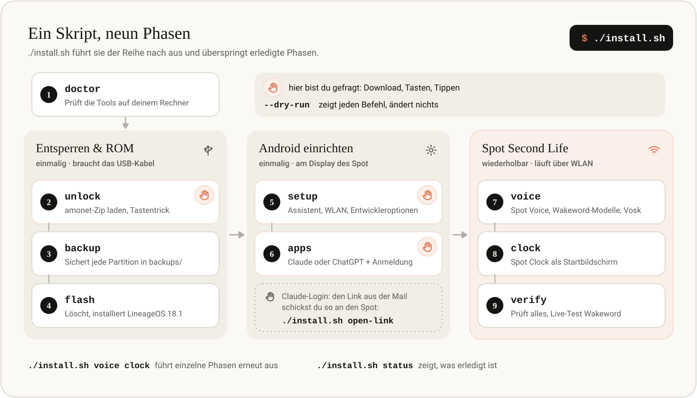

<sub>[English](README.md) · **Deutsch**</sub>

<p align="center">
  
</p>

# Echo Spot Second Life

Echo Spot Second Life macht aus einem Amazon Echo Spot der **ersten Generation (2017/2018)** ein offenes Gerät.
Statt Fire OS läuft darauf LineageOS 18.1 (Android 11). Du sagst ein Wake-Word, und der Spot öffnet den
**Sprachmodus von Claude oder ChatGPT**. Danach sprichst du einfach los, ohne etwas anzufassen. Kurze
**Offline-Sprachbefehle** steuern Musik, Internetradio, Timer und Wecker. Wenn niemand spricht, zeigt der Spot eine
ruhige **runde Uhr**. Ein einziges Skript, `./install.sh`, führt dich durch alle Schritte: vom Entsperren des
Bootloaders bis zur abschließenden Prüfung. Du brauchst einen freien Nachmittag, ein USB-Datenkabel und einen Mac
oder Linux-Rechner.

<p align="center">
  <b><a href="#schnellstart">Schnellstart</a></b> · <a href="#was-du-brauchst">Was du brauchst</a> · <a href="#die-anleitung">Die Anleitung</a> · <a href="#stand-was-getestet-wurde">Was getestet wurde</a> · <a href="docs/de/09-troubleshooting.md">Fehlerbehebung</a>
</p>

## Was du bekommst

<table>
  <tr>
    <td align="center" width="33%">
      <br>
      <sub><b>Uhr</b>: Sonnenuntergang, Wetter, Regenwahrscheinlichkeit, Datum und Mondphase</sub>
    </td>
    <td align="center" width="33%">
      <br>
      <sub><b>Timer und Wecker</b>: Der Ring zählt herunter, unten steht die Weckzeit</sub>
    </td>
    <td align="center" width="33%">
      <br>
      <sub><b>App-Übersicht</b>: Ein Tipp auf die Uhr bringt dich zu deinen Apps</sub>
    </td>
  </tr>
  <tr>
    <td align="center">
      <br>
      <sub><b>Spot Voice</b>: Status, Zuhören an/aus, Claude oder ChatGPT</sub>
    </td>
    <td align="center">
      <br>
      <sub><b>Claude-Sprachmodus</b>: vom Wake-Word geöffnet (Text unkenntlich gemacht)</sub>
    </td>
    <td align="center">
      <sub>Die Screenshots zeigen die deutsche Oberfläche, so wie mit <code>--lang de</code>.<br>Mit <code>--lang en</code> sind Spot, Uhr und Installer englisch.</sub>
    </td>
  </tr>
</table>

- **Wake-Word, dann freihändiger Sprachmodus.** Sag „Hey Claude“. Der Spot wacht auf, öffnet die Claude-App und
  tippt für dich auf den Button für den Sprachmodus. Dann sprichst du einfach. Mit ChatGPT klappt das genauso (neu,
  siehe [Stand](#stand-was-getestet-wurde)).
- **Echo-Schutz.** Der Spot hat keine Echounterdrückung in der Hardware. Spot Voice schaltet deshalb das Mikrofon
  des Assistenten stumm, solange er spricht, und gibt es danach wieder frei. So antwortet er nicht auf sich selbst.
- **Leicht zu beenden.** Sag „Danke Claude“ oder „Thank you Claude“, sei etwa 10 Sekunden still, sag noch einmal
  das Wake-Word oder drück die mittlere Taste oben. Der Spot kehrt zur Uhr zurück und hört wieder zu.
- **Offline-Sprachbefehle auf Deutsch oder Englisch.** Sag das Wake-Word und dann einen kurzen Befehl: „Stell einen
  Timer auf fünf Minuten“, „Weck mich um halb sieben“, „Spiel Radio SWR3“, „Spiel Miles Davis auf Spotify“,
  „Lauter“, „Nächstes Lied“. Die Sprache wird auf dem Spot selbst erkannt (Vosk); nur die Radiosuche und Spotify
  brauchen das Internet.
- **Eine Uhr für das runde Display.** Wetter und Regenwahrscheinlichkeit (Open-Meteo, ohne Konto), Sonnenauf- und
  -untergang, Datum und Mondphase, der laufende Titel mit Cover, Ringe für Timer und Wecker. Ein gedimmtes
  Nachtzifferblatt und die Displayhelligkeit richten sich nach dem Licht im Raum (Lichtsensor). Die Uhr ist
  Startbildschirm und Bildschirmschoner zugleich.
- **Ein Installationsskript.** `./install.sh` prüft deinen Computer, entsperrt, sichert, flasht und richtet den Spot
  ein. Für jeden Handgriff zeigt es eine nummerierte Anleitung, prüft jeden Download per SHA-256, hat einen
  Probelauf und macht dort weiter, wo es aufgehört hat.

## Was du brauchst

| Du brauchst | Wofür |
|---|---|
| **Einen Amazon Echo Spot der 1. Generation (2017/2018)** | Nur dieses Modell (Codename `rook`) funktioniert. Wie du es vom Modell von 2024 unterscheidest, steht unten. |
| **Sein Original-Netzteil** | Der Spot hängt die ganze Zeit an seinem eigenen Netzteil. Das USB-Kabel ersetzt es nicht. |
| **Ein Micro-USB-Datenkabel** | Es kommt in einen versteckten Anschluss auf der Rückseite. Viele billige Kabel können nur laden. Damit klappt es nicht. |
| **Einen Mac oder Linux-Rechner** | macOS ist getestet. Linux sollte funktionieren, ist aber ungetestet. Windows unterstützt `install.sh` nicht. |
| **WLAN** | Für den Assistenten, das Wetter, das Radio und die App-Downloads. |
| **Ein Konto bei Claude oder ChatGPT** | Für den Assistenten, dessen Sprachmodus du nutzen willst. Ein Spotify-Konto ist optional. |

**Erste oder zweite Generation?** Der Echo Spot der 1. Generation (2017/2018) ist der kugelförmige mit einem ganz
**runden Display und einer Kamera** darüber. Der Echo Spot der 2. Generation (2024) hat ein **halbrundes Display und
keine Kamera**. Das ist ein anderes Gerät, und es funktioniert hier nicht. Der Installer prüft das Modell, bevor er
irgendetwas verändert, und bricht ab, wenn es kein Spot der 1. Generation ist.

Details, Bilder vom versteckten Anschluss und die Vorbereitung des Computers: [1 · Hardware und was du brauchst](docs/de/01-hardware.md).

## Schnellstart

Öffne ein Terminal (auf dem Mac: Programme → Dienstprogramme → Terminal) und tippe diese Zeilen ein. Neu bei `git`,
Homebrew oder `adb`? [Kapitel 1](docs/de/01-hardware.md#dein-computer) zeigt, wie du sie vorher installierst.

```bash
cd ~
git clone https://github.com/Nachtfux/Echo_spot_second_life.git
cd Echo_spot_second_life
./install.sh
```

Beim ersten Start stellt der Installer drei Fragen: die Sprache (`de` oder `en`), den Assistenten (`claude` oder
`chatgpt`) und einen Ort für das Wetter. Tippe einen Ortsnamen wie `Berlin` ein (nur Namen, keine Postleitzahl;
`<Ort>, <Region>` grenzt ein) oder drücke Enter für kein Wetter. Danach arbeitet er neun Phasen der Reihe
nach ab. Vor jeder fragt er `Phase "unlock" jetzt ausführen? [J/n/skip]`: Enter führt die Phase aus, `n` hört hier auf
und du machst später weiter, `skip` überspringt sie. Mit Strg+C kannst du jederzeit abbrechen, nur nicht während des
Entsperrens. Startest du `./install.sh` noch einmal, überspringt er erledigte Phasen und macht weiter. Drei Phasen
brauchen deine Hände: **unlock** (Datei herunterladen, Tasten drücken), **setup** (auf dem Spot tippen) und
**apps** (installieren und anmelden).

> [!TIP]
> Erst einmal nur zuschauen? `./install.sh --dry-run --yes` zeigt jeden Befehl an, statt ihn auszuführen.
> Dafür brauchst du kein Gerät, es wird nichts heruntergeladen und nichts gespeichert. Der echte Lauf stellt
> seine Fragen deshalb noch einmal.

<p align="center">
  
</p>

Nützliche Befehle für später:

| Befehl | Was er macht |
|---|---|
| `./install.sh status` | Zeigt Einstellungen, erledigte Phasen und das verbundene Gerät |
| `./install.sh help` | Listet alle Phasen, Befehle und Optionen auf |
| `./install.sh verify` | Prüft alles und bietet einen Live-Test des Wake-Words an |
| `./install.sh open-link` | Öffnet den Claude-Anmeldelink aus deiner E-Mail auf dem Spot (unsichtbare Eingabe, wird nie gespeichert) |
| `./install.sh apps voice --assistant chatgpt` | Stellt das Wake-Word auf ChatGPT um (`claude` stellt es zurück) |
| `./install.sh clock --place "Hamburg"` | Ändert den Wetter-Ort |
| `./install.sh voice --sensitivity low` | Weniger Fehlauslösungen (`high` = hört dich besser) |

## Die Anleitung

| Kapitel | Worum es geht | Installer-Phase |
|---|---|---|
| [1 · Hardware und was du brauchst](docs/de/01-hardware.md) | Einen Spot der 1. Generation erkennen, den versteckten USB-Anschluss öffnen, den Computer vorbereiten | `doctor` |
| [2 · Den Spot entsperren](docs/de/02-unlock.md) | Der amonet-Exploit, der Drei-Tasten-Trick für Fastboot, TWRP | `unlock` |
| [3 · LineageOS: Sicherung und Installation](docs/de/03-lineageos.md) | Vollständige Sicherung aller Partitionen, dann LineageOS 18.1 | `backup`, `flash` |
| [4 · Android einrichten](docs/de/04-setup.md) | Einrichtungsassistent, Entwickleroptionen, Sprache, Aurora Store, adb über WLAN | `setup` |
| [5 · Sprachassistent: Claude oder ChatGPT](docs/de/05-voice-assistant.md) | Installieren und anmelden, Wake-Word, Echo-Schutz, Gespräch beenden, Feinabstimmung | `apps`, `voice` |
| [6 · Sprachbefehle](docs/de/06-voice-commands.md) | Alle Offline-Befehle auf Deutsch und Englisch | `voice` |
| [7 · Die Uhr](docs/de/07-clock.md) | Zifferblätter, Wetter, laufender Titel, Timer und Wecker | `clock` |
| [8 · Eigenes Wake-Word trainieren](docs/de/08-wakeword-training.md) | Ein Wake-Word oder Stoppwort auf dem eigenen Rechner trainieren | `train` |
| [9 · Fehlerbehebung und FAQ](docs/de/09-troubleshooting.md) | Prüfungen, häufige Probleme, Sicherung zurückspielen | `verify` |
| [10 · So funktioniert es](docs/de/10-architecture.md) | Architektur, für Entwickler | — |

## Stand: was getestet wurde

| Teil | Stand |
|---|---|
| Entsperren (amonet-rook v2.0.0), Sicherung, LineageOS 18.1 v0.3 | Einmal an einem echten Echo Spot durchgeführt, am 23.11.2026, von macOS auf Apple Silicon aus, ausgehend von Fire OS 5.5.6.9. Diese Schritte werden **nicht** für jedes Release wiederholt. |
| Phasen `voice`, `clock`, `verify` | Am 24.11.2026 vollständig gegen einen echten Spot gelaufen: alle Prüfungen grün, und der Live-Test hat den Sprachmodus von Claude geöffnet. Die Schritte hinter `setup` und `apps` wurden am selben Spot durchgeführt und geprüft. |
| Sprachmodus von Claude | Funktioniert freihändig: Wake-Word, automatischer Tipp auf den Sprachmodus-Button, Echo-Schutz, Beenden per Stoppwort oder Stille. |
| Sprachmodus von ChatGPT | **Neu, weniger getestet als Claude.** Die ChatGPT-App lässt sich auf dem Spot installieren und läuft. Die Beschriftungen ihrer Sprachmodus-Buttons werden noch kalibriert. Trainierte Modelle für „Hey ChatGPT“ und „Danke ChatGPT“ liegen in `models/`. |
| Sprachbefehle | Deutsche Befehle am Spot getestet (Timer, Wecker, Radio). Die englischen Befehle sind per Unit-Test geprüft und wurden am echten Spot seltener benutzt. |
| Wake-Word „Hey Claude“ | Bei der Standardempfindlichkeit hat es 55 % von 400 synthetischen Testaufnahmen erkannt und auf 10,7 Stunden echter Alltagsaufnahmen 0,28-mal pro Stunde fälschlich ausgelöst. Echte Räume sind schwieriger als die Testaufnahmen. Details und Feinabstimmung: [Kapitel 5](docs/de/05-voice-assistant.md). |
| Computer | macOS getestet. Linux sollte funktionieren, ist aber ungetestet. Windows unterstützt `install.sh` nicht (amonet selbst bringt Windows-Skripte für das Entsperren mit). |

## Grenzen

- **Die Kamera funktioniert nicht.** LineageOS 18.1 für den Spot hat keine Treiberschicht für die Kamera (HAL).
  Android sieht keine Kamera.
- **Kein Dazwischenreden.** Ohne Echounterdrückung in der Hardware läuft das Gespräch im Wechsel (halbduplex):
  Solange der Assistent spricht, hört er dich nicht.
- **Der Sprachmodus antwortet jedem im Raum**, genau wie am Handy.
- **Das Wake-Word ist nicht perfekt.** Manchmal überhört es dich, und ein Fernseher oder Radio kann es versehentlich
  auslösen. Du kannst es feiner einstellen oder [auf deine eigene Stimme trainieren](docs/de/08-wakeword-training.md).
- **Die Sprachbefehle nutzen kleine Offline-Modelle** für Deutsch oder Englisch. Sie kennen eine feste Auswahl an
  Befehlen.
- **Keine Google-Dienste.** Apps kommen über Aurora Store aus Google Play. „Mit Google anmelden“ funktioniert nicht.
- **adb über WLAN schaltet sich bei jedem Neustart des Spot ab.** Der Installer merkt das und bittet dich einmal ums
  Kabel.

Mehr dazu: [9 · Fehlerbehebung und FAQ](docs/de/09-troubleshooting.md).

## Datenschutz und Sicherheit

- Wake-Word und Sprachbefehle werden **auf dem Spot** verarbeitet. Ton geht nur dann an Anthropic oder OpenAI, wenn
  deren Sprachmodus offen ist, genau wie bei ihren Handy-Apps.
- Die Wetterabfrage enthält nur die Koordinaten deines Orts.
- Anmeldedaten tauchen nie auf der Kommandozeile auf. `./install.sh open-link` liest den Link unsichtbar ein und
  speichert ihn nicht.
- Die Partitionssicherung bleibt auf deinem Computer in `backups/` (von git ignoriert). Sie enthält
  gerätespezifische Daten: Gib sie nie weiter.
- Jeder Download wird per SHA-256 geprüft. Bei Aurora Store prüft der Installer zusätzlich das Signaturzertifikat,
  wenn `apksigner` installiert ist.
- Schritte, die löschen oder entsperren, verlangen ein getipptes `JA` (oder `YES`). Bedienungshilfe und
  Benachrichtigungszugriff werden erst eingeschaltet, wenn du mit `j` antwortest.
- Die Release-APKs (`spot-voice.apk`, `spot-clock.apk`, dazu `SHA256SUMS`) sind mit diesem Zertifikat signiert:
  `48:04:B0:EB:D0:63:A5:82:8A:38:32:5A:DD:A7:E8:93:C5:06:FE:19:C8:C8:E9:96:4B:46:AF:DC:DB:B4:A4:0E` (SHA-256; prüfen
  mit `apksigner verify --print-certs spot-voice.apk`). Wenn du sie lieber selbst baust, nimm `./install.sh build`
  oder häng `--from-source` an (braucht JDK 17 und das Android SDK).

## Danke

Dieses Projekt steht auf den Schultern anderer. Danke an:
[amonet](https://github.com/R0rt1z2/amonet) von R0rt1z2 und Mitwirkenden (Entsperren und TWRP für den Spot),
[TWRP](https://twrp.me),
die LineageOS-18.1-Portierung für rook von [amazon-oss](https://github.com/amazon-oss/releases/releases/tag/lineage-18.1-rook-v0.3),
[openWakeWord](https://github.com/dscripka/openWakeWord),
[Vosk](https://alphacephei.com/vosk/),
[Piper](https://github.com/rhasspy/piper-sample-generator) (synthetische Stimmen für das Training),
[Aurora Store](https://gitlab.com/AuroraOSS/AuroraStore),
[Open-Meteo](https://open-meteo.com) und
[radio-browser.info](https://www.radio-browser.info).
Lizenzen und Details: [THIRD_PARTY.md](THIRD_PARTY.md).

## Lizenz

- Der Code dieses Projekts (`install.sh`, `scripts/`, `apps/`, `training/`) steht unter der MIT-Lizenz: siehe
  [LICENSE](LICENSE).
- Die trainierten Wake-Word-Modelle in `models/` stehen unter **CC BY-NC-SA 4.0** (nicht kommerziell, Weitergabe
  unter gleichen Bedingungen), weil sie mit openWakeWord-Daten unter dieser Lizenz trainiert wurden. Die
  openWakeWord-Basismodelle, die der App-Build herunterlädt, stehen ebenfalls unter CC BY-NC-SA 4.0.
- Software von Dritten behält ihre eigene Lizenz: siehe [THIRD_PARTY.md](THIRD_PARTY.md).

## Haftungsausschluss

> [!WARNING]
> Durch Entsperren und Flashen verliert dein Echo Spot die Garantie, und er kann unbrauchbar werden („gebrickt“).
> Du tust das auf eigenes Risiko. Mach die Sicherung aus [Kapitel 3](docs/de/03-lineageos.md), bevor du irgendetwas
> flashst.

Dieses Projekt steht in keiner Verbindung zu Amazon, Anthropic, OpenAI oder Spotify und wird von ihnen weder
unterstützt noch gesponsert. Amazon, Echo und Alexa sind Marken von Amazon.com, Inc. Claude ist eine Marke von
Anthropic, PBC. ChatGPT ist eine Marke von OpenAI. Spotify ist eine Marke von Spotify AB.
