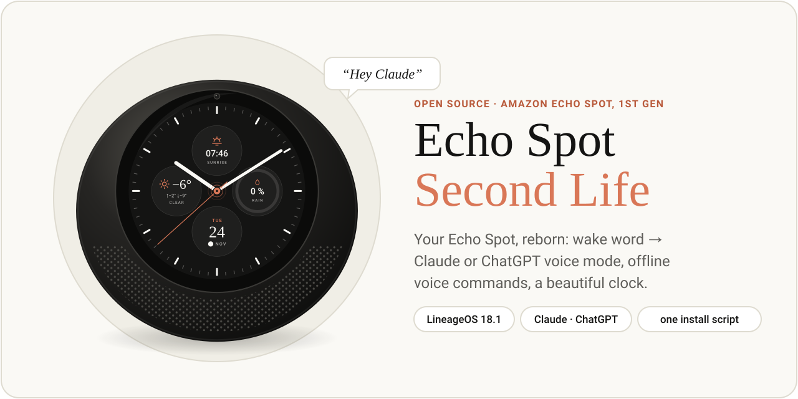
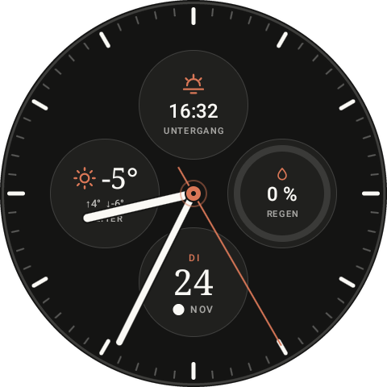
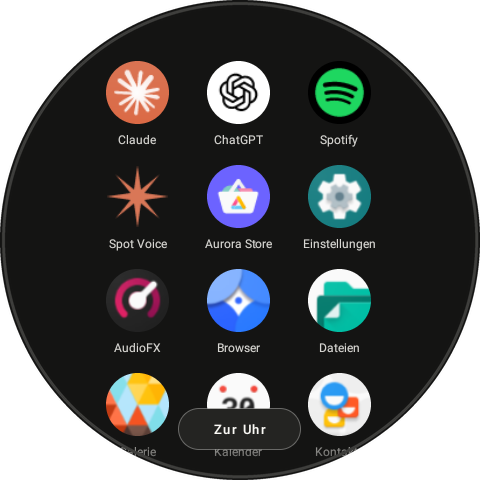
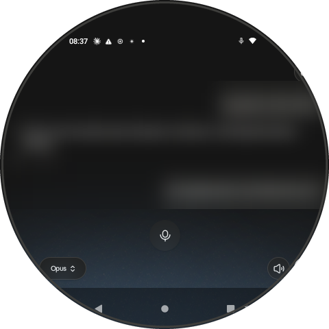
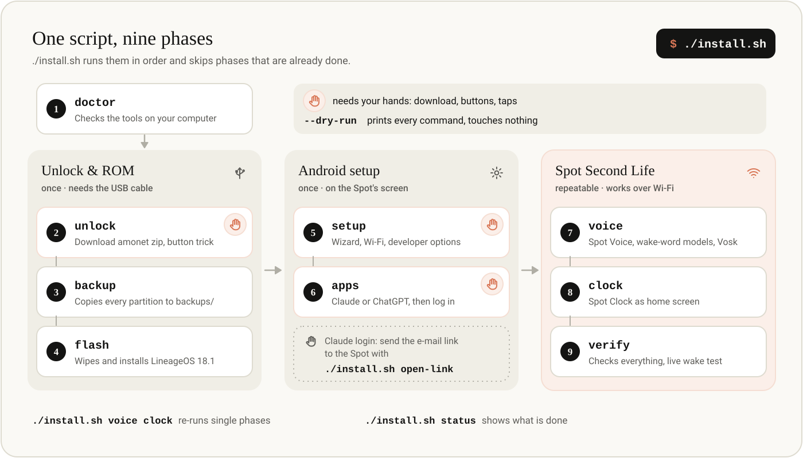

<sub>**English** · [Deutsch](README.de.md)</sub>

<p align="center">
  
</p>

# Echo Spot Second Life

Echo Spot Second Life turns an Amazon Echo Spot of the **first generation (2017/2018)** into an open device.
Fire OS is replaced by LineageOS 18.1 (Android 11). Say a wake word, and the Spot opens the **voice mode of
Claude or ChatGPT**, so you can talk to it hands-free. Short **offline voice commands** handle music, internet radio,
timers and alarms. When nobody is talking, the Spot shows a calm **round clock**. One script, `./install.sh`,
guides you through every step, from unlocking the bootloader to a final check. You need a free afternoon, a USB data
cable and a Mac or Linux computer.

## What you get

<table>
  <tr>
    <td align="center" width="33%">
      <br>
      <sub><b>Clock</b>: sunset, weather, rain chance, date and moon phase</sub>
    </td>
    <td align="center" width="33%">
      <br>
      <sub><b>Timer and alarm</b>: the ring counts down, the alarm time sits at the bottom</sub>
    </td>
    <td align="center" width="33%">
      <br>
      <sub><b>Apps screen</b>: tap the clock to reach your apps</sub>
    </td>
  </tr>
  <tr>
    <td align="center">
      <br>
      <sub><b>Spot Voice</b>: status, listening on/off, Claude or ChatGPT</sub>
    </td>
    <td align="center">
      <br>
      <sub><b>Claude voice mode</b>: opened by the wake word (text blurred)</sub>
    </td>
    <td align="center">
      <sub>The screenshots show the German user interface.<br>With <code>--lang en</code> the Spot, the clock and the installer are in English.</sub>
    </td>
  </tr>
</table>

- **Wake word, then hands-free voice mode.** Say "Hey Claude". The Spot wakes up, opens the Claude app and taps
  its voice-mode button for you. Then you just talk. ChatGPT works the same way (new, see [Status](#status-what-was-tested)).
- **Echo guard.** The Spot has no hardware echo cancellation. Spot Voice therefore mutes the assistant's microphone
  while the assistant speaks and opens it again when it is done, so it does not answer itself.
- **Easy to end.** Say "Danke Claude" or "Thank you Claude", stay silent for about 10 seconds, say the wake word
  again, or press the middle button on top. The Spot goes back to the clock and listens again.
- **Offline voice commands in German or English.** Say the wake word, then a short command: "set a timer for
  5 minutes", "wake me up at half past six", "play radio SWR3", "play Miles Davis on Spotify", "louder", "next".
  The speech is recognised on the Spot itself (Vosk); only the radio search and Spotify use the internet.
- **A clock made for the round screen.** Weather and rain chance (Open-Meteo, no account needed), sunrise and
  sunset, date and moon phase, now playing with cover art, timer and alarm rings. A dim night face and the screen
  brightness follow the room light (light sensor). The clock is the home screen and the screensaver.
- **One install script.** `./install.sh` checks your computer, unlocks, backs up, flashes and sets up the Spot.
  It shows numbered instructions for every step you do by hand, checks every download with SHA-256, has a dry-run
  mode, and continues where it stopped.

## What you need

| You need | Why |
|---|---|
| **An Amazon Echo Spot, 1st generation (2017/2018)** | Only this model (codename `rook`) works. See below how to tell it apart from the 2024 model. |
| **Its original power supply** | The Spot runs on its own power supply the whole time. The USB cable does not replace it. |
| **A micro-USB data cable** | It goes into a hidden port on the back. Many cheap cables can only charge. They will not work. |
| **A Mac or a Linux computer** | macOS is tested. Linux should work but is untested. Windows is not supported by `install.sh`. |
| **Wi-Fi** | For the assistant, the weather, the radio and the app downloads. |
| **A Claude or ChatGPT account** | The one whose voice mode you want to use. A Spotify account is optional. |

**First or second generation?** The 1st-generation Echo Spot (2017/2018) is the ball-shaped one with a fully
**round screen and a camera** above it. The 2nd-generation Echo Spot (2024) has a **half-round screen and no
camera**. It is a different device and cannot be used here. The installer checks the model before it changes
anything and stops if it is not a 1st-generation Spot.

Details, photos of the hidden port and computer preparation: [1 · Hardware and what you need](docs/en/01-hardware.md).

## Quick start

```bash
git clone https://github.com/Nachtfux/Echo_spot_second_life.git
cd Echo_spot_second_life
./install.sh
```

On the first run the installer asks three questions: the language (German or English), the assistant (Claude or
ChatGPT) and a place for the weather. Then it runs nine phases in order. Before each one it asks
`Run phase "unlock" now? [Y/n/skip]`. You can stop with Ctrl+C at any time, except during the unlock. When you run
`./install.sh` again, it skips finished phases and continues. Three phases need your hands: **unlock** (download a
file, press buttons), **setup** (taps on the Spot) and **apps** (install and log in).

> [!TIP]
> Want to see everything first? `./install.sh --dry-run --yes` prints every command instead of running it.
> It needs no device and downloads nothing.

<p align="center">
  
</p>

Useful commands later on:

| Command | What it does |
|---|---|
| `./install.sh status` | Shows settings, finished phases and the connected device |
| `./install.sh help` | Lists all phases, commands and options |
| `./install.sh verify` | Checks everything and offers a live wake-word test |
| `./install.sh open-link` | Opens the Claude login link from your e-mail on the Spot (hidden input, never stored) |
| `./install.sh apps voice --assistant chatgpt` | Switches the wake word to ChatGPT (`claude` switches back) |
| `./install.sh clock --place "Hamburg"` | Changes the weather place |
| `./install.sh voice --sensitivity low` | Fewer false wakes (`high` = hears you better) |

## The guide

| Chapter | What it covers | Installer phase |
|---|---|---|
| [1 · Hardware and what you need](docs/en/01-hardware.md) | Identify a 1st-gen Spot, open the hidden USB port, prepare your computer | `doctor` |
| [2 · Unlocking the Spot](docs/en/02-unlock.md) | The amonet exploit, the three-button fastboot trick, TWRP | `unlock` |
| [3 · LineageOS: backup and install](docs/en/03-lineageos.md) | Full partition backup, then LineageOS 18.1 | `backup`, `flash` |
| [4 · Android setup](docs/en/04-setup.md) | Setup wizard, developer options, language, Aurora Store, adb over Wi-Fi | `setup` |
| [5 · Voice assistant: Claude or ChatGPT](docs/en/05-voice-assistant.md) | Install and log in, wake word, echo guard, ending a conversation, tuning | `apps`, `voice` |
| [6 · Voice commands](docs/en/06-voice-commands.md) | All offline commands in German and English | `voice` |
| [7 · The clock](docs/en/07-clock.md) | Faces, weather, now playing, timers and alarms | `clock` |
| [8 · Train your own wake word](docs/en/08-wakeword-training.md) | Train a wake word or stop word on your own computer | `train` |
| [9 · Troubleshooting and FAQ](docs/en/09-troubleshooting.md) | Checks, common problems, restoring the backup | `verify` |
| [10 · How it works](docs/en/10-architecture.md) | Architecture, for developers | — |

## Status: what was tested

| Part | Status |
|---|---|
| Unlock (amonet-rook v2.0.0), backup, LineageOS 18.1 v0.3 | Done once on a real Echo Spot on 2026-11-23, from macOS on Apple Silicon, starting from Fire OS 5.5.6.9. These steps are **not** repeated for every release. |
| Phases `voice`, `clock`, `verify` | Run end to end against a real Spot on 2026-11-24: all checks green, and the live test opened Claude voice mode. The steps behind `setup` and `apps` were done and checked on the same Spot. |
| Claude voice mode | Works hands-free: wake word, automatic tap on the voice button, echo guard, ending by stop word or silence. |
| ChatGPT voice mode | **New, tested less than Claude.** The ChatGPT app installs and runs on the Spot. The labels of its voice-mode buttons are still being calibrated. The "Hey ChatGPT" wake-word model is still in training; until it is added, the wake word for ChatGPT is "Alexa". |
| Voice commands | German commands tested on the Spot (timer, alarm, radio). The English commands are unit-tested and have been used less on a real Spot. |
| Wake word "Hey Claude" | At the default sensitivity it recognised 55 % of 400 synthetic test clips and woke up falsely 0.28 times per hour on 10.7 hours of real-world audio. Real rooms are harder than the test clips. Details and tuning: [chapter 5](docs/en/05-voice-assistant.md). |
| Computers | macOS tested. Linux should work but is untested. Windows is not supported by `install.sh` (amonet itself ships Windows scripts for the unlock). |

## Limitations

- **The camera does not work.** LineageOS 18.1 for the Spot has no camera driver layer (HAL). Android sees no camera.
- **No interrupting.** Without hardware echo cancellation the conversation is half duplex: while the assistant
  speaks, it cannot hear you.
- **Voice mode answers anyone in the room**, just like on a phone.
- **The wake word is not perfect.** It sometimes misses you, and a TV or radio can wake it up by mistake.
  You can tune it or [train it on your own voice](docs/en/08-wakeword-training.md).
- **Voice commands use small offline models** for German or English. They know a fixed set of commands.
- **No Google services.** Apps come from Google Play through Aurora Store. "Sign in with Google" does not work.
- **adb over Wi-Fi switches off when the Spot restarts.** The installer notices and asks for the cable once.

More: [9 · Troubleshooting and FAQ](docs/en/09-troubleshooting.md).

## Privacy and safety

- Wake word and voice commands are processed **on the Spot**. Audio only goes to Anthropic or OpenAI while their
  voice mode is open, as with their phone apps.
- The weather request contains only the coordinates of your place.
- Login data never appears on the command line. `./install.sh open-link` reads the link hidden and does not store it.
- The partition backup stays on your computer in `backups/` (ignored by git). It contains device-unique data:
  never share it.
- Every download is checked with SHA-256. Aurora Store is also checked against its signing certificate when
  `apksigner` is installed.
- Steps that erase or unlock need you to type `YES`. Accessibility and notification access are only switched on
  after you answer `y`.
- The release APKs (`spot-voice.apk`, `spot-clock.apk`, with `SHA256SUMS`) are signed with the certificate
  `48:04:B0:EB:D0:63:A5:82:8A:38:32:5A:DD:A7:E8:93:C5:06:FE:19:C8:C8:E9:96:4B:46:AF:DC:DB:B4:A4:0E` (SHA-256; check it with
  `apksigner verify --print-certs spot-voice.apk`). If you prefer to build them yourself, use `./install.sh build`
  or add `--from-source` (needs JDK 17 and the Android SDK).

## Credits

This project stands on the work of others. Thank you to:
[amonet](https://github.com/R0rt1z2/amonet) by R0rt1z2 and contributors (unlock and TWRP for the Spot),
[TWRP](https://twrp.me),
the [amazon-oss](https://github.com/amazon-oss/releases/releases/tag/lineage-18.1-rook-v0.3) LineageOS 18.1 port for rook,
[openWakeWord](https://github.com/dscripka/openWakeWord),
[Vosk](https://alphacephei.com/vosk/),
[Piper](https://github.com/rhasspy/piper-sample-generator) (synthetic voices for training),
[Aurora Store](https://gitlab.com/AuroraOSS/AuroraStore),
[Open-Meteo](https://open-meteo.com) and
[radio-browser.info](https://www.radio-browser.info).
Licences and details: [THIRD_PARTY.md](THIRD_PARTY.md).

## Licence

- The code of this project (`install.sh`, `scripts/`, `apps/`, `training/`) is MIT-licensed: see [LICENSE](LICENSE).
- The trained wake-word models in `models/` are licensed **CC BY-NC-SA 4.0** (non-commercial, share alike),
  because they were trained with openWakeWord data under that licence. The openWakeWord base models that the
  app build downloads are CC BY-NC-SA 4.0 as well.
- Third-party software keeps its own licence: see [THIRD_PARTY.md](THIRD_PARTY.md).

## Disclaimer

> [!WARNING]
> Unlocking and flashing your Echo Spot voids its warranty and can make it unusable ("brick" it). You do this at
> your own risk. Make the backup in [chapter 3](docs/en/03-lineageos.md) before you flash anything.

This project is not affiliated with, endorsed or sponsored by Amazon, Anthropic, OpenAI or Spotify. Amazon, Echo and
Alexa are trademarks of Amazon.com, Inc. Claude is a trademark of Anthropic, PBC. ChatGPT is a trademark of OpenAI.
Spotify is a trademark of Spotify AB.
