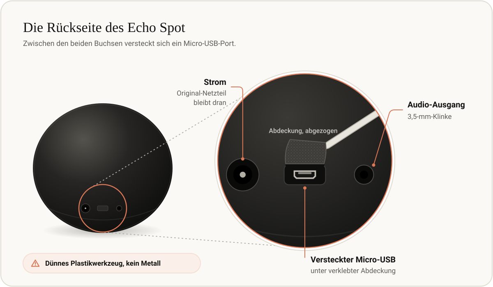
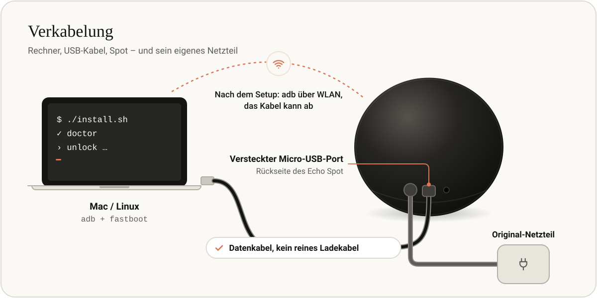

<sub>[English](../en/01-hardware.md) · **Deutsch**</sub>

# 1 · Hardware und was du brauchst

> **Ziel:** sicherstellen, dass du den richtigen Echo Spot hast, seinen versteckten USB-Anschluss finden und deinen Computer vorbereiten · **Zeit:** etwa 15 Minuten (plus Installation der Werkzeuge) · **Installer:** `./install.sh doctor`

In diesem Kapitel änderst du nichts am Spot. Du prüfst das Modell, öffnest eine kleine Abdeckung auf der Rückseite,
suchst das richtige Kabel heraus und lässt den Installer deinen Computer prüfen.

## Ist das der richtige Echo Spot?

Nur die **erste Generation** des Echo Spot funktioniert. Ihr interner Codename ist `rook`.

| | Echo Spot 1. Generation (2017/2018) | Echo Spot 2. Generation (2024) |
|---|---|---|
| Form | kugelförmig | anderes Gehäuse |
| Display | ganz **rund** | **halbrund** |
| Kamera | ja, über dem Display | **keine Kamera** |
| Funktioniert mit diesem Projekt | **ja** | nein |

Wenn du unsicher bist, mach trotzdem weiter: In [Kapitel 2](02-unlock.md) fragt der Installer den Spot nach seinem
Produktnamen, bevor er irgendetwas schreibt. Lautet die Antwort nicht `ROOK`, bricht er ab, und nichts wird
verändert.

> [!NOTE]
> Getestet wurde der Installer mit **Fire OS 5.5.6.9**. Im Fastboot-Modus liest er die Version des Bootloaders aus
> (`lk_build_desc` = `c1c79aa-20220824_171625`). Findet er eine andere, hört er auf, bevor er etwas schreibt.

## Was du brauchst

| Was | Hinweise |
|---|---|
| Echo Spot, 1. Generation | Siehe Tabelle oben. |
| Sein Original-Netzteil | Das mit dem runden Stecker, das beim Spot dabei war. Es bleibt die ganze Zeit eingesteckt, auch wenn das USB-Kabel dran ist. |
| Ein Micro-USB-**Daten**kabel | Micro-USB, nicht USB-C. Es muss Daten übertragen, nicht nur Strom. Siehe [Datenkabel oder Ladekabel?](#datenkabel-oder-ladekabel) |
| Ein dünnes Plastikwerkzeug | Ein Gitarrenplektrum oder ein Hebelwerkzeug aus Kunststoff, um die Abdeckung über dem USB-Anschluss anzuheben. Ein Fingernagel geht auch. |
| Einen Mac oder Linux-Rechner | Mit etwa 5 GB freiem Speicherplatz. macOS ist getestet; Linux sollte funktionieren, ist aber ungetestet. Windows unterstützt `install.sh` nicht. |
| WLAN | Ab [Kapitel 4](04-setup.md) braucht der Spot es. |
| Ein kostenloses Konto im XDA-Forum | Zum Herunterladen des Entsperr-Werkzeugs in [Kapitel 2](02-unlock.md). |
| Ein Konto bei Claude oder ChatGPT | Für den Sprachassistenten in [Kapitel 5](05-voice-assistant.md). Ein Spotify-Konto ist optional. |

## Der versteckte USB-Anschluss

Der Echo Spot hat eine Micro-USB-Buchse, die Amazon unter einer kleinen, aufgeklebten Gummiabdeckung auf der
Rückseite versteckt hat. Sie sitzt **zwischen der runden Netzbuchse und der 3,5-mm-Audiobuchse**. Alles in Kapitel 2
und 3 läuft über diesen Anschluss: Solange Android noch nicht installiert ist, kann dein Computer nur auf diesem Weg
mit dem Spot sprechen.

<p align="center">
  
</p>

So öffnest du die Abdeckung, ohne etwas zu beschädigen:

1. Zieh das Netzteil ab. Leg den Spot mit dem Display nach unten auf ein weiches Tuch, damit nichts verkratzt.
2. Such die kleine Gummiabdeckung zwischen Netzbuchse und Audiobuchse.
3. Heb eine Kante der Abdeckung mit dem Fingernagel oder einem dünnen Plastikwerkzeug an. **Nimm kein Metall.**
   Ein Schraubendreher oder ein Messer kann abrutschen, das Gehäuse zerkratzen oder die Kontakte in der Buchse
   verbiegen.
4. Zieh die Abdeckung langsam ab. Der Kleber gibt nach; Kraft brauchst du nicht.
5. Schau in die Öffnung: Dort siehst du eine Micro-USB-Buchse.
6. Heb die Abdeckung auf. Wenn du das Kabel nicht mehr brauchst, kannst du sie wieder andrücken. Nach der
   Einrichtung arbeitet der Spot über WLAN ([Kapitel 4](04-setup.md)). Den Anschluss brauchst du dann nur noch selten.

## Verkabelung

<p align="center">
  
</p>

In den Spot kommen zwei Kabel:

- das **Original-Netzteil** in die runde Netzbuchse und
- das **Micro-USB-Datenkabel** vom versteckten Anschluss **direkt** zu deinem Computer.

Das Netzteil bleibt bei jedem Schritt angeschlossen. Verlass dich nicht darauf, dass das USB-Kabel den Spot mit
Strom versorgt. Wenn es in einem Schritt heißt „Netzteil abziehen“, ist das Netzteil gemeint. Das USB-Kabel kann
stecken bleiben.

## Datenkabel oder Ladekabel?

Viele Micro-USB-Kabel, vor allem die von Lampen, Powerbanks oder Spielzeug, haben nur die beiden Adern für Strom.
Mit so einem Kabel bekommt der Spot nichts von deinem Computer mit, und der Installer wartet endlos auf ein Gerät.

So findest du es heraus:

1. Hast du ein Android-Handy oder ein anderes Gerät mit Micro-USB, verbinde es über das Kabel mit deinem Computer.
   Bemerkt der Computer das Gerät (ein Dialog zur Dateiübertragung, ein neues Laufwerk, oder das Handy fragt, was es
   mit der USB-Verbindung tun soll), überträgt das Kabel Daten.
2. Der eigentliche Test kommt in [Kapitel 2](02-unlock.md): Ist der Spot im Fastboot-Modus, muss
   `fastboot devices` ihn auflisten. Bleibt die Liste leer, probier zuerst ein anderes Kabel.

> [!TIP]
> Markier das Kabel, das nachweislich funktioniert, mit einem Stück Klebeband. Du brauchst es wieder, falls du
> jemals die Sicherung zurückspielst.

## USB-Hubs, Docks und Adapter

Steck das Kabel **direkt in einen Anschluss deines Computers**. USB-Hubs, Docks und die USB-Anschlüsse von Monitoren
führen oft zu Verbindungsabbrüchen oder zu Geräten, die gar nicht erst auftauchen. Beim Entsperren zählt das am
meisten: Der Exploit braucht eine saubere USB-Verbindung, und schon ein kurzer Abbruch kann dich einen Versuch
kosten.

Hat dein Mac nur USB-C-Anschlüsse, nimm ein einfaches Datenkabel von USB-C auf Micro-USB oder einen kleinen Adapter
von USB-C auf USB-A mit nur einem Anschluss. Meide Hubs mit mehreren Anschlüssen.

## Dein Computer

`./install.sh` läuft unter **macOS** (getestet, auch mit der alten Standard-Bash 3.2) und unter **Linux** (sollte
funktionieren, ist aber ungetestet). Windows unterstützt der Installer nicht. Das Entsperr-Werkzeug amonet bringt
zwar eigene Windows-Skripte mit, aber alles nach dem Entsperren müsstest du dann von Hand erledigen.

Der Installer braucht diese Werkzeuge. Die Phase `doctor` prüft sie und bietet an, `adb` und `fastboot` für dich zu
installieren.

| Werkzeug | Gebraucht für | macOS | Debian / Ubuntu |
|---|---|---|---|
| `adb`, `fastboot` | die Verbindung zum Spot | `brew install android-platform-tools` | `sudo apt install adb fastboot` |
| `curl` | Downloads | vorinstalliert | `sudo apt install curl` |
| `unzip` | Entpacken des Entsperr-Werkzeugs und des Sprachmodells | vorinstalliert | `sudo apt install unzip` |
| `python3` | kleine Hilfsprogramme | vorinstalliert (wenn es nicht läuft: `xcode-select --install`) | `sudo apt install python3` |
| `shasum` oder `sha256sum` | Prüfen der Downloads | vorinstalliert | vorinstalliert |

Optionale Werkzeuge: `doctor` meldet sie, setzt sie aber nicht voraus.

| Werkzeug | Was es bringt | macOS |
|---|---|---|
| `gtimeout` / `timeout` | Zeitlimits für Befehle (der Installer hat einen eigenen Ersatz) | `brew install coreutils` |
| `apksigner` | prüft das Signaturzertifikat von Aurora Store und wird für einen Notweg bei der Installation in [Kapitel 5](05-voice-assistant.md) gebraucht | Teil der build-tools des Android SDK |
| `scrcpy` | zeigt das Display des Spot auf deinem Computer, mit echter Tastatur für Anmeldungen | `brew install scrcpy` |

Für die `brew`-Befehle brauchst du unter macOS [Homebrew](https://brew.sh). Installier es zuerst, falls du es noch
nicht hast.

Meldet `adb` unter Linux später „no permissions“, installier die udev-Regeln für Android-Geräte (zum Beispiel
`sudo apt install android-sdk-platform-tools-common`) und steck das Kabel neu ein.

### Das Projekt holen

```bash
git clone https://github.com/Nachtfux/Echo_spot_second_life.git
cd Echo_spot_second_life
```

### Die Prüfung starten

```bash
./install.sh doctor
```

Den Spot musst du dafür nicht anschließen. Fehlt ein benötigtes Werkzeug, sagt dir `doctor`, wie du es
installierst. Auf einem Mac ohne `adb` fragt er:

```
?? adb + fastboot jetzt installieren (brew install android-platform-tools)? [J/n]
```

## Was der Installer für dich erledigt

`./install.sh doctor` (Phase 1 von 9):

- zeigt dein System (macOS oder Linux, Prozessor, Bash-Version) und warnt, dass Linux ungetestet ist;
- prüft die benötigten Werkzeuge `adb`, `fastboot`, `curl`, `unzip`, `python3` und `shasum`/`sha256sum`;
- bietet `brew install android-platform-tools` (macOS) oder `sudo apt install adb fastboot` (Linux) an, wenn `adb`
  oder `fastboot` fehlt;
- meldet die optionalen Werkzeuge `gtimeout`/`timeout`, `apksigner` und `scrcpy`;
- warnt, wenn weniger als etwa 5 GB Speicherplatz frei sind (LineageOS, Sicherung, Sprachmodell);
- prüft, ob die Wake-Word-Modelle in `models/` liegen (ein Zeichen, dass das Repository vollständig ist);
- erinnert dich an die USB-Regeln: direkter Anschluss, Datenkabel, Netzteil bleibt dran;
- zeigt an, was gerade angeschlossen ist (nur lesend), und schlägt die nächste Phase vor.

Er installiert nichts, ohne zu fragen, und ändert nichts am Spot.

## Prüfen

Am Ende sollte `./install.sh doctor` diese beiden Zeilen ausgeben:

```
[ok] Dieser Computer ist bereit.
[ok] Phase "doctor" erledigt.
```

Ein typischer Lauf auf einem Mac sieht so aus (gekürzt):

```
==> Phase 1/9: doctor - diesen Computer prüfen (Werkzeuge, USB)
     Mehr Hilfe: docs/de/01-hardware.md
[..] Computer: Darwin 25.3.0 (arm64), bash 3.2.57(1)-release

==> Benötigte Werkzeuge
[ok] adb: /opt/homebrew/bin/adb
[ok] fastboot: /opt/homebrew/bin/fastboot
[ok] curl: /usr/bin/curl
[ok] unzip: /usr/bin/unzip
[ok] python3: /usr/bin/python3
[ok] sha256: shasum -a 256

==> Optionale Werkzeuge
[ok] timeout: /opt/homebrew/bin/gtimeout
[..] scrcpy nicht gefunden (optional: zeigt das Spot-Display am Computer, praktisch zum Eintippen von Logins) - brew install scrcpy

==> Speicherplatz und Repository
[ok] Freier Speicher: 26 GB
[ok] Wake-Word-Modelle: models/

==> USB
     Den Spot DIREKT am Computer anschließen (kein USB-Hub, kein Dock, kein Monitor-Anschluss) und ein Micro-USB-DATENkabel nehmen - viele billige Kabel laden nur.
     Das Original-Netzteil des Spot bleibt die ganze Zeit eingesteckt.
[..] Gerade kein Spot verbunden - für diese Prüfung kein Problem.
     Mehr Hilfe: docs/de/01-hardware.md  |  docs/images/wiring.de.svg
[ok] Dieser Computer ist bereit.
[ok] Phase "doctor" erledigt.
```

Du kannst das Ergebnis auch später mit `./install.sh status` nachsehen: Die Zeile für `doctor` bekommt einen Haken.

## Wenn etwas schiefgeht

| Problem | Was du tust |
|---|---|
| `[xx] adb nicht gefunden` oder `fastboot nicht gefunden` | Nimm das Angebot zur Installation an, oder installier die Platform Tools von Hand (Tabelle oben). Starte dann `./install.sh doctor` noch einmal. Siehe [Fehlerbehebung: doctor meldet fehlende Werkzeuge](09-troubleshooting.md#doctor-reports-missing-tools). |
| `python3 funktioniert nicht (macOS: xcode-select --install)` | Führ `xcode-select --install` aus, warte, bis es fertig ist, und starte `doctor` noch einmal. |
| `Nur N GB frei` | Schaff etwas Platz. Der Download von LineageOS ist etwa 1 GB groß, die Sicherung 1–2 GB. |
| `models/hey_claude.onnx oder danke_claude.onnx fehlt` | Das Repository ist unvollständig. Hol es mit `git clone` noch einmal. |
| Die Abdeckung auf der Rückseite geht nicht ab | Arbeite dich langsam mit dem Plastikwerkzeug am Rand entlang. Hebel nie mit Metall. |
| Später taucht der Spot gar nicht auf | Prüf Kabel und Anschluss. Siehe [Fehlerbehebung: fastboot sieht den Spot nicht](09-troubleshooting.md#fastboot-does-not-see-the-spot). |

---
[Übersicht](../../README.de.md) · [2 · Den Spot entsperren →](02-unlock.md)
