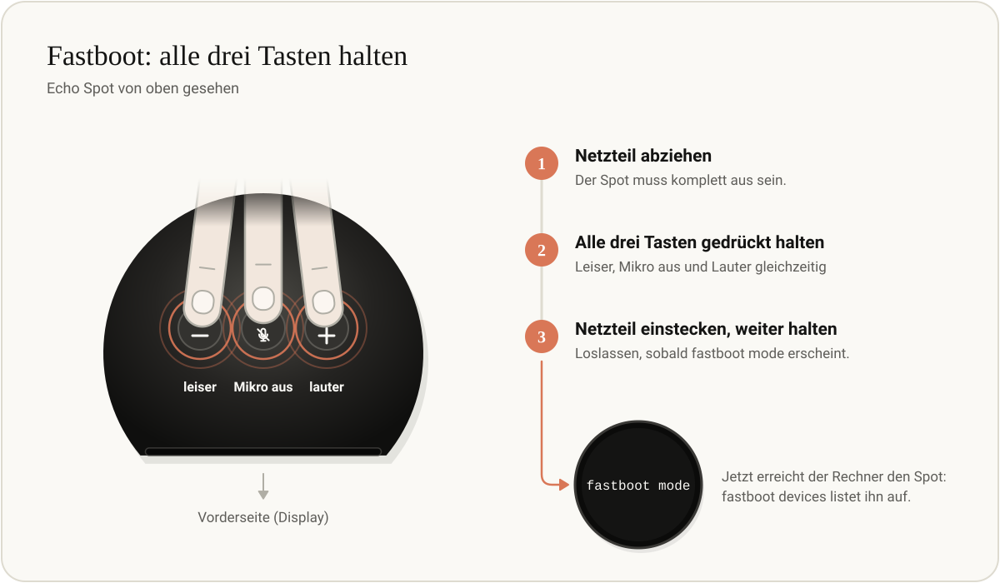

<sub>[English](../en/02-unlock.md) · **Deutsch**</sub>

# 2 · Den Spot entsperren

> **Ziel:** den Bootloader des Spot mit amonet entsperren, sodass er das Recovery-System TWRP startet · **Zeit:** etwa 30 Minuten (das Entsperren selbst dauert ein paar Minuten) · **Installer:** `./install.sh unlock`

Ab Werk startet der Echo Spot nur Software, die Amazon signiert hat. Damit du LineageOS installieren kannst, muss
zuerst der Bootloader entsperrt werden. Darum geht es in diesem Kapitel. Am Ende zeigt der Spot TWRP, ein kleines
Recovery-System. Von dort aus machst du in [Kapitel 3](03-lineageos.md) die Sicherung und installierst LineageOS.

> [!WARNING]
> Das ist der riskante Schritt. Das Entsperren nutzt einen Exploit, also eine Sicherheitslücke. Es kann scheitern
> und den Spot im schlimmsten Fall unbrauchbar machen („bricken“). Die Garantie erlischt. Getestet wurde es
> **einmal, an einem Spot** (23.11.2026, macOS auf Apple Silicon, Fire OS 5.5.6.9). Rechne damit, dass alles
> verloren geht, was heute auf dem Spot ist: Kapitel 3 löscht Fire OS und Alexa.

## Was amonet macht

[amonet](https://github.com/R0rt1z2/amonet) nutzt eine Schwachstelle im Boot-ROM des MediaTek-Chips MT8163, der im
Spot steckt. Das Boot-ROM ist Code, der fest in den Chip eingebrannt ist und vor allem anderen läuft. Kein
Software-Update kann ihn reparieren. Die Ausgabe für den Echo Spot, **amonet-rook v2.0.0**, packt den ganzen Exploit
in eine einzige Image-Datei, `fastbrick.img`. Der Installer schickt diese Datei mit `fastboot flash brick`, also an
ein Ziel namens „brick“. Der gesperrte Bootloader lehnt den ersten Versuch ab. Der zweite Versuch hängt: In diesem
Moment übernimmt der Exploit. amonet entsperrt dann den Bootloader und installiert TWRP, das etwa 30 Sekunden später
auf dem Display erscheint. Der Installer schreibt nur dieses eine Image; den Rest erledigt der Exploit. amonet für
den Spot ist die Arbeit von R0rt1z2 und Mitwirkenden und baut auf dem ursprünglichen amonet von xyz\` und k4y0z auf.
Danke! (Lizenzen: [THIRD_PARTY.md](../../THIRD_PARTY.md).)

## Risiken und Schutzmaßnahmen

| Risiko | So begrenzt der Installer es |
|---|---|
| Falsches Gerät | Bevor er etwas schreibt, prüft er im Fastboot-Modus: genau ein Fastboot-Gerät, Produkt `ROOK`, `unlock_status` `false`. Sonst bricht er ab, und nichts wird verändert. |
| Ungetestete Firmware | Er macht nur mit dem getesteten Bootloader-Build `c1c79aa-20220824_171625` (Fire OS 5.5.6.9) weiter. |
| Falsche oder beschädigte Entsperr-Datei | Er prüft die SHA-256-Prüfsumme der ZIP-Datei und die genaue Größe von `fastbrick.img` (114294816 Bytes). |
| Versehentlicher Start | Du musst `JA` in Großbuchstaben eintippen (`YES` geht auch). Enter oder `--yes` reicht nicht. |
| Abbruch im falschen Moment | Er sagt dir, wann du nichts abziehen darfst. **An diese eine Regel musst du dich selbst halten.** |

> [!IMPORTANT]
> Von dem Moment an, in dem du `JA` eintippst, bis TWRP erscheint (bis zu 6 Minuten): Zieh **weder** das USB-Kabel
> **noch** das Netzteil ab, und drück keine Tasten am Spot.

## Bevor du anfängst

1. Starte `./install.sh doctor` und achte darauf, dass er `[ok] Dieser Computer ist bereit.` meldet (siehe
   [Kapitel 1](01-hardware.md)).
2. Nimm die Abdeckung vom versteckten USB-Anschluss ab und leg dein Micro-USB-Datenkabel bereit (siehe
   [Kapitel 1](01-hardware.md#der-versteckte-usb-anschluss)).
3. Steck andere Android-Handys und -Tablets von deinem Computer ab. Der Installer erwartet genau ein Gerät im
   Fastboot-Modus.
4. Optional: Schau auf dem Spot nach, welche Fire-OS-Version er hat. In der englischen Oberfläche steht sie unter
   Settings → Device Options → Device Software Version; auf Deutsch findest du sie in den Einstellungen unter den
   Geräteoptionen. Getestet wurde der Installer mit 5.5.6.9, und er prüft das im Fastboot-Modus selbst. Du erfährst
   es so nur früher.
5. Optional: Ist der Spot noch in deinem Amazon-Konto registriert, kannst du ihn in der Alexa-App entfernen. Nach
   [Kapitel 3](03-lineageos.md) ist Alexa ohnehin vom Spot verschwunden.

## Schritt 1: amonet herunterladen

Der Download hängt an einem Beitrag im XDA-Forum und braucht ein kostenloses XDA-Konto. Deshalb holst du ihn selbst.

1. Öffne den Thread in deinem Browser:
   [[UNLOCK][ROOT][TWRP][UNBRICK] Amazon Echo Spot 2017 (rook)](https://xdaforums.com/t/unlock-root-twrp-unbrick-amazon-echo-spot-2017-rook.4754878/)
2. Melde dich bei XDA an (oder leg ein kostenloses Konto an). Anhänge lassen sich nur herunterladen, wenn du
   angemeldet bist.
3. Lade im ersten Beitrag den Anhang **`amonet-rook-v2.0.0.zip`** herunter.

   Safari entpackt ZIP-Dateien von selbst („Sichere Dateien nach dem Laden öffnen“), dann findest du in `Downloads`
   nur einen Ordner `amonet-rook-v2.0.0`. Der Installer braucht aber die ZIP-Datei. Schalte die Option unter
   Safari → Einstellungen → Allgemein aus und lade die Datei noch einmal, oder nimm einen anderen Browser.

4. Leg die ZIP-Datei **ohne sie zu entpacken** in den Ordner `downloads/` des Projekts. Im Terminal, im Ordner
   `Echo_spot_second_life`:

   ```bash
   mkdir -p downloads
   mv ~/Downloads/amonet-rook-v2.0.0.zip downloads/
   ```

   Lässt du das aus, sucht der Installer auch in deinem Ordner `Downloads` und bietet an, die Datei zu kopieren.
5. Optional: Prüf die Prüfsumme selbst. Der Installer macht das sowieso.

   ```bash
   shasum -a 256 downloads/amonet-rook-v2.0.0.zip
   ```

   Unter Linux nimmst du `sha256sum` statt `shasum -a 256`. Herauskommen muss:

   ```
   be856ba4c880fc2b8664d326d7b9cbe8e2f74d2cc82718cc4aa6a895c0e2418f
   ```

   Ein anderer Wert bedeutet eine andere Version oder einen kaputten Download. Andere Versionen lehnt der
   Installer ab.

## Schritt 2: Den Spot in den Fastboot-Modus bringen

Der Fastboot-Modus ist ein kleiner Modus des Bootloaders, in dem der Computer dem Spot Befehle schicken kann. Du
kommst mit allen drei Tasten oben hinein.

<p align="center">
  
</p>

1. Zieh das Netzteil des Spot ab. Der Spot muss ganz aus sein.
2. Verbinde das Micro-USB-Datenkabel vom versteckten Anschluss direkt mit deinem Computer.
3. Drück **alle drei Tasten** oben und halt sie gedrückt: Leiser (−), die mittlere Taste (Mikrofon aus) und
   Lauter (+).
4. Halt sie weiter gedrückt und steck das Netzteil wieder ein.
5. Halt die Tasten, bis auf dem Display **„fastboot mode“** steht. Dann lass los.

Startet der Spot stattdessen ganz normal, hast du zu früh losgelassen, oder eine Taste war nicht richtig gedrückt.
Zieh das Netzteil ab und versuch es noch einmal.

Prüf am Computer:

```bash
fastboot devices
```

Du siehst eine Zeile mit einer Seriennummer und dem Wort `fastboot`, zum Beispiel `XXXXXXXXXXXXXXXX	fastboot`.
Bleibt die Liste leer, schau unter [Wenn etwas schiefgeht](#wenn-etwas-schiefgeht).

> [!TIP]
> Du kannst auch zuerst `./install.sh unlock` starten. Er zeigt diese Schritte am Bildschirm an und wartet bis zu
> 10 Minuten, bis der Spot im Fastboot-Modus auftaucht.

## Schritt 3: Das Entsperren starten

```bash
./install.sh unlock
```

Der Installer arbeitet fünf Schritte ab:

| Schritt | Was passiert | Dein Teil |
|---|---|---|
| 1/5 amonet-rook v2.0.0 besorgen | Findet die ZIP-Datei, prüft ihre SHA-256-Prüfsumme, entpackt sie nach `downloads/amonet-rook-v2.0.0/` und prüft die Größe von `fastbrick.img`. | Schritt 1 oben |
| 2/5 Fastboot-Modus | Zeigt den Tastentrick und wartet bis zu 10 Minuten auf den Spot. | Schritt 2 oben |
| 3/5 Sicherheitsprüfungen | Liest (schreibt nicht) die Zahl der Fastboot-Geräte, das Produkt, den Entsperrstatus und den Bootloader-Build. | — |
| 4/5 Entsperr-Payload senden | Bittet dich, `JA` einzutippen, und sendet dann das Payload: bis zu 15 Versuche, jeder auf 8 Sekunden begrenzt. | `JA` tippen, dann Finger weg |
| 5/5 auf TWRP warten | Wartet bis zu 6 Minuten, bis der Spot per adb im Recovery-Modus antwortet, und prüft dann, ob es ein `rook` mit TWRP ist. | Warten. Nichts abziehen. |

Vor Schritt 4 erscheint diese Frage:

```
!! Das entsperrt den Bootloader des Spot mit einem Exploit. Getestet wurde es einmal an einem Spot; es kann scheitern und im schlimmsten Fall das Gerät unbrauchbar machen. Ab jetzt Kabel und Strom NICHT abziehen, bis TWRP erscheint (bis zu 6 Minuten).
   JA eintippen zum Fortfahren, alles andere bricht ab:
```

Tipp `JA` ein und drück Enter. Alles andere bricht hier ab, und es wird nichts gesendet.

## Was du siehst

So sieht der erwartete Ablauf aus. Die Uhrzeiten sind Beispiele, und Zeilen mit `…` stehen für Ausgaben von
`fastboot`, die auf deinem Computer etwas anders aussehen können.

```
==> Schritt 3/5: Sicherheitsprüfungen (nur lesen)
[ok] genau ein Fastboot-Gerät
[ok] product = ROOK
[ok] unlock_status = false
[ok] lk_build_desc = c1c79aa-20220824_171625 (Fire OS 5.5.6.9)

==> Schritt 4/5: Entsperr-Payload senden
   (die JA-Frage von oben)
[..] [14:02:11] Versuch 1: gtimeout 8 fastboot -S 1G flash brick bin/fastbrick.img
      …
      FAILED (remote: 'restricted on locked hw')
      exit=1
[..] [14:02:13] Versuch 2: gtimeout 8 fastboot -S 1G flash brick bin/fastbrick.img
      …
      exit=124
[ok] [14:02:21] Timeout beim Senden -> der Exploit läuft vermutlich. Keine weiteren Versuche.

==> Schritt 5/5: auf TWRP warten
[!!] Warte bis zu 6 Minuten auf TWRP. NICHTS abstecken!
     Auf dem Display: der Spot startet neu und zeigt das blaue TWRP-Recovery.
[ok] [14:02:53] TWRP läuft: ro.product.device=rook, twrp=3.7.0_9-0
Der Spot ist entsperrt. Für die nächste Phase (backup) in TWRP lassen.
```

Was das bedeutet:

1. **Versuch 1 scheitert mit `restricted on locked hw`.** Das ist normal. Der gesperrte Bootloader lehnt den
   Befehl ab.
2. **Versuch 2 hängt und läuft in das Zeitlimit von 8 Sekunden (`exit=124`).** Das ist das gute Zeichen: Der
   Exploit läuft. Der Installer hört auf zu senden.
3. **Etwa 30 Sekunden später erscheint TWRP auf dem Display.** Der Installer sieht es per adb und prüft es.

> [!WARNING]
> Zwischen Versuch 2 und dem TWRP-Bildschirm kann es so aussehen, als passiere nichts. Das ist normal. Zieh den Spot
> nicht ab und drück keine Tasten. Gib ihm die vollen 6 Minuten.

Statt `gtimeout` siehst du vielleicht `timeout` (Linux) oder `(bash) timeout` (kein GNU timeout installiert). Alle
drei tun dasselbe.

## Warum `fastboot -S 1G` (das Detail für macOS)

amonet bringt ein eigenes Skript mit, `fastbrick.sh`. Auf einem Mac läuft es so nicht: Es braucht Bash 4 (macOS
bringt Bash 3.2 mit), und die `fastboot`-Programme in der ZIP-Datei sind für Linux gebaut. Deshalb erledigt der
Installer dieselben Schritte selbst, mit dem `fastboot` aus Homebrew (oder aus deinen Linux-Paketen). Aktuelle
`fastboot`-Versionen lehnen `fastbrick.img` allerdings ab: Die Datei ist 32 Bytes größer als die maximale
Download-Größe, die der Spot meldet. Die Option `-S 1G` bringt `fastboot` dazu, sie trotzdem zu senden. Alles andere
folgt amonets eigener Logik: bis zu 15 Versuche, 8 Sekunden Zeitlimit pro Versuch, und ein Timeout heißt, dass der
Exploit läuft. Der genaue Ablauf, der am echten Spot getestet wurde, liegt in `scripts/reference/unlock-rook-tested.sh`.

## Was der Installer für dich erledigt

`./install.sh unlock` (Phase 2 von 9):

- zeigt, wo du amonet herunterlädst, und findet die ZIP-Datei in `downloads/` oder in deinem Ordner `Downloads`;
- prüft die SHA-256-Prüfsumme der ZIP-Datei (`be856ba4…2418f`), entpackt sie und prüft die Größe von
  `fastbrick.img`;
- zeigt die nummerierten Schritte für den versteckten Anschluss und den Tastentrick und wartet bis zu 10 Minuten auf
  den Fastboot-Modus;
- führt die Prüfungen durch, die nur lesen (ein Gerät, `ROOK`, gesperrt, Bootloader-Build von Fire OS 5.5.6.9);
- sendet nichts, wenn der Spot schon entsperrt ist, und bietet an, die Phase als erledigt zu markieren;
- bittet dich, `JA` einzutippen, und sendet dann `fastboot -S 1G flash brick bin/fastbrick.img` mit amonets
  Wiederholungslogik;
- hört sofort auf, wenn eine der bekannten fatalen Meldungen kommt (verschlissener Speicher, falsches Payload,
  `fastboot` lehnt das Image ab);
- wartet bis zu 6 Minuten auf TWRP und prüft `ro.product.device=rook` und die TWRP-Version;
- markiert die Phase einfach als erledigt, wenn TWRP beim Start schon läuft.

## Prüfen

1. Das Display des Spot zeigt TWRP.
2. Am Computer:

   ```bash
   adb devices
   ```

   Der Spot steht mit dem Status `recovery` in der Liste, zum Beispiel:

   ```
   List of devices attached
   XXXXXXXXXXXXXXXX	recovery
   ```

3. `./install.sh status` zeigt einen Haken bei `unlock`.

Lass den Spot in TWRP und angeschlossen. Die nächste Phase, die Sicherung, startet genau hier:
[Kapitel 3](03-lineageos.md).

## Später wieder in TWRP kommen

TWRP brauchst du wieder, wenn du die Sicherung zurückspielen oder neu installieren willst.

1. Zieh das Netzteil des Spot ab. Das USB-Kabel kann dranbleiben.
2. Drück **Lauter (+)** und halt die Taste gedrückt.
3. Halt sie weiter und steck das Netzteil wieder ein. Lass los, sobald TWRP erscheint.

## Wenn etwas schiefgeht

Der Installer bricht mit einer klaren Meldung ab. Such sie in dieser Tabelle.

| Meldung | Was sie bedeutet | Was du tust |
|---|---|---|
| `Kein Fastboot-Gerät gefunden.` | Der Computer sieht den Spot nicht. | Prüf das Kabel (Datenkabel?), nimm einen Anschluss direkt am Computer und versuch die drei Tasten noch einmal. Siehe [Fehlerbehebung: fastboot sieht den Spot nicht](09-troubleshooting.md#fastboot-does-not-see-the-spot). |
| `Genau 1 Fastboot-Gerät erwartet, gefunden: N` | Ein anderes Handy oder Tablet ist im Fastboot-Modus. | Steck das andere Gerät ab und starte `./install.sh unlock` noch einmal. |
| `product='…' (erwartet ROOK)` | Das ist kein Echo Spot der 1. Generation. | Nichts wurde verändert. Dieses Gerät wird nicht unterstützt. |
| `unlock_status = true: dieser Spot ist schon entsperrt` | Das Entsperren ist schon passiert. | Es wurde nichts gesendet. Antworte mit `J`, um die Phase als erledigt zu markieren, und starte dann TWRP mit Lauter (siehe oben). |
| `Unerwartete Bootloader-Version lk_build_desc='…'` | Eine Fire-OS-Version, mit der dieser Installer nicht getestet wurde. | Nichts wurde verändert. Frag im XDA-Thread nach, ob amonet deine Version unterstützt. |
| `Das ist nicht die getestete amonet-rook-v2.0.0-ZIP.` | Falsche Prüfsumme. | Lade die ZIP-Datei noch einmal aus dem ersten Beitrag des Threads herunter. |
| `fastbrick.img hat eine unerwartete Größe` | Die ZIP-Datei ist beschädigt oder eine andere Version. | Lade sie noch einmal herunter. |
| `Der eMMC-Speicher ist dauerhaft schreibgeschützt (Hardwaredefekt).` | Der Speicherchip des Spot ist verschlissen. | Dieser Spot lässt sich nicht entsperren. Er wurde nicht verändert und kann gefahrlos neu starten. |
| `Device mismatch - falsches Payload für dieses Gerät.` | Das Payload passt nicht zu diesem Gerät. | Nichts wurde verändert. Prüf, ob du die rook-Version heruntergeladen hast. |
| `fastboot lehnt das Image ab (-S wirkt nicht).` | Dein `fastboot` versteht `-S` nicht wie erwartet. | Aktualisier es: `brew upgrade android-platform-tools` (Linux: das Paket `fastboot` aktualisieren), dann versuch es noch einmal. |
| `Nach 15 Versuchen kein Erfolg. Strom NICHT trennen` | Der Exploit ist nicht gestartet. | Schau zuerst aufs Display. Steht dort noch „fastboot mode“, starte `./install.sh unlock` noch einmal. |
| `Nach 6 Minuten kein TWRP per adb sichtbar.` | TWRP hat nicht rechtzeitig geantwortet. | Schau aufs Display. Siehe [Fehlerbehebung: Das Entsperren bricht ab oder TWRP erscheint nicht](09-troubleshooting.md#the-unlock-stops-or-twrp-does-not-appear). |

Hast du während des Entsperrens Strg+C gedrückt, warnt dich der Installer: Zieh den Spot nicht ab, solange sein
Display arbeitet. Warte, schau aufs Display und entscheide dann.

> [!NOTE]
> **Windows:** `install.sh` läuft nicht unter Windows. Die amonet-ZIP enthält `fastbrick.bat` und `fastbrick.ps1`
> für Windows. Der Rest dieser Anleitung geht von einem Mac oder Linux-Rechner aus.

---
[← 1 · Hardware und was du brauchst](01-hardware.md) · [Übersicht](../../README.de.md) · [3 · LineageOS: Sicherung und Installation →](03-lineageos.md)
