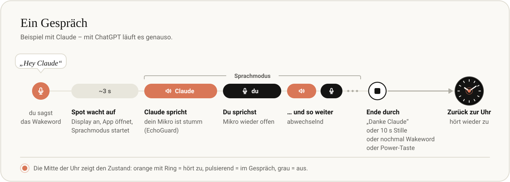
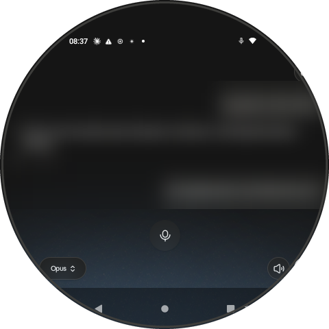
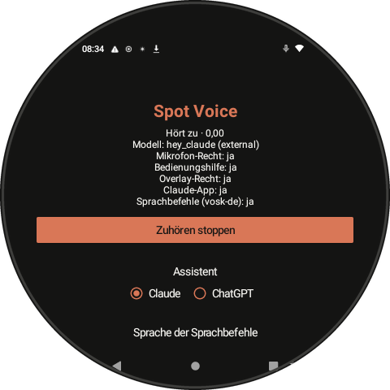

<sub>[English](../en/05-voice-assistant.md) · **Deutsch**</sub>

# 5 · Sprachassistent: Claude oder ChatGPT

> **Ziel:** „Hey Claude“ sagen und freihändig mit Claude (oder ChatGPT) reden, im Sprachmodus der jeweiligen App. · **Zeit:** etwa 20–30 Minuten · **Installer:** `./install.sh apps voice`

Das ist das Herzstück des Projekts. Nach diesem Kapitel funktioniert dein Spot so:

1. Du sagst das Wake-Word. Der Spot erkennt es selbst, ganz ohne Internet.
2. Der Spot schaltet den Bildschirm ein, öffnet die Claude-App (oder ChatGPT) und tippt für dich auf den Sprachmodus-Button.
3. Du sprichst mit dem Assistenten, und er antwortet mit seiner eigenen Stimme. Sprache rein, Sprache raus, genau wie am Handy.
4. Sagst du „Danke Claude“, bist du 10 Sekunden still oder beendest du das Gespräch auf einem anderen Weg, geht der Spot zurück zur Uhr und wartet auf das nächste Wake-Word.

Dafür sorgen zwei kleine Android-Apps aus diesem Projekt. **Spot Voice** hört auf das Wake-Word, startet den Sprachmodus und hält das Gespräch am Laufen. **Spot Clock** ist die runde Uhr (Kapitel 7). Das Gespräch selbst läuft in der offiziellen Claude- oder ChatGPT-App. Dieses Projekt ersetzt oder imitiert sie nicht.

<p align="center">
  
</p>

---

## Claude oder ChatGPT?

Beide werden unterstützt, und du kannst jederzeit wechseln (siehe [Zwischen Claude und ChatGPT wechseln](#zwischen-claude-und-chatgpt-wechseln)). Nimm den, für den du ein Konto hast.

| | Claude | ChatGPT |
|---|---|---|
| App | Claude von Anthropic (`com.anthropic.claude`) | ChatGPT von OpenAI (`com.openai.chatgpt`) |
| Installiert über | Aurora Store (kein Google-Konto nötig) | Aurora Store (kein Google-Konto nötig) |
| Anmeldung | Magic Link per E-Mail, auf dem Spot geöffnet mit `./install.sh open-link` | E-Mail-Adresse und Code aus der E-Mail, auf dem Spot eingetippt |
| Wake-Word | „Hey Claude“ | „Hey ChatGPT“ (Modell im Training; bis dahin „Alexa“, siehe unten) |
| Stoppwort (auf dem Spot erkannt) | „Danke Claude“, „Claude stopp“ | „Danke ChatGPT“ (Modell im Training) |
| Stand | auf einem echten Spot getestet | neu, weniger getestet als Claude |

Du brauchst ein eigenes Konto bei Anthropic oder OpenAI. Was der Sprachmodus der App in deinem Tarif kann, bekommst du auch auf dem Spot.

> [!NOTE]
> **Die ChatGPT-Unterstützung ist neu und weniger getestet als Claude.** Die ChatGPT-App lässt sich installieren und läuft auf dem Spot. Spot Voice findet die Buttons in einer Assistenten-App über ihre Beschriftung auf dem Bildschirm: den Sprachmodus-Button, den Stummschalt-Button und den Beenden-Button. Für Claude wurden diese Beschriftungen auf einem echten Spot abgeglichen. Für ChatGPT läuft der Abgleich auf dem Gerät noch. Wird der Sprachmodus-Button oder der Stummschalt-Button nicht gefunden, lies [ChatGPT-Beschriftungen kalibrieren](#chatgpt-beschriftungen-kalibrieren-dump_nodes) und melde bitte, was du siehst.

---

## Schritt 1 · Assistenten-App installieren

Der Installer öffnet die Seite der App im **Aurora Store**. Das ist ein quelloffener Client für den Play Store, der ohne Google-Konto auskommt. Aurora hast du in Kapitel 4 installiert.

1. Starte am Computer im Projektordner:

   ```bash
   ./install.sh apps
   ```

   Für ChatGPT hängst du `--assistant chatgpt` an. Ohne diese Option fragt der Installer beim ersten Lauf nach. Standard ist Claude.
2. Beim ersten Mal fragt der Installer: `Auch Spotify installieren (für Sprachbefehle wie "spiele ..."; braucht ein Spotify-Konto)? [j/N]`. Antworte `j`, wenn du Musik per Stimme steuern willst (Kapitel 6). Nachholen kannst du das mit `./install.sh apps --spotify`.
3. Schau auf den Spot. Aurora Store öffnet die Seite der App. Bist du zum ersten Mal in Aurora, geh durch die Willkommensseiten und wähle den Login **„Anonym“**.
4. Tippe auf **„Installieren“** und bestätige den Android-Dialog mit **„Installieren“**.
5. Warte. Der Installer merkt selbst, wann die Installation fertig ist (er wartet bis zu 10 Minuten), und meldet `[ok] Claude installiert`.
6. Der Installer fragt, ob er das Mikrofon für die App gleich erlauben soll. Antworte `J`. Sonst fragt die App beim ersten Gebrauch.

> [!TIP]
> Zeigt Aurora die App nach den Willkommensseiten nicht von selbst an, starte einfach noch einmal `./install.sh apps`.

**Wenn der Installer von Aurora hängt.** Auf diesem ROM wird die Installationsbestätigung von Aurora manchmal nie fertig. Der Installer bietet dann einen geprüften Notweg an. Er holt die Dateien, die Aurora schon heruntergeladen hat, vom Spot, prüft mit `apksigner`, dass jeder Teil (Split-APK) dieselbe gültige Signatur hat, und installiert sie mit `adb install-multiple`. Dieser Notweg braucht „Debugging als Root“ (Kapitel 4) und `apksigner` aus den Build-Tools des Android SDK auf deinem Computer. Fehlt eins davon, sagt dir der Installer Bescheid.

## Schritt 2 · Anmelden

Am Ende der Phase `apps` öffnet der Installer die Assistenten-App auf dem Spot und zeigt dir die Schritte zur Anmeldung. Zugangsdaten laufen nie über die Kommandozeile, und der Installer speichert nichts davon.

### Claude: der Magic Link

Claude meldet dich mit einem Link an, den du per E-Mail bekommst. Dieser Link muss **auf dem Spot** geöffnet werden, also auf dem Gerät, auf dem du dich anmeldest. Einen langen Link auf dem kleinen runden Display einzutippen ist unpraktisch. Deshalb reicht der Installer ihn für dich weiter.

1. Wähle auf dem Spot **„Mit E-Mail fortfahren“** und tippe deine E-Mail-Adresse ein.
2. Öffne am Computer die E-Mail von Anthropic. Klick mit der rechten Maustaste auf den Anmelde-Button und kopiere den Link.
3. Der Installer fragt `Login-Link jetzt einfügen? [J/n]`. Drück Enter. Willst du das später erledigen, starte:

   ```bash
   ./install.sh open-link
   ```

4. Füge den Link ein und drück Enter. **Du siehst den Text nicht.** Das ist Absicht. Der Link wird nicht gespeichert, nicht protokolliert und taucht nicht in der Prozessliste deines Computers auf.
5. Schau auf den Spot. Die Claude-App öffnet den Link und schließt die Anmeldung ab.
6. Erlaube das Mikrofon, wenn Claude danach fragt.
7. Zurück am Computer drückst du Enter bei `Enter drücken, wenn du angemeldet bist ...`.

### ChatGPT: E-Mail und Code

1. Auf dem Spot ist die ChatGPT-App offen. Melde dich mit deiner E-Mail-Adresse an.
2. Tippe den Code aus der E-Mail auf dem Spot ein.
3. Erlaube das Mikrofon, wenn ChatGPT danach fragt.
4. Zurück am Computer drückst du Enter.

„Mit Google fortfahren“ braucht die Google-Dienste, und die hat dieses ROM nicht. Das klappt also nicht. Auch die Anmeldung mit Apple funktioniert eventuell nicht. Nimm die E-Mail.

> [!TIP]
> Tippen auf einem runden 2,5-Zoll-Display ist mühsam. `scrcpy` spiegelt den Spot in ein Fenster auf deinem Computer, dann funktionieren Tastatur und Maus:
>
> ```bash
> brew install scrcpy
> scrcpy                       # über WLAN: scrcpy -s 192.168.x.y:5555
> ```

## Schritt 3 · Spot Voice installieren

```bash
./install.sh voice
```

Diese Phase läuft von allein. Sie stellt dir eine Frage, nämlich die nach der Bedienungshilfe. Jeden ihrer Schritte findest du unter [Was der Installer für dich erledigt](#was-der-installer-für-dich-erledigt).

### Die Bedienungshilfe: warum sie nötig ist

Die Apps von Claude und ChatGPT bieten keinen offiziellen Weg, über den eine andere App den Sprachmodus starten kann. Es gibt dafür keinen Link, keinen Intent und keine Einstellung. Den Sprachmodus-Button für dich drücken kann nur eine Android-**Bedienungshilfe**, derselbe Mechanismus, den Screenreader nutzen. Spot Voice bringt eine mit. Sie heißt „Spot Voice Auto-Tap“.

Eine Bedienungshilfe ist mächtig. Sie kann lesen, was auf dem Bildschirm steht, und überall hintippen. Deshalb fragt der Installer vorher, und die Standardantwort ist **Nein**:

```text
==> Bedienungshilfe
Spot Voice braucht seine Bedienungshilfe, um in der Claude-App für dich auf den Sprachmodus-Button zu tippen.
     Eine Bedienungshilfe kann den Bildschirm lesen und tippen. Spot Voice handelt nur in der Assistenten-App; der Code ist offen (apps/voice/.../launch/VoiceModeA11yService.kt).
?? Bedienungshilfe für Spot Voice jetzt per adb aktivieren? [j/N]
```

- Antwortest du `j`, schaltet der Installer sie per adb ein.
- Antwortest du `N` (oder drückst nur Enter), öffnet der Installer die Einstellungen für Bedienungshilfen auf dem Spot. Dann:
  1. Tippe auf **„Spot Voice Auto-Tap“** (unter den heruntergeladenen Apps bzw. Diensten). Der Installer nennt sie kurz „Spot Voice“.
  2. Schalte **„Spot Voice Auto-Tap verwenden“** ein und bestätige mit **„Zulassen“**.

  Der Installer wartet bis zu 5 Minuten und bemerkt das Einschalten von selbst.

**Was die Bedienungshilfe tut.** Sie handelt nur in der gewählten Assistenten-App:

- Nach dem Wake-Word tippt sie auf „Neuer Chat“, damit jede Sitzung mit einem frischen Gespräch beginnt, und dann auf den Sprachmodus-Button. Ist kein „Neuer Chat“-Button zu sehen (zum Beispiel, weil schon ein leerer Chat offen ist), tippt sie gleich auf den Sprachmodus-Button.
- Sie tippt auf den Stummschalt-Button der App, solange der Assistent spricht, und hebt die Stummschaltung wieder auf, wenn er fertig ist (siehe [EchoGuard](#echoguard-warum-du-nicht-dazwischenreden-kannst)).
- Sie liest den Transkript-Text auf dem Bildschirm, um eine gesprochene Verabschiedung wie „Danke Claude“ zu bemerken.
- Sie tippt auf „Beenden“, wenn das Gespräch vorbei ist.
- Sie bemerkt, wenn du die App verlässt oder der Bildschirm ausgeht, und lässt Spot Voice dann wieder zuhören.

**Was sie nicht tut.** Sie tippt in keiner anderen App. Sie schickt nichts irgendwohin und speichert keine Transkripte. Damit sie merkt, dass die Assistenten-App verlassen wurde, bekommt sie Fensterwechsel aller Apps mit, handelt aber nur in der Assistenten-App. Zur Fehlersuche landen die Bildschirm-Beschriftungen, die sie angeschaut hat, im lokalen Systemlog des Spot (logcat). Der Code ist offen: `apps/voice/app/src/main/java/ai/pocket/heyclaude/launch/VoiceModeA11yService.kt`.

Ohne Bedienungshilfe öffnet das Wake-Word zwar die Assistenten-App, aber niemand tippt auf den Sprachmodus-Button, und EchoGuard kann nicht arbeiten.

---

## Ein Gespräch, Schritt für Schritt

Das Beispiel nutzt Claude. Mit ChatGPT läuft es genauso.

<p align="center">
  
</p>
<p align="center"><sub>Sprachmodus von Claude auf dem Spot (Transkript zum Schutz der Privatsphäre unscharf).</sub></p>

1. **Der Spot wartet.** Die Uhr zeigt einen orangen Mittelpunkt mit einem dünnen Lichtring. Das heißt: „Ich höre auf das Wake-Word.“
2. **Sag „Hey Claude“** in Richtung Spot und mach dann eine Pause. Sag nur das Wake-Word.
3. **Du hörst einen kurzen Piepton.** Etwa 2 Sekunden lang hört der Spot jetzt auf einen Offline-Sprachbefehl wie „Timer fünf Minuten“ (Kapitel 6). Sagst du nichts, geht es mit dem nächsten Schritt weiter.
4. **Der Spot wacht auf.** Der Bildschirm geht an, die Claude-App öffnet sich, und Spot Voice tippt auf den Sprachmodus-Button. Das dauert etwa 3 Sekunden.
5. **Sprich.** Stell deine Frage in ganz normalen Sätzen.
6. **Claude antwortet laut.** Während Claude spricht, schaltet EchoGuard Claudes Mikrofon stumm. Du siehst in der App, wie sich der Stummschalt-Button ändert. Etwa 0,7 Sekunden nachdem Claude fertig ist, ist das Mikrofon wieder offen.
7. **Du bist wieder dran.** Ihr könnt euch so lange abwechseln, wie du willst.
8. **Ende.** Sag **„Danke Claude“** (oder nimm einen der anderen Wege aus dem nächsten Abschnitt). Der Sprachmodus von Claude schließt sich, der Spot kehrt zur Uhr zurück, und der orange Lichtring zeigt, dass er wieder zuhört.

> [!IMPORTANT]
> **Sag das Wake-Word allein und warte auf den Sprachmodus.** Was du direkt nach dem Wake-Word sagst, wird auf einen Offline-Sprachbefehl geprüft. Es wird **nicht** an Claude weitergegeben. Sagst du mehr als zwei Wörter, die kein Befehl sind (zum Beispiel „Hey Claude, wie wird das Wetter morgen“), hält der Spot das für einen Fehlalarm aus einem Gespräch im Raum. Er spielt einen tiefen Fehlerton und öffnet Claude nicht. Ein oder zwei zusätzliche Wörter („Hey Claude, hallo“) öffnen Claude zwar, gehen aber verloren. Warte, bis der Sprachmodus da ist, und stell dann deine Frage.

---

## Wake-Words und Stoppwörter

| Assistent | Wake-Word (startet) | Stoppwort (beendet, auf dem Spot erkannt) | Verabschiedungen im Transkript |
|---|---|---|---|
| Claude | „Hey Claude“ | „Danke Claude“, „Claude stopp“ | „danke Claude“, „tschüss Claude“, „Claude stopp“, „Claude, ende“, „thank you Claude“, „bye Claude“, „Claude, that's all“, … |
| ChatGPT | „Hey ChatGPT“ (Modell im Training) | „Danke ChatGPT“ (Modell im Training) | „danke ChatGPT“, „stopp ChatGPT“, „thanks ChatGPT“, … |

- **Wake-Word** und **Stoppwort** sind kleine neuronale Netze ([openWakeWord](https://github.com/dscripka/openWakeWord)), die auf dem Spot selbst laufen. Die trainierten Claude-Modelle liegen diesem Projekt in `models/` bei. Sie wurden mit synthetischen deutschen und englischen Stimmen trainiert. Kapitel 8 zeigt, wie du eigene trainierst.
- Die **Verabschiedungen** funktionieren anders. EchoGuard liest die neuen Zeilen des Transkripts im Fenster des Assistenten und sucht ein Abschiedswort direkt neben dem Namen des Assistenten. Wörter vor dem Namen: danke, dankeschön, stopp, tschüss, ciao, ende, beenden, auf wiedersehen, bye, thank you, thanks, goodbye, see you. Wörter nach dem Namen: stopp, danke, tschüss, ende, beenden, aus, bye, goodbye, that's all. Typische Verhörer des Namens wie „Cloud“ oder „Klaud“ zählen auch. Diese Prüfung klappt nur, wenn die Assistenten-App ein Transkript auf dem Bildschirm zeigt.

> [!NOTE]
> **Notlösung „Alexa“.** Gibt es für den gewählten Assistenten kein trainiertes Wake-Word-Modell, nimmt Spot Voice das eingebaute **„Alexa“**-Modell von openWakeWord. Das passt ja zum Echo Spot. Der Installer warnt dich dann: `models/hey_chatgpt.onnx oder models/danke_chatgpt.onnx fehlt - Spot Voice nutzt für ChatGPT das eingebaute Wake-Word "Alexa", bis ein trainiertes Modell da ist.` Genau das ist im Moment bei ChatGPT der Fall: Die Modelle für „Hey ChatGPT“ und „Danke ChatGPT“ werden noch trainiert. Ohne Stoppwort-Modell beendest du das Gespräch, indem du noch einmal das Wake-Word sagst.

---

## Gespräch beenden

Jeder dieser Wege funktioniert. Danach kehrt der Spot zur Uhr zurück und hört wieder auf das Wake-Word.

| Du … | Was passiert |
|---|---|
| sagst **„Danke Claude“** oder **„Claude stopp“** | Das Stoppwort-Modell auf dem Spot hört es, und EchoGuard drückt den Beenden-Button der App. |
| sagst eine Verabschiedung wie **„tschüss Claude“** | Die Prüfung des Transkripts findet sie, und EchoGuard drückt den Beenden-Button. |
| sagst **noch einmal das Wake-Word** („Hey Claude“) | Spot Voice beendet das Gespräch. |
| bist nach der letzten Antwort des Assistenten **10 Sekunden still** | EchoGuard drückt den Beenden-Button. Arbeitet der Assistent noch an einer Antwort auf deine Frage, wartet EchoGuard bis zu 30 Sekunden. |
| tippst auf den **Beenden-Button** der App („Beenden“) | Der Sprachmodus schließt sich ganz normal. |
| drückst die **Ein/Aus-Taste** (die mittlere Taste oben, unter LineageOS dient sie als Ein/Aus-Taste) | Der Bildschirm geht aus, die Sitzung endet, und die Uhr kommt nach vorn. |
| gehst **zum Startbildschirm** (verlässt die App) | Beim Verlassen der App beendet Spot Voice die Sitzung über die Benachrichtigung der App selbst. So redet sie nicht im Hintergrund weiter. |

Spot Voice hört selbst weiter auf Wake-Word und Stoppwort, auch während der Assistent spricht. „Danke Claude“ ist also so gebaut, dass es auch mitten in einer Antwort funktioniert. Erfährt Spot Voice überhaupt nicht, dass die Sitzung vorbei ist, hört es nach 10 Minuten trotzdem wieder zu.

---

## EchoGuard: warum du nicht dazwischenreden kannst

Am Handy filtert die Hardware die eigene Stimme des Assistenten aus dem Mikrofon heraus (akustische Echounterdrückung). **Das ROM des Spot hat keine Echounterdrückung.** Im freihändigen Sprachmodus würde der Assistent sich selbst über den Lautsprecher hören, das für deine Stimme halten und sich immer wieder selbst unterbrechen.

EchoGuard, ein Teil von Spot Voice, löst das mit **Halbduplex**, wie beim Funkgerät:

1. Er misst, was aus dem Lautsprecher kommt (Androids Visualizer am Audioausgang).
2. Sobald der Assistent spricht, tippt er auf den **Stummschalt-Button im Sprachmodus des Assistenten**. Die systemweite Mikrofon-Stummschaltung ignoriert der Audiotreiber des Spot. Deshalb nutzt EchoGuard den Button der App.
3. Ist der Lautsprecher etwa 0,7 Sekunden lang still, hebt er die **Stummschaltung wieder auf**.

Was das für dich heißt:

- **Du kannst dem Assistenten nicht ins Wort fallen.** Warte, bis er fertig ist, und sprich dann. Sind dir die Antworten zu lang, bitte um kurze Antworten („bitte antworte kurz“).
- Schaltest **du** das Mikrofon von Hand stumm, lässt EchoGuard es stumm.
- Beenden klappt trotzdem, während der Assistent spricht: Wake-Word und „Danke Claude“ gehen an Spot Voice, nicht an den Assistenten.

> [!WARNING]
> Der freihändige Sprachmodus antwortet **jedem**, der im Raum spricht, nicht nur dir. Solange ein Gespräch läuft, hört und transkribiert der Assistent alles, was in der Nähe des Spot gesagt wird.

---

## Die Uhr zeigt, was passiert

Der Mittelpunkt der Uhr (Kapitel 7) zeigt den Zustand von Spot Voice:

| Mittelpunkt | Bedeutung |
|---|---|
| Orange mit dünnem Lichtring | Hört auf das Wake-Word. |
| Orange mit pulsierenden Ringen | Aktiv: hört direkt nach dem Wake-Word auf einen Sprachbefehl, oder ein Gespräch läuft. |
| Grau | Aus: Spot Voice ist gestoppt oder hat einen Fehler. Öffne Spot Voice, um zu sehen, warum. |

In der gedimmten Nachtansicht ist der Punkt gedämpft orange, solange Spot Voice zuhört, und grau, wenn es aus ist.

---

## Empfindlichkeit: weniger Fehlauslösungen oder besser hören

Alle 80 Millisekunden gibt das Wake-Word-Modell einen Wert zwischen 0 und 1 aus: „War das ‚Hey Claude'?“. Der Spot wacht nur auf, wenn dieser Wert mehrere **Fenster** (je 80 ms) hintereinander über der **Schwelle** bleibt. Die Zahl der Fenster wirkt viel stärker als die Schwelle selbst.

Gemessen mit `training/evaluate.py` am Modell `hey_claude` v2:

| Empfindlichkeit (`--sensitivity`) | Schwelle / Fenster | Trefferquote¹ | Fehlauslösungen pro Stunde² |
|---|---|---|---|
| `high` | `0.6` / `3` | 63 % | 0,93 |
| `normal` (Standard) | `0.6` / `4` | 55 % | 0,28 (etwa alle 3,5 Stunden einmal) |
| `low` | `0.6` / `5` | 45 % | 0 in 10,7 Stunden |

¹ Anteil von 400 neuen synthetischen „Hey Claude“-Aufnahmen, bei denen das Modell ausgelöst hat. Das ist eine Obergrenze: Echte Räume mit Abstand, Hall und Geräuschen sind schwieriger. Rechne also damit, das Wake-Word ab und zu wiederholen zu müssen.<br>
² Gemessen an 10,7 Stunden echter Audioaufnahmen (dem Validierungsdatensatz von openWakeWord): Sprache, Musik, Fernsehen.

Warum Fenster? Eine frühere Einstellung mit 0,7 / 2 Fenstern hat dich besser gehört (70 %), ist aber 1,9-mal pro Stunde aufgewacht. In einem Raum mit Stimmen hat sich der Spot „von selbst eingeschaltet“. Muss der Wert etwas länger hoch bleiben, fällt das meiste davon weg. Das Stoppwort („Danke Claude“, 0,5 / 2 Fenster) löst 0,47-mal pro Stunde fälschlich aus. Es hört aber nur während eines Gesprächs zu, und dort beendet eine Fehlauslösung bloß das Gespräch etwas früher.

Werte für „Hey ChatGPT“ folgen, sobald das Modell trainiert ist. Bis dahin nutzt der Installer für ChatGPT dieselben Einstellungen (er nennt sie vorläufig).

### So änderst du sie

**Mit dem Installer** (die Einstellung wird gespeichert und bei jedem späteren `./install.sh voice` wieder gesetzt):

```bash
./install.sh voice --sensitivity low      # weniger Fehlauslösungen
./install.sh voice --sensitivity high     # hört dich besser, wacht aber öfter grundlos auf
```

**Ohne Neuinstallation**, per Broadcast. Dafür brauchst du `adb` und ein laufendes Spot Voice. Die Werte werden auf dem Spot gespeichert:

```bash
adb shell am broadcast -a ai.pocket.heyclaude.SET_THRESHOLD -p ai.pocket.heyclaude \
  --ef wake 0.6 --ef stop 0.5 --ei frames 4
```

| Extra | Bedeutung | Erlaubter Bereich |
|---|---|---|
| `--ef wake` | Schwelle des Wake-Words | 0.05–0.99 |
| `--ef stop` | Schwelle des Stoppworts | 0.05–0.99 |
| `--ei frames` | wie viele 80-ms-Fenster hintereinander der Wake-Wert über der Schwelle bleiben muss | 1–10 |
| `--ez new_chat` | `true` (Standard): Jede Wake-Word-Sitzung beginnt einen neuen Chat. `false`: Der letzte Chat wird fortgesetzt. | true / false |

Jedes Extra ist optional, du kannst also auch nur eins ändern. Das Ergebnis prüfst du mit `adb logcat -d -s HeyClaude | grep Thresholds`. Dort steht dann eine Zeile wie `Thresholds: wake=0.6 stop=0.5 frames=4 newChat=true`.

**Auf dem Spot** in der App Spot Voice: Der Regler **„Schwelle“** (0,20–0,90) ändert die Schwelle des Wake-Words. Der **„Mikrofon-Test“** zeigt live den Mikrofonpegel und den Wake-Score. Er läuft nur, solange das Zuhören gestoppt ist. Tippe also vorher auf „Zuhören stoppen“. Sag „Hey Claude“ von deinem üblichen Platz aus und schau, wie hoch der Wert steigt.

> [!TIP]
> - Sprich in Richtung Spot und mach nach „Hey Claude“ eine kurze Pause.
> - Die meisten Fehlauslösungen kommen von einem Fernseher oder Radio in der Nähe. Stell den Spot weiter weg oder nimm `--sensitivity low`.
> - Am besten hilft gegen beides ein Wake-Word, das mit deiner eigenen Stimme trainiert ist: [Kapitel 8](08-wakeword-training.md).

---

## Zwischen Claude und ChatGPT wechseln

Es gibt drei Wege. Nur der Installer erledigt alles.

**1. Mit dem Installer (empfohlen).** Er installiert die andere App und meldet sie an, kopiert ihre Wake-Word-Modelle auf den Spot und stellt Spot Voice um:

```bash
./install.sh apps voice --assistant chatgpt
./install.sh apps voice --assistant claude     # und zurück
```

**2. In der App Spot Voice.** Tippe auf die Uhr, um die App-Liste zu öffnen, und öffne **Spot Voice**. Wähle unter **„Assistent“** entweder **Claude** oder **ChatGPT**. Die Änderung gilt sofort, ohne Neuinstallation.

<p align="center">
  
</p>
<p align="center"><sub>Spot Voice: Status, „Zuhören stoppen“, Auswahl des Assistenten.</sub></p>

**3. Per Broadcast** von deinem Computer:

```bash
adb shell am broadcast -a ai.pocket.heyclaude.SET_ASSISTANT -p ai.pocket.heyclaude --es assistant chatgpt
```

Weg 2 und 3 schalten nur um. Sie installieren nichts. Die andere App muss schon installiert und angemeldet sein, und ihr Wake-Word-Modell muss schon auf dem Spot liegen. Sonst ist das Wake-Word „Alexa“. Die Empfindlichkeit gilt für beide Assistenten.

---

## Datenschutz: was auf dem Spot bleibt

| Teil | Läuft | Was den Spot verlässt |
|---|---|---|
| Wake-Word und Stoppwort | auf dem Spot (openWakeWord) | nichts |
| Sprachbefehle (Kapitel 6) | auf dem Spot (Vosk) | nichts, außer dem Sendernamen bei einer Radiosuche (radio-browser.info) und dem Suchtext, den du an Spotify gibst |
| Gespräch | in der App von Claude oder ChatGPT | deine Stimme und das Gespräch, genau wie im Sprachmodus am Handy |
| Bedienungshilfe | auf dem Spot | nichts |
| Wetter auf der Uhr | Spot Clock | nur die Koordinaten deines Wetter-Orts (Open-Meteo) |

Nur der Sprachmodus des Assistenten nutzt die Cloud. Spot Voice selbst zeichnet keine Gespräche auf und hat weder Konto noch Server.

---

## Die App Spot Voice

Du öffnest sie über die App-Liste (auf die Uhr tippen, dann **Spot Voice**). Von oben nach unten:

| Teil | Was er zeigt oder tut |
|---|---|
| Status | `Hört zu · 0,00` (Zustand und aktueller Wake-Score), das benutzte Wake-Word-Modell (zum Beispiel `Modell: hey_claude (external)`) und ja/nein-Zeilen für `Mikrofon-Recht`, `Bedienungshilfe`, `Overlay-Recht`, die Assistenten-App (`Claude-App`) und `Sprachbefehle (vosk-de)`. |
| Buttons für fehlende Rechte | „Mikrofon erlauben“, „Bedienungshilfe aktivieren“, „Overlay-Recht erteilen“. Jeder erscheint nur, solange das jeweilige Recht fehlt. |
| Zuhören starten / Zuhören stoppen | Schaltet das Lauschen auf das Wake-Word ein oder aus. Hast du es hier ausgeschaltet, bleibt es auch nach einem Neustart aus. |
| Assistent | Claude oder ChatGPT. |
| Sprache der Sprachbefehle | Deutsch oder English (Kapitel 6). |
| Schwelle | Der Regler für die Schwelle des Wake-Words. |
| Mikrofon-Test | Pegel und Wake-Score live, solange das Zuhören gestoppt ist. |
| Test: Claude jetzt starten | Startet den Sprachmodus, als hättest du das Wake-Word gesagt. |

Spot Voice startet nach einem Neustart von selbst.

---

## Was der Installer für dich erledigt

### Phase `apps`

1. Fragt, ob Spotify auch installiert werden soll, und merkt sich die Antwort.
2. Öffnet `market://details?id=<App>` im Aurora Store auf dem Spot und wartet, bis du auf „Installieren“ getippt hast (bis zu 10 Minuten).
3. Hängt der Installer von Aurora: holt die heruntergeladenen Split-APKs, prüft ihre Signaturen mit `apksigner` und installiert sie mit `adb install-multiple`.
4. Gibt der App das Mikrofon-Recht (nach `[J/n]`).
5. Installiert Spotify auf dieselbe Weise, wenn du das wolltest.
6. Öffnet die App und zeigt die Schritte zur Anmeldung. Für Claude startet er `open-link` für den Magic Link.

### Phase `voice`

1. Lädt `spot-voice.apk` aus dem neuesten GitHub-Release, prüft die SHA-256-Prüfsumme gegen `SHA256SUMS` und installiert die App. Mit `--from-source` baut er sie stattdessen selbst.
2. Gibt das Mikrofon-Recht, erlaubt „Über anderen Apps einblenden“ (damit Spot Voice den Assistenten nach vorn holen darf) und nimmt Spot Voice aus der Akku-Optimierung.
3. Startet den Zuhör-Dienst.
4. Kopiert das Wake-Word- und das Stoppwort-Modell deines Assistenten aus `models/` auf den Spot. Fehlen sie, warnt er, dass „Alexa“ benutzt wird.
5. Lädt das kleine Offline-Sprachmodell von Vosk für deine Sprache (etwa 50 MB), prüft seine SHA-256-Prüfsumme und kopiert es auf den Spot. Liegt das Modell schon dort, überspringt er das (`--force` kopiert es neu).
6. Schaltet die Bedienungshilfe ein, nach deinem `[j/N]`.
7. Stellt Assistent, Sprache der Sprachbefehle und Empfindlichkeit per Broadcast ein und startet das Zuhören.

`./install.sh --dry-run voice` zeigt jeden Befehl an, statt ihn auszuführen. Die letzten Schritte sehen so aus:

```text
==> Assistent, Sprache und Schwellen einstellen
+ adb shell am broadcast -a ai.pocket.heyclaude.SET_ASSISTANT -p ai.pocket.heyclaude --es assistant claude
+ adb shell am broadcast -a ai.pocket.heyclaude.SET_LANG -p ai.pocket.heyclaude --es lang de
+ adb shell am broadcast -a ai.pocket.heyclaude.SET_THRESHOLD -p ai.pocket.heyclaude --ef wake 0.6 --ef stop 0.5 --ei frames 4
[ok] Assistent=claude, Sprache=de, wake=0.6/4 Fenster (normal), stop=0.5
+ adb shell am start-foreground-service -n ai.pocket.heyclaude/.WakeWordService
[ok] Spot Voice hört zu.
```

---

## Prüfen

### Schneller Selbsttest

```bash
./install.sh verify
```

Der Selbsttest prüft alles, was für die Sprachsteuerung zählt. Jede Zeile sollte ein grünes ✓ zeigen. Ein ✗ kommt mit einem Lösungshinweis nach `->`. Die Prüfungen rund um die Sprache sind: `Spot Voice installiert`, `Claude installiert` (bzw. dein Assistent), `Bedienungshilfe aktiviert`, `Wake-Word-Modelle auf dem Spot`, `Vosk-Sprachmodell auf dem Spot`, `WakeWordService läuft` und `Claude vermutlich angemeldet`. Danach bietet er einen **Live-Test** an: Er öffnet den Sprachmodus, als hättest du das Wake-Word gesagt, und wartet bis zu 25 Sekunden auf das Antippen des Buttons. Klappt es, siehst du:

```text
==> Live-Test
Spot Voice öffnet jetzt den Claude-Sprachmodus, als hättest du das Wake-Word gesagt.
?? Live-Test jetzt starten? [J/n]
     Auf den Spot schauen: Claude öffnet sich und startet den Sprachmodus.
   ✓ Sprachmodus-Button getippt - jetzt mit Claude sprechen oder zum Beenden das Stoppwort sagen
```

### Per Stimme

1. Schau, ob die Uhr den orangen Mittelpunkt mit Lichtring zeigt.
2. Sag „Hey Claude“, warte auf den Sprachmodus und frag etwas Kurzes.
3. Achte, während Claude antwortet, auf den Stummschalt-Button: Er sollte auf stumm wechseln und danach zurück.
4. Sag „Danke Claude“. Der Spot sollte zur Uhr zurückkehren.

### Im Log

```bash
adb logcat -s HeyClaude OpenWakeWord
```

Diese Zeilen solltest du während eines Gesprächs sehen:

```text
Wake word detected (score=…, threshold=0.6, frames=4)
A11y: voice-mode button tapped
EchoGuard: Claude speaks -> mic muted
EchoGuard: Claude done -> mic open
Wake/stop word during conversation (score=…) -> end it
EchoGuard: end conversation (wake word) -> end button
```

Der Grund in Klammern zeigt, was das Gespräch beendet hat: `wake word` (das Wake-Word oder das Stoppwort-Modell, zum Beispiel „Danke Claude“), `stop phrase` (eine Verabschiedung im Transkript), `10 s silence` oder `30 s silence` (Stille).

---

## Nützliche adb-Befehle

Für Tests und Feinabstimmung von deinem Computer aus. Listet `adb devices` mehr als ein Gerät, schreib `-s 192.168.x.y:5555` direkt hinter `adb`. Broadcasts erreichen Spot Voice nur, solange sein Zuhör-Dienst läuft. Ausnahmen sind `SET_ASSISTANT` und `SET_LANG`, die auch bei gestopptem Dienst gespeichert werden, und `DUMP_NODES`, das die Bedienungshilfe verarbeitet.

| Was | Befehl | Wirkung |
|---|---|---|
| Gespräch ohne Sprechen starten | `adb root`, dann<br>`adb shell am start-foreground-service -n ai.pocket.heyclaude/.WakeWordService -a ai.pocket.heyclaude.TRIGGER_NOW` | Wie ein erkanntes Wake-Word, nur ohne Prüfung auf einen Sprachbefehl. Braucht „Debugging als Root“ (`adb root`), weil der Dienst nicht exportiert ist. |
| Wieder zuhören | `adb shell am broadcast -a ai.pocket.heyclaude.RESUME -p ai.pocket.heyclaude` | Beendet den Zustand „pausiert“ und hört wieder auf das Wake-Word. |
| Assistent wechseln | `adb shell am broadcast -a ai.pocket.heyclaude.SET_ASSISTANT -p ai.pocket.heyclaude --es assistant chatgpt` | `claude` oder `chatgpt`. Lädt Wake- und Stoppwort-Modell neu. Schick den Broadcast noch einmal, nachdem du neue Modelldateien kopiert hast. |
| Sprache der Sprachbefehle | `adb shell am broadcast -a ai.pocket.heyclaude.SET_LANG -p ai.pocket.heyclaude --es lang de` | `de` oder `en`; lädt `vosk-de` oder `vosk-en`. |
| Empfindlichkeit | `adb shell am broadcast -a ai.pocket.heyclaude.SET_THRESHOLD -p ai.pocket.heyclaude --ef wake 0.6 --ef stop 0.5 --ei frames 4` | Siehe [Empfindlichkeit](#empfindlichkeit-weniger-fehlauslösungen-oder-besser-hören). |
| Sprachbefehl testen | `adb shell am broadcast -a ai.pocket.heyclaude.COMMAND -p ai.pocket.heyclaude --es text "timer fünf minuten"` | Wertet den Text aus und führt ihn aus, als wäre er gesprochen worden. Im Log steht `Test command 'timer fünf minuten' (de) -> Timer(300s)`. |
| Bildschirm-Beschriftungen ausgeben | `adb shell am broadcast -a ai.pocket.heyclaude.DUMP_NODES -p ai.pocket.heyclaude` | Schreibt den Bedienungshilfe-Baum aller Fenster ins Log. Braucht die Bedienungshilfe. |
| Pegel protokollieren | `adb shell am broadcast -a ai.pocket.heyclaude.LEVEL_LOG -p ai.pocket.heyclaude --ez on true` | Schreibt den Mikrofonpegel ins Log und während eines Gesprächs auch den Lautsprecherpegel, den EchoGuard misst. `--ez on false` schaltet das wieder ab. |
| Stummschalt-Button des Assistenten drücken | `adb shell am broadcast -a ai.pocket.heyclaude.MIC_MUTE -p ai.pocket.heyclaude --ez on true` | Testet das Stummschalten durch EchoGuard (`false` = Stummschaltung aufheben). |

Die Ergebnisse liest du mit `adb logcat -d -s HeyClaude`.

### ChatGPT-Beschriftungen kalibrieren (DUMP_NODES)

Spot Voice findet Buttons über ihre Beschriftung für Bedienungshilfen, in der deutschen Claude-App zum Beispiel „Mikrofon stummschalten“ oder „Beenden“. Für ChatGPT sind diese Beschriftungen noch begründete Vermutungen, bis sie auf dem Gerät bestätigt sind. So prüfst du sie:

1. Stell sicher, dass die Bedienungshilfe an ist (`./install.sh verify`).
2. Öffne ChatGPT auf dem Spot, sodass der Chat-Bildschirm zu sehen ist.
3. Am Computer:

   ```bash
   adb logcat -c
   adb shell am broadcast -a ai.pocket.heyclaude.DUMP_NODES -p ai.pocket.heyclaude
   adb logcat -d -s HeyClaude > chatgpt-chat.txt
   ```

4. Starte den Sprachmodus in ChatGPT von Hand und wiederhole Schritt 3, diesmal mit `chatgpt-voice.txt` als Datei.
5. Such in den Dateien die Einträge der Buttons mit `desc="…"`: den Sprachmodus-Button, die Buttons zum Stummschalten und Aufheben der Stummschaltung und den Beenden-Button.

Scheitert das automatische Antippen, steht im Log außerdem `A11y: try 1/8: no node matches …` und eine Liste möglicher Buttons als `cand[…]`. Bitte eröffne ein Issue auf [GitHub](https://github.com/Nachtfux/Echo_spot_second_life/issues) mit den passenden Zeilen und der Version der App.

> [!WARNING]
> Ein solcher Abzug enthält alles, was auf dem Bildschirm steht, auch Chat-Text. Entferne persönliche Inhalte, bevor du ihn teilst.

---

## Wenn etwas schiefgeht

| Problem | Siehe |
|---|---|
| Die Installation in Aurora wird nie fertig | [Aurora-Installation hängt](09-troubleshooting.md#aurora-store-hangs-while-installing) |
| Der Login-Link tut auf dem Spot nichts | [Probleme bei der Anmeldung](09-troubleshooting.md#the-login-link-does-not-open) |
| `adb` erreicht den Spot nach einem Neustart nicht | [adb über WLAN nach Neustart weg](09-troubleshooting.md#adb-over-wi-fi-is-gone-after-a-reboot) |
| Auf das Wake-Word passiert nichts | [Wake-Word wird nicht erkannt](09-troubleshooting.md#the-wake-word-does-not-react) |
| Der Spot wacht von selbst auf | [Der Spot wacht von selbst auf](09-troubleshooting.md#the-spot-wakes-up-by-itself) |
| Die App öffnet sich, aber der Sprachmodus startet nicht | [Sprachmodus-Button wird nicht gefunden](09-troubleshooting.md#voice-mode-does-not-start) |
| Der Assistent unterbricht sich oder hört sich selbst | [Assistent unterbricht sich selbst](09-troubleshooting.md#the-assistant-hears-itself) |
| ChatGPT-Buttons werden nicht angetippt | [ChatGPT-Buttons werden nicht gefunden](09-troubleshooting.md#chatgpt-buttons-are-not-found) |

---
[← 4 · Android einrichten](04-setup.md) · [Übersicht](../../README.de.md) · [6 · Sprachbefehle →](06-voice-commands.md)
