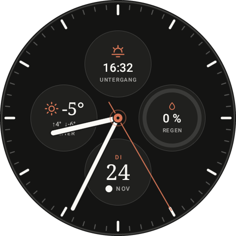
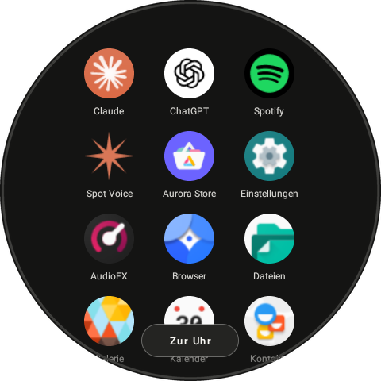

<sub>[English](../en/07-clock.md) · **Deutsch**</sub>

# 7 · Die Uhr

> **Ziel:** Alles verstehen, was die runde Uhr anzeigt, und den Ort für das Wetter einstellen. · **Zeit:** etwa 5 Minuten · **Installer:** `./install.sh clock`

**Spot Clock** macht aus dem runden 480 × 480 Pixel großen Bildschirm eine ruhige analoge Uhr mit Wetter, Sonnenzeiten, Datum und Mondphase. Sie ist der **Startbildschirm** und der **Bildschirmschoner** des Spot. Du siehst sie also immer, wenn keine App offen ist. In einem dunklen Raum dimmt sie sich selbst, sie zeigt das Cover der laufenden Musik und deine Timer und Wecker. Ihr Mittelpunkt zeigt, was der Sprachassistent gerade tut.

Auf einem deutschen Spot heißt die App in Android **„Spot-Uhr“**, zum Beispiel in den Einstellungen. Der Installer und diese Anleitung nennen sie Spot Clock.

---

## Das Zifferblatt am Tag

<p align="center">
  
</p>
<p align="center"><sub>Das Zifferblatt am Tag.</sub></p>

Um die Mitte herum sitzen vier runde Anzeigen:

| Position | Zeigt | Details |
|---|---|---|
| Oben | **Sonne** | Das nächste Sonnenereignis: vor Sonnenaufgang **AUFGANG** mit der heutigen Uhrzeit, tagsüber **UNTERGANG**, nach Sonnenuntergang der **AUFGANG** von morgen. |
| Links | **Wetter jetzt** | Symbol und aktuelle Temperatur, darunter die Höchst- und Tiefstwerte von heute (`↑4°  ↓-6°`) und eine kurze Beschreibung: KLAR, HEITER, WOLKIG, BEDECKT, NEBEL, NIESELN, REGEN, SCHNEE, SCHAUER, SCHNEESCHAUER, GEWITTER. |
| Rechts | **Regen** | Die höchste Regenwahrscheinlichkeit von heute, als Zahl und als oranger Ring, der sich füllt (0 % = kein Ring, 100 % = voller Kreis). |
| Unten | **Datum** | Wochentag (orange), Tag, Monat und eine kleine **Mond**-Scheibe, die den heute beleuchteten Teil des Mondes zeigt (von der Nordhalbkugel aus gesehen). |
| Mitte | **Zustand des Assistenten** | Siehe nächsten Abschnitt. |

Die Zeiger: weiße Stunden- und Minutenzeiger und ein dünner oranger **Sekundenzeiger**, der einmal pro Sekunde springt. Uhrzeiten stehen immer im 24-Stunden-Format da.

Ohne Wetterdaten zeigen die Anzeigen `—`. Die Wetterzeile lautet dann **ORT FEHLT** (noch kein Wetter-Ort gesetzt) oder **LÄDT …** (wartet auf die erste Antwort). Siehe [Der Wetter-Ort](#der-wetter-ort).

---

## Der Mittelpunkt: was der Assistent gerade tut

Der kleine runde Punkt, an dem die Zeiger zusammenlaufen, zeigt den Zustand von Spot Voice (Kapitel 5):

| Mittelpunkt | Bedeutung |
|---|---|
| **Orange mit dünnem Lichtring** | Hört auf das Wake-Word. Sag „Hey Claude“. |
| **Orange mit pulsierenden Ringen** | Aktiv: Der Spot hört direkt nach dem Wake-Word auf einen Sprachbefehl, oder ein Gespräch läuft. |
| **Grau** | Aus: Spot Voice ist gestoppt oder hat ein Problem. Öffne Spot Voice über die App-Liste, um zu sehen, warum. |

In der Nachtansicht ist die Mitte ein kleiner Punkt: gedämpft orange, solange Spot Voice zuhört, grau, wenn es aus ist.

---

## Nachtansicht und Helligkeit

Der Spot hat einen **Lichtsensor**. Spot Clock liest ihn aus und stellt die Bildschirmhelligkeit in vier Stufen ein:

| Raumlicht | Ansicht | Bildschirmhelligkeit |
|---|---|---|
| Dunkel (unter etwa 4 Lux: ein dunkles Schlafzimmer) | **Nachtansicht** | 5 % |
| Gedämpft (etwa 4–30 Lux) | Tagesansicht | 25 % |
| Normal (etwa 30–250 Lux) | Tagesansicht | 60 % |
| Hell (über etwa 250 Lux) | Tagesansicht | deine Helligkeitseinstellung in Android |

Damit nichts flackert, wechselt die Stufe erst, wenn das Licht deutlich über eine Grenze hinausgeht (um etwa 40 %) und 4 Sekunden so bleibt. Eine Hand, die am Sensor vorbeistreicht, ändert nichts.

Die **Nachtansicht** ist für ein dunkles Schlafzimmer gemacht: schwarzer Hintergrund, gedämpft orange Stundenpunkte und Zeiger, die aktuelle Temperatur und kein Sekundenzeiger. Sie aktualisiert sich nur alle 30 Sekunden.

Meldet ein Spot keinen Lichtsensor, zeigt die Uhr stattdessen von 22:00 bis 07:00 die Nachtansicht. Ein klingelnder Timer oder Wecker nutzt immer die Tagesansicht mit deiner normalen Android-Helligkeit, damit du ihn auch siehst.

---

## Musik-Anzeige

Läuft auf dem Spot Musik, wechselt die Uhr zur **Musik-Anzeige** (der Installer nennt sie „Läuft gerade“). Das klappt mit jeder App, die die üblichen Mediensteuerungen anbietet: mit Spotify und mit dem Internetradio von Spot Voice (Kapitel 6).

- Das **Cover** (oder das Senderlogo) füllt den runden Bildschirm.
- **Titel** und **Interpret** stehen unten, die aktuelle Uhrzeit oben.
- Ein **Fortschrittsring** läuft am Rand entlang, bei Titeln mit bekannter Länge. Liveradio hat keine Länge, also gibt es dort keinen Fortschritt.
- **PAUSE** steht unter dem Titel, solange die Wiedergabe pausiert ist. 20 Sekunden nach einer Pause kehrt die Uhr zur normalen Ansicht zurück.

Diese Ansicht braucht **Benachrichtigungszugriff** für Spot Clock. Android lässt eine App nur über den Benachrichtigungszugriff die Mediensitzungen anderer Apps sehen (Titel, Interpret, Cover, Position). Technisch könnte der Benachrichtigungszugriff alle Benachrichtigungen lesen. Spot Clock ignoriert sie und liest nur die Mediensitzung. Der Code ist offen: `apps/clock/src/ai/pocket/spotclock/NowPlayingService.java`. Der Installer fragt, bevor er den Zugriff erlaubt ([Was der Installer für dich erledigt](#was-der-installer-für-dich-erledigt)). Ohne ihn funktioniert die Uhr ganz normal, nur die Musik-Anzeige bleibt aus.

---

## Timer und Wecker auf dem Zifferblatt

Timer und Wecker stellst du per Stimme (Kapitel 6). Sie wohnen in Spot Clock.

<p align="center">
  
</p>
<p align="center"><sub>Timer mit 4:53 Restzeit und ein Wecker um 06:30.</sub></p>

- **Timer:** ein oranger **Bogen am Rand**, der mit der Zeit schrumpft, und oben die **Restzeit** (`4:53`, bei längeren Timern `1:05:00`).
- **Wecker:** eine Zeile unten, **WECKER 06:30**.
- Läuft einer ab, holt Spot Clock ihr Zifferblatt nach vorn. Es zeigt **pulsierende orange Ringe**, das Wort **TIMER** oder **WECKER**, die Uhrzeit und **„Tippen zum Beenden“**. Der Standard-Alarmton des Spot spielt in Schleife, höchstens **2 Minuten** lang. Eine Benachrichtigung meldet „Timer abgelaufen“ bzw. „Wecker“ mit dem Hinweis *Tippen auf die Uhr oder „Hey Claude, stopp“*. Nutzt du ChatGPT, steht dort „Hey ChatGPT“.
- **So stoppst du es:** Tippe auf den Bildschirm, oder sag das Wake-Word und „stopp“ (auf Englisch „stop“).

Es gibt immer einen Timer und einen Wecker. Beide laufen weiter, auch wenn die Uhr gerade nicht zu sehen ist.

---

## Die App-Liste

<p align="center">
  
</p>
<p align="center"><sub>Die App-Liste mit dem Button „Zur Uhr“.</sub></p>

Der Spot hat keine eigene App-Übersicht. Spot Clock bringt eine im selben Look mit:

1. **Tippe auf die Uhr.** Die App-Liste öffnet sich.
2. Die wichtigsten Apps stehen vorn: **Claude, ChatGPT, Spotify, Spot Voice, Aurora Store, Einstellungen** (jeweils nur, wenn installiert). Alle anderen Apps folgen alphabetisch. Für mehr nach unten wischen.
3. **Tippe auf eine App**, um sie zu öffnen. Verlässt du sie (Startbildschirm), bist du wieder bei der Uhr.
4. **„Zur Uhr“** unten führt zurück zur Uhr.

Was ein Tippen auf die Uhr bewirkt:

| Situation | Ein Tippen … |
|---|---|
| Die Uhr ist der Startbildschirm (der Normalfall) | öffnet die App-Liste |
| Ein Timer oder Wecker klingelt | stoppt ihn |
| Du hast Spot Clock als normale App aus der App-Liste geöffnet | schließt sie |

---

## Startbildschirm und Bildschirmschoner

Der Installer macht Spot Clock zu beidem:

- **Startbildschirm.** Nach einem Gespräch, nach dem Drücken auf „Startbildschirm“ und nach einem Neustart landest du bei der Uhr. Der Bildschirm bleibt an, solange die Uhr vorn ist. Als Startbildschirm tut „Zurück“ nichts, denn dahinter gibt es nichts mehr. Beim ersten Start als Startbildschirm setzt sie außerdem ein schlichtes dunkles Hintergrundbild (zu sehen hinter dem Sperrbildschirm), damit alles zusammenpasst.
- **Bildschirmschoner.** Ist der Spot untätig, zeigt der Bildschirmschoner von Android dasselbe Zifferblatt, mit derselben automatischen Helligkeit. Ein Tippen beendet den Bildschirmschoner.

---

## Der Wetter-Ort

Wetter und Sonnenzeiten kommen von [Open-Meteo](https://open-meteo.com/), einem freien Wetterdienst ohne Konto und ohne API-Schlüssel. Die Uhr fragt höchstens alle 15 Minuten neue Daten ab und behält die letzte Antwort, damit sie direkt nach einem Neustart Daten hat. Die Anfrage enthält nur die Koordinaten deines Wetter-Orts.

Es gibt **keinen voreingestellten Ort**. Bis du einen setzt, zeigt die Uhr kein Wetter.

### Mit dem Installer setzen oder ändern

1. Starte die Phase `clock` mit deinem Ort:

   ```bash
   ./install.sh clock --place "Berlin"
   ```

2. Der Installer sucht den Namen bei Open-Meteo. Gibt es mehrere Orte mit diesem Namen, listet er sie auf:

   ```text
   [..] Suche "Berlin" (Open-Meteo) ...
   Es gibt mehrere Orte namens "Berlin":
       1) Berlin, Berlin, Stadt, Land Berlin, Deutschland
       2) Berlin, City of Berlin, Coös County, New Hampshire, Vereinigte Staaten
       3) Berlin, Borough of Berlin, Camden County, New Jersey, Vereinigte Staaten
      ...
   ?? Welcher? Nummer 1-10 (0 = keiner davon) [1]:
   ```

3. Tippe die Nummer deines Orts ein und drück Enter.
4. Bestätige Ort und Koordinaten mit `J`, zum Beispiel bei `?? Wetter-Ort: Berlin, Berlin, Stadt, Land Berlin, Deutschland (52.5244, 13.4105). Richtig? [J/n]`.
5. Der Installer schickt den Ort an die Uhr auf dem Spot. Das Wetter erscheint ein paar Sekunden später.

**Tipps für den Namen:**

- Nimm den **Ortsnamen, keine Postleitzahl**. Open-Meteo findet Orte über den Namen. Tippst du Ziffern ein, sagt der Installer: `Open-Meteo findet Orte über den Namen, nicht über die Postleitzahl. Bitte den Ortsnamen eingeben, z. B. "Neustadt, Holstein".`
- Hänge nach einem Komma die Region an, um die Liste einzugrenzen: `"<Ort>, <Region>"`, zum Beispiel `--place "Neustadt, Holstein"` oder `--place "Hamburg, Deutschland"`. Der Teil nach dem Komma wird mit Bundesland, Kreis und Land abgeglichen.
- Passt nichts, antworte `0`. Dann lässt dich der Installer einen anderen Namen probieren (bis zu 5 Versuche). Eine leere Antwort heißt: kein Wetter. Die Uhr läuft dann einfach ohne.

### Von Hand setzen

Kennst du die Koordinaten (Breite und Länge als Dezimalzahlen mit Punkt), schick sie direkt:

```bash
adb shell am start -n ai.pocket.spotclock/.ClockActivity --es lat 52.52 --es lon 13.40 --es place Berlin
```

Sowohl `lat` als auch `lon` sind nötig. `place` ist optional und wird nur zur Info gespeichert. Ein neuer Ort löscht das zwischengespeicherte Wetter.

Um den Ort ganz zu vergessen, lösch die Daten der App. Dabei verschwinden auch ein gestellter Timer und Wecker:

```bash
adb shell pm clear ai.pocket.spotclock
```

---

## Sprachen

Spot Clock spricht **Deutsch** oder **Englisch**. Sie folgt der Systemsprache des Spot, die der Installer mit `--lang` während `setup` einstellt (Kapitel 4). Beschriftungen, Wetterbeschreibungen und die Namen von Wochentagen und Monaten wechseln mit:

| Englisch | Deutsch |
|---|---|
| SUNRISE / SUNSET | AUFGANG / UNTERGANG |
| RAIN | REGEN |
| NO LOCATION / LOADING … | ORT FEHLT / LÄDT … |
| PAUSED | PAUSE |
| ALARM 06:30 | WECKER 06:30 |
| Tap to stop | Tippen zum Beenden |
| Back to clock | Zur Uhr |
| Spot Clock (Name der App) | Spot-Uhr |

Uhrzeiten stehen in beiden Sprachen immer im 24-Stunden-Format da. Die Screenshots in dieser Anleitung zeigen die deutsche Oberfläche.

---

## Broadcasts, die die Uhr versteht

Für Tests und Automatisierung von deinem Computer aus. Zeigt `adb devices` nichts an, verbinde dich zuerst mit `adb connect 192.168.x.y:5555` (Adresse aus `./install.sh status`). Listet es mehr als ein Gerät, schreib `-s 192.168.x.y:5555` direkt hinter `adb`.

| Aktion | Befehl | Wirkung |
|---|---|---|
| Timer stellen | `adb shell am broadcast -a ai.pocket.spotclock.TIMER -p ai.pocket.spotclock --el seconds 600` | Startet einen 10-Minuten-Timer und ersetzt einen laufenden. `seconds` muss ein **long** sein (`--el`); `0` bricht ab. |
| Timer abbrechen | `adb shell am broadcast -a ai.pocket.spotclock.TIMER -p ai.pocket.spotclock --el seconds 0` | Bricht den Countdown ab. |
| Wecker stellen | `adb shell am broadcast -a ai.pocket.spotclock.ALARM -p ai.pocket.spotclock --ei hour 6 --ei minute 30` | Wecker beim nächsten 06:30, heute oder morgen. |
| Wecker abbrechen | `adb shell am broadcast -a ai.pocket.spotclock.ALARM -p ai.pocket.spotclock --ei hour -1` | Bricht den Wecker ab. |
| Klingeln stoppen | `adb shell am broadcast -a ai.pocket.spotclock.STOP_RINGING -p ai.pocket.spotclock` | Bringt einen klingelnden Timer oder Wecker zum Schweigen. |
| Zustand des Assistenten anzeigen | `adb shell am broadcast -a ai.pocket.heyclaude.STATE -p ai.pocket.spotclock --es state active --es assistant ChatGPT` | `state` = `off`, `listening` oder `active`. Normalerweise schickt Spot Voice das selbst. Den Namen des Assistenten nutzt die Benachrichtigung beim Klingeln. |
| Wetter-Ort setzen | `adb shell am start -n ai.pocket.spotclock/.ClockActivity --es lat 52.52 --es lon 13.40 --es place Berlin` | Siehe [Von Hand setzen](#von-hand-setzen). |

> [!IMPORTANT]
> Häng immer `-p ai.pocket.spotclock` an. Ohne das stellt Android diese Broadcasts der App nicht zu. Achte auch auf den Typ: `--ei seconds 600` (ein int statt eines long) wird als „kein Wert“ gelesen und **bricht den Timer ab**.

Die Uhr schreibt ins Log unter `adb logcat -s SpotClock`.

---

## Was der Installer für dich erledigt

Die Phase `clock`:

1. Lädt `spot-clock.apk` aus dem neuesten GitHub-Release, prüft die SHA-256-Prüfsumme und installiert die App. Mit `--from-source` baut er sie stattdessen selbst.
2. Erlaubt den Benachrichtigungszugriff für die Musik-Anzeige, **nachdem er mit `[j/N]` gefragt hat**. Antwortest du Nein, öffnet er stattdessen die Einstellungen auf dem Spot. Tippe auf **„Spot-Uhr“** (der Installer schreibt „Spot Clock“), schalte **„Benachrichtigungszugriff erlauben“** ein und bestätige mit **„Zulassen“**. Der Installer wartet bis zu 5 Minuten auf das Einschalten.
3. Macht Spot Clock zum Startbildschirm und zum Bildschirmschoner.
4. Sucht deinen Wetter-Ort bei Open-Meteo, lässt dich auswählen und bestätigen und speichert ihn in `.state/config.env`.
5. Startet die Uhr mit den Koordinaten.

`./install.sh --dry-run clock` zeigt die Befehle:

```text
==> Startbildschirm und Bildschirmschoner
+ adb shell cmd package set-home-activity ai.pocket.spotclock/.ClockActivity
+ adb shell settings put secure screensaver_components ai.pocket.spotclock/ai.pocket.spotclock.ClockDream
+ adb shell settings put secure screensaver_enabled 1
+ adb shell settings put secure screensaver_activate_on_sleep 1
+ adb shell settings put secure screensaver_activate_on_dock 1
[ok] Spot Clock ist Startbildschirm und Bildschirmschoner
     Auf dem Spot: Tippen auf die Uhr öffnet die App-Liste; "Zur Uhr" führt zurück.
```

---

## Prüfen

1. Starte die Prüfungen:

   ```bash
   ./install.sh verify
   ```

   Diese Zeilen müssen ein ✓ zeigen: `Spot Clock installiert`, `Spot Clock ist Startbildschirm`, `Spot Clock ist Bildschirmschoner`. `Benachrichtigungszugriff für Spot Clock` brauchst du nur für die Musik-Anzeige.
2. Drück auf dem Spot auf „Startbildschirm“: Die Uhr erscheint.
3. Die Wetteranzeige zeigt eine Temperatur und eine Beschreibung, nicht `—` und ORT FEHLT. Direkt nach dem Setzen des Orts wartest du ein paar Sekunden.
4. Der Mittelpunkt ist orange mit Lichtring (Spot Voice hört zu).
5. Tippe auf die Uhr: Die App-Liste öffnet sich. Tippe auf „Zur Uhr“.
6. Spiel Musik ab: Die Musik-Anzeige erscheint mit Cover und Titel.

---

## Wenn etwas schiefgeht

| Problem | Siehe |
|---|---|
| Das Wetter zeigt `—` / ORT FEHLT | [Wetter fehlt](09-troubleshooting.md#no-weather-on-the-clock) |
| `Konnte das App-Release nicht von GitHub laden` | [Das App-Release lässt sich nicht laden](09-troubleshooting.md#the-app-release-cannot-be-downloaded) |
| Kein Cover und kein Titel, während Musik läuft | [Musik-Anzeige erscheint nicht](09-troubleshooting.md#the-now-playing-face-does-not-appear) |
| „Startbildschirm“ zeigt einen anderen Launcher, oder die Uhr kommt nicht zurück | [Uhr ist nicht der Startbildschirm](09-troubleshooting.md#the-clock-is-not-the-home-screen) |
| Der Mittelpunkt bleibt grau | [Wake-Word wird nicht erkannt](09-troubleshooting.md#the-wake-word-does-not-react) |

---
[← 6 · Sprachbefehle](06-voice-commands.md) · [Übersicht](../../README.de.md) · [8 · Eigenes Wake-Word trainieren →](08-wakeword-training.md)
