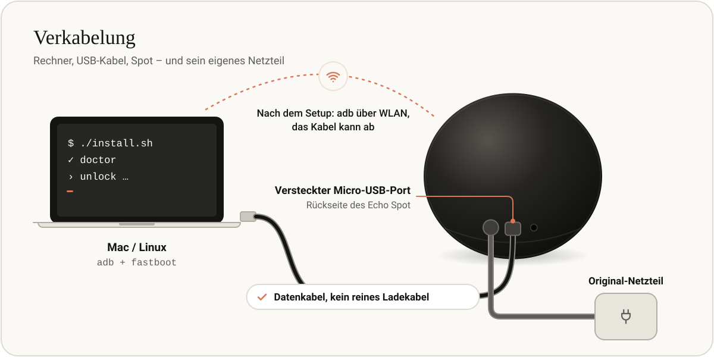
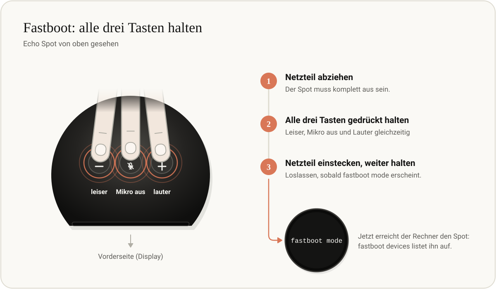

<sub>[English](../en/09-troubleshooting.md) · **Deutsch**</sub>

# 9 · Fehlerbehebung und FAQ

> **Ziel:** ein Problem schnell finden und beheben, sortiert nach Installer-Phase und nach Anzeichen · **Zeit:** 5–30 min pro Problem · **Installer:** `./install.sh verify`

Dieses Kapitel ist so sortiert wie die Installation: Computer, Entsperren, LineageOS, Android einrichten, Apps,
Sprachassistent, Sprachbefehle, Uhr. Jedes Problem hat eine eigene Überschrift, auf die du verlinken kannst. Am Ende
findest du die FAQ, wie du eine Sicherung zurückspielst und wie du alles wieder entfernst.

| Bereich | Probleme |
|---|---|
| [Schnelle Prüfungen](#schnelle-prüfungen) · [Logs sammeln](#logs-sammeln) · [Was verify meldet](#was-verify-meldet) | hier anfangen |
| [Computer und USB](#computer-und-usb) | [doctor meldet fehlende Werkzeuge](#doctor-meldet-fehlende-werkzeuge) · [USB-Hubs und Kabel](#usb-hubs-und-kabel) · [Linux: adb oder fastboot meldet „no permissions“](#linux-adb-oder-fastboot-meldet-no-permissions) |
| [Entsperren](#entsperren) | [fastboot sieht den Spot nicht](#fastboot-sieht-den-spot-nicht) · [Die Sicherheitsprüfungen stoppen das Entsperren](#die-sicherheitsprüfungen-stoppen-das-entsperren) · [Timeout beim Exploit](#timeout-beim-exploit) · [TWRP erscheint nicht](#twrp-erscheint-nicht) |
| [Sicherung und LineageOS](#sicherung-und-lineageos) | [sha256 stimmt nicht](#sha256-stimmt-nicht) · [TWRP wird nicht gefunden](#twrp-wird-nicht-gefunden) · [Bootschleife beim ersten Start](#bootschleife-beim-ersten-start) |
| [Android einrichten](#android-einrichten) | [adb meldet unauthorized](#adb-meldet-unauthorized) · [Debugging als Root ist aus](#debugging-als-root-ist-aus) · [adb per WLAN nach einem Neustart weg](#adb-per-wlan-nach-einem-neustart-weg) · [Mehr als ein Gerät](#mehr-als-ein-gerät) |
| [Apps und Anmeldung](#apps-und-anmeldung) | [Aurora-Installation hängt](#aurora-installation-hängt) · [Probleme bei der Anmeldung](#probleme-bei-der-anmeldung) |
| [Sprachassistent](#sprachassistent) | [Android hat die Bedienungshilfe abgeschaltet](#android-hat-die-bedienungshilfe-abgeschaltet) · [Sprachmodus-Button wird nicht gefunden](#sprachmodus-button-wird-nicht-gefunden) · [Der Spot wacht von selbst auf](#der-spot-wacht-von-selbst-auf) · [Wake-Word wird nicht erkannt](#wake-word-wird-nicht-erkannt) · [Der Spot piept, aber nichts öffnet sich](#der-spot-piept-aber-nichts-öffnet-sich) · [Der Assistent unterbricht sich selbst](#der-assistent-unterbricht-sich-selbst) · [Das Gespräch endet nicht](#das-gespräch-endet-nicht) · [Spot Voice hört nicht mehr zu](#spot-voice-hört-nicht-mehr-zu) |
| [Sprachbefehle](#sprachbefehle) | [Sprachbefehle werden falsch verstanden](#sprachbefehle-werden-falsch-verstanden) · [Radiosender wird nicht gefunden](#radiosender-wird-nicht-gefunden) · [Spotify spielt nicht](#spotify-spielt-nicht) |
| [Die Uhr](#die-uhr) | [Kein Wetter](#kein-wetter) · [Nach dem Aufwachen fehlt die Uhr](#nach-dem-aufwachen-fehlt-die-uhr) · [Die Musik-Anzeige erscheint nicht](#die-musik-anzeige-erscheint-nicht) |
| [Wake-Word-Training](#wake-word-training) · [FAQ](#faq) · [Aus der Sicherung wiederherstellen](#aus-der-sicherung-wiederherstellen) · [Deinstallieren und zurück zu Fire OS](#deinstallieren-und-zurück-zu-fire-os) | |

<a id="quick-checks"></a>

## Schnelle Prüfungen

1. Einstellungen, erledigte Phasen und verbundene Geräte anzeigen:

   ```bash
   ./install.sh status
   ```

2. Die ganze Installation prüfen (dafür muss LineageOS auf dem Spot laufen und der Spot per adb erreichbar sein):

   ```bash
   ./install.sh verify
   ```

3. Ist eine Phase fehlgeschlagen, behebe die Ursache, die über der Fehlermeldung steht, und starte die Phase noch
   einmal, zum Beispiel `./install.sh voice`. Jede Phase darfst du gefahrlos wiederholen. `./install.sh` allein macht
   mit der ersten Phase weiter, die noch nicht erledigt ist.

<a id="collect-logs"></a>

## Logs sammeln

Spot Voice schreibt ins Log mit dem Tag `HeyClaude`, seine Wake-Word-Erkennung mit `OpenWakeWord` und Spot Clock mit `SpotClock`.
Die Logzeilen sind englisch.

1. Das Log live mitlesen (beenden mit Strg+C):

   ```bash
   adb logcat -s HeyClaude OpenWakeWord SpotClock
   ```

2. Oder einen Versuch in eine Datei schreiben: Log leeren, das Problem nachstellen, dann speichern.

   ```bash
   adb logcat -c
   # jetzt das Problem auf dem Spot nachstellen
   adb logcat -d -s HeyClaude OpenWakeWord SpotClock > spot-log.txt
   ```

Über WLAN setzt du `-s 192.168.x.y:5555` direkt hinter `adb`.

Nützliche Zeilen:

| Logzeile | Bedeutung |
|---|---|
| `State -> LISTENING` | Spot Voice wartet auf das Wake-Word. |
| `Detector ready for claude, model=hey_claude (external)` | Das Wake-Word-Modell ist geladen. `alexa_v0.1 (fallback)` = kein eigenes Modell gefunden, das Wake-Word ist „Alexa“. |
| `Wake word detected (score=0.83, threshold=0.6, frames=4)` | Das Wake-Word hat ausgelöst. |
| `Command heard: '…'` | Was die Offline-Spracherkennung nach dem Wake-Word verstanden hat. |
| `No command in '…' -> probably a false alarm, not opening the assistant` | Gerede im Raum nach dem Wake-Word: ignoriert. |
| `Launcher: started com.anthropic.claude (autoTap=true, a11y=true)` | Die Assistenten-App wurde geöffnet. `a11y=false` = die Bedienungshilfe läuft nicht. |
| `A11y: voice-mode button tapped` | Das automatische Antippen hat geklappt. |
| `EchoGuard on (claude, visualizer=true)` | Der Echo-Schutz beobachtet den Lautsprecher. |
| `EchoGuard: Claude speaks -> mic muted` / `EchoGuard: Claude done -> mic open` | Der Echo-Schutz bei der Arbeit. |
| `EchoGuard: end conversation (10 s silence) -> end button` | Warum ein Gespräch endete (`stop phrase`, `wake word`, `10 s silence`, `30 s silence`). |
| `A11y: sending RESUME (…)` | Das Gespräch ist vorbei, Spot Voice hört wieder zu. |
| `Voice commands off: no Vosk model in …` | Das Sprachmodell für die Sprachbefehle fehlt. |
| `room light 12 lux -> level 1` (Tag `SpotClock`) | Die Uhr passt ihre Helligkeit an. |

> [!WARNING]
> Logs können private Texte enthalten. `Command heard` zeigt, was du nach dem Wake-Word gesagt hast, und `DUMP_NODES`
> (siehe [Sprachmodus-Button wird nicht gefunden](#sprachmodus-button-wird-nicht-gefunden)) listet Texte vom Bildschirm auf,
> darunter Teile deines Chats oder dein Kontoname. Lies ein Log durch, bevor du es irgendwo veröffentlichst, und entferne Privates.

<a id="verify-output-explained"></a>

## Was verify meldet

`./install.sh verify` schreibt eine Zeile pro Prüfung. `✓` = in Ordnung, `✗` = fehlgeschlagen (mit einer Lösung nach `->`),
`?` = nicht sicher feststellbar (zählt nie als Fehler), `·` = nicht geprüft (Probelauf). Gibt es mindestens ein `✗`,
bricht verify mit `N Prüfung(en) fehlgeschlagen - siehe Hinweise (->) oben.` ab und lässt den Live-Test aus. Eine
fehlgeschlagene Zeile sieht so aus:

```
==> Prüfungen
   ✓ Spot Voice installiert (ai.pocket.heyclaude)
   ✓ Spot Clock installiert (ai.pocket.spotclock)
   ✓ Claude installiert (com.anthropic.claude)
   ✗ Bedienungshilfe aktiviert
       -> ./install.sh voice, oder auf dem Spot: Einstellungen > Bedienungshilfen > Spot Voice
```

| Zeile | Was geprüft wird | Wenn sie fehlschlägt |
|---|---|---|
| Spot Voice installiert (ai.pocket.heyclaude) | das Paket ist da | `./install.sh voice` |
| Spot Clock installiert (ai.pocket.spotclock) | das Paket ist da | `./install.sh clock` |
| Claude installiert (com.anthropic.claude) oder ChatGPT installiert (com.openai.chatgpt) | die Assistenten-App ist da | `./install.sh apps`, siehe [Aurora-Installation hängt](#aurora-installation-hängt) |
| Spotify installiert | nur, wenn du Spotify gewählt hast | `./install.sh apps --spotify` |
| Bedienungshilfe aktiviert | die Bedienungshilfe von Spot Voice steht in der Liste der aktiven Bedienungshilfen, und Bedienungshilfen sind eingeschaltet | `./install.sh voice`, siehe [Android hat die Bedienungshilfe abgeschaltet](#android-hat-die-bedienungshilfe-abgeschaltet) |
| Benachrichtigungszugriff für Spot Clock | die Uhr darf Mediensitzungen lesen | `./install.sh clock`. Nur für die Musik-Anzeige nötig. |
| Spot Clock ist Startbildschirm | die Home-Taste öffnet die Uhr | `./install.sh clock` |
| Spot Clock ist Bildschirmschoner | der Bildschirmschoner ist die Uhr | `./install.sh clock` |
| Wake-Word-Modelle auf dem Spot (hey_claude.onnx, danke_claude.onnx) | das Wake-Word-Modell liegt im Dateiordner der App | `./install.sh voice`. Zeigt `?` mit `Kein trainiertes hey_chatgpt.onnx - das Wake-Word ist "Alexa"`, wenn `models/` kein Modell für deinen Assistenten enthält: [Kapitel 8](08-wakeword-training.md). |
| Vosk-Sprachmodell auf dem Spot (vosk-de oder vosk-en) | das Sprachmodell für die Sprachbefehle ist da | `./install.sh voice --force` |
| WakeWordService läuft | der Zuhör-Dienst läuft | `./install.sh voice`, oder Spot Voice öffnen und „Zuhören starten“ tippen |
| Claude angemeldet (Schätzung) | die App hält mindestens 10 MB Daten (braucht „Debugging als Root“) | Schlägt nie fehl. `?` = die App auf dem Spot öffnen und nachsehen. Claude: `./install.sh open-link`. |
| Live-Test: Sprachmodus-Button getippt | öffnet den Sprachmodus, als hättest du das Wake-Word gesagt, und wartet bis zu 25 s auf `voice-mode button tapped` im Log | Ist der Assistent angemeldet? Ist die Bedienungshilfe an? Siehe [Sprachmodus-Button wird nicht gefunden](#sprachmodus-button-wird-nicht-gefunden). |

Ist alles in Ordnung, endet verify mit `Alle Prüfungen bestanden.` (11 Zeilen ohne Spotify, dazu der Live-Test).

<a id="computer-and-usb"></a>

## Computer und USB

<a id="doctor-reports-missing-tools"></a>

### doctor meldet fehlende Werkzeuge

`./install.sh doctor` prüft deinen Computer und schreibt `[xx] <werkzeug> nicht gefunden` für alles, was fehlt.
adb und fastboot kann es dir gleich installieren (mit Homebrew auf macOS, mit apt auf Linux).

| Werkzeug | Gebraucht für | Installieren |
|---|---|---|
| `adb`, `fastboot` | alles, was mit dem Spot spricht | macOS: `brew install android-platform-tools` (braucht [Homebrew](https://brew.sh)). Linux: `sudo apt install adb fastboot` |
| `curl`, `unzip` | Downloads | `brew install curl unzip` oder `sudo apt install curl unzip` |
| `python3` | um das Ergebnis der Wetter-Ortssuche (JSON) zu lesen | macOS: `xcode-select --install`. Linux: `sudo apt install python3` |
| `shasum` oder `sha256sum` | Prüfsummen | gehört zu macOS und den meisten Linux-Systemen |
| `gtimeout` (optional) | Zeitlimits | `brew install coreutils`; ohne nutzt der Installer ein eigenes |
| `apksigner` (optional) | Signaturprüfung von Aurora Store und des [Aurora-Notwegs](#aurora-installation-hängt) | Android SDK build-tools |
| `scrcpy` (optional) | zeigt das Display des Spot auf deinem Computer | `brew install scrcpy` |

doctor warnt außerdem, wenn weniger als etwa 5 GB Speicher frei sind (LineageOS, Sicherung, Sprachmodell).
Nach dem Installieren startest du `./install.sh doctor` so lange neu, bis `Dieser Computer ist bereit.` erscheint.

<a id="usb-hubs-and-cables"></a>

### USB-Hubs und Kabel

Die meisten Verbindungsprobleme liegen am Kabel oder an einem Hub.

1. Steck das Kabel **direkt** in den Computer. Kein USB-Hub, kein Dock, kein Anschluss am Monitor.
2. Nimm ein Micro-USB-**Daten**kabel. Viele billige Kabel können nur laden. Reagiert der Computer überhaupt nicht,
   wenn du den Spot einsteckst, probier ein anderes Kabel.
3. Lass das Original-Netzteil des Spot die ganze Zeit eingesteckt. Über USB bekommt der Spot keinen Strom.
4. Starte `./install.sh doctor`. Es prüft die Werkzeuge und zeigt diese Hinweise ebenfalls.

<p align="center">
  
</p>

<a id="linux-adb-or-fastboot-says-no-permissions"></a>

### Linux: adb oder fastboot meldet „no permissions“

Linux ist ungetestet. Zeigt `adb devices` oder `fastboot devices` die Meldung `no permissions`, installier die
udev-Regeln und steck den Spot neu ein, zum Beispiel so:

```bash
sudo apt install android-sdk-platform-tools-common
```

<a id="unlock"></a>

## Entsperren

<a id="fastboot-does-not-see-the-spot"></a>

### fastboot sieht den Spot nicht

Die Phase `unlock` wartet bis zu 10 Minuten und meldet `Kein Fastboot-Gerät gefunden.`, wenn nichts auftaucht.

1. Zieh das Netzteil des Spot ab. Der Spot muss ganz aus sein.
2. Halte **alle drei** Tasten oben gedrückt (Leiser, die mittlere Taste, Lauter).
3. Halte sie weiter und steck das Netzteil wieder ein. Lass los, sobald auf dem Display **„fastboot mode“** steht.
4. Prüf am Computer:

   ```bash
   fastboot devices
   ```

   Du solltest eine Zeile mit einer Seriennummer und `fastboot` sehen.
5. Immer noch leer? Prüf [USB-Hubs und Kabel](#usb-hubs-und-kabel). Auf dem Mac installierst oder aktualisierst du die
   Platform Tools: `brew install android-platform-tools` (oder `brew upgrade android-platform-tools`). Dann `./install.sh unlock` noch einmal starten.

<p align="center">
  
</p>

<a id="the-safety-checks-stop-the-unlock"></a>

### Die Sicherheitsprüfungen stoppen das Entsperren

Bevor irgendetwas geschrieben wird, liest der Installer vier Werte aus. Passt einer nicht, bricht er ab, und **nichts wird verändert**.

| Meldung | Bedeutung und Lösung |
|---|---|
| `Genau 1 Fastboot-Gerät erwartet, gefunden: N` | Andere Handys und Tablets abstecken. |
| `product='…' (erwartet ROOK) - das ist kein Echo Spot 1. Generation` | Nur der Echo Spot der 1. Generation (2017/2018, „rook“) wird unterstützt. |
| `unlock_status = true: dieser Spot ist schon entsperrt - das Payload wird NICHT erneut gesendet.` | Gute Nachricht. Antworte `J`, um das Entsperren als erledigt zu markieren. TWRP startest du so: Netzteil abziehen, Lauter gedrückt halten und wieder einstecken. |
| `Unerwartete Bootloader-Version lk_build_desc='…'` | Getestet wurde nur Fire OS 5.5.6.9 (Bootloader `c1c79aa-20220824_171625`). Frag im [XDA-Thread](https://xdaforums.com/t/unlock-root-twrp-unbrick-amazon-echo-spot-2017-rook.4754878/) nach, bevor du etwas anderes versuchst. |

<a id="exploit-timeout"></a>

### Timeout beim Exploit

Ein Timeout ist **gewollt**. So sah ein erfolgreiches Entsperren auf dem getesteten Spot aus:

1. Versuch 1 meldet `restricted on locked hw`. Das ist normal.
2. Versuch 2 hängt und bricht nach 8 Sekunden ab (`exit=124`). Das heißt: Der Exploit läuft.
   Der Installer meldet `Timeout beim Senden -> der Exploit läuft vermutlich. Keine weiteren Versuche.` und sendet nichts mehr.
3. Etwa 30 Sekunden später erscheint TWRP. Der Installer wartet bis zu 6 Minuten darauf.

> [!WARNING]
> Ab dem Moment, in dem du `JA` tippst, bis TWRP erscheint: Kabel und Netzteil **nicht** abziehen.

Andere Meldungen:

| Meldung | Was du tun kannst |
|---|---|
| `eMMC-RO` … `dauerhaft schreibgeschützt (Hardwaredefekt)` | Der Speicher des Spot ist defekt. Das Gerät ist unverändert, das Entsperren kann darauf nicht klappen. |
| `Device mismatch - falsches Payload für dieses Gerät.` | Das Payload passt nicht zu diesem Gerät. Hör auf und frag im XDA-Thread nach. |
| `fastboot lehnt das Image ab (-S wirkt nicht)` | Dein fastboot ist zu alt: `brew upgrade android-platform-tools`, dann `./install.sh unlock` noch einmal starten. |
| `Nach 15 Versuchen kein Erfolg. Strom NICHT trennen - erst aufs Display schauen.` | Schau auf den Spot. Steht dort noch „fastboot mode“, läuft nichts: Netzteil abziehen, wieder in den Fastboot-Modus gehen und `./install.sh unlock` noch einmal starten. Zeigt er etwas anderes, warte ein paar Minuten, bevor du ihn anfasst. |

<a id="twrp-does-not-appear"></a><a id="the-unlock-stops-or-twrp-does-not-appear"></a><a id="das-entsperren-bricht-ab-oder-twrp-erscheint-nicht"></a>

### TWRP erscheint nicht

Nach dem Timeout wartet der Installer bis zu 6 Minuten auf TWRP (`adb get-state` = `recovery`).

1. Warte die vollen 6 Minuten ab. Steck nichts ab.
2. TWRP ist auf dem Display, aber der Installer sieht es nicht? Prüf das Kabel und starte `adb devices`.
   Dann `./install.sh unlock` noch einmal starten: Es merkt `TWRP läuft bereits - der Spot ist entsperrt.`
3. Nach 6 Minuten bleibt das Display schwarz oder zeigt etwas anderes: Netzteil abziehen, **Lauter** gedrückt halten und
   wieder einstecken. Hat das Entsperren geklappt, startet TWRP.
4. Unsicher, ob das Entsperren geklappt hat? Geh in den Fastboot-Modus (drei Tasten) und starte `./install.sh unlock` noch einmal.
   Die rein lesenden Prüfungen melden `unlock_status = true`, wenn der Spot entsperrt ist; das Payload wird dann **nicht** erneut gesendet.
5. Startet weder fastboot noch TWRP: Im [XDA-Thread](https://xdaforums.com/t/unlock-root-twrp-unbrick-amazon-echo-spot-2017-rook.4754878/)
   zu amonet steht, wie du einen Spot wiederbelebst (Unbrick).

<a id="backup-and-lineageos"></a>

## Sicherung und LineageOS

<a id="sha256-mismatch"></a>

### sha256 stimmt nicht

Jeder Download und jede Kopie wird per sha256 geprüft.

| Wo | Meldung | Was du tun kannst |
|---|---|---|
| Ein Download (LineageOS, Aurora, Vosk, App-Release) | `Prüfsumme falsch bei …` mit `erwartet` / `erhalten` | Die Datei wurde in `….bad` umbenannt. Starte denselben Befehl noch einmal; er lädt die Datei neu. |
| amonet-ZIP | `Das ist nicht die getestete amonet-rook-v2.0.0-ZIP.` | `amonet-rook-v2.0.0.zip` noch einmal aus dem XDA-Thread laden. Andere Versionen unterstützt der Installer nicht. |
| LineageOS auf dem Spot (flash) | `sha256 auf dem Spot falsch (…) - die Kopie ist beschädigt.` | Noch ist nichts installiert. Kabel prüfen, dann `./install.sh flash`. |
| Sicherung | `Größe stimmt nicht` oder `sha256 stimmt nicht`, danach `… Partition(en) nicht korrekt` | `./install.sh backup` noch einmal starten, **bevor** du irgendetwas flashst. |
| App-Release | `… fehlt in SHA256SUMS des Releases` | Später noch einmal versuchen oder die Apps selbst bauen: `./install.sh voice clock --from-source`. |

Eine Sicherung kannst du jederzeit nachprüfen:

```bash
(cd backups/<datum> && shasum -a 256 -c MANIFEST.sha256)
```

<a id="twrp-is-not-found"></a>

### TWRP wird nicht gefunden

Sicherung und Flashen brauchen TWRP. Meldet der Installer `TWRP nicht gefunden.`:

1. Zieh das Netzteil des Spot ab. Das USB-Kabel bleibt dran.
2. Halte **Lauter** gedrückt und steck das Netzteil wieder ein.
3. Lass los, sobald der blaue TWRP-Bildschirm erscheint, und starte die Phase noch einmal.

<a id="first-boot-loops"></a><a id="lineageos-does-not-start"></a><a id="lineageos-startet-nicht"></a>

### Bootschleife beim ersten Start

Der erste Start von LineageOS dauert **etwa 5 Minuten**. Die Startanimation kann lange laufen. Das ist normal.

Zeigt der Spot nach etwa 15 Minuten immer noch die Startanimation oder startet er immer wieder neu:

1. Netzteil abziehen, **Lauter** gedrückt halten und wieder einstecken, um TWRP zu starten.
2. Die Phase `flash` noch einmal starten. Sie löscht Cache, Daten und System, kopiert und prüft LineageOS erneut und installiert es:

   ```bash
   ./install.sh flash
   ```

3. Meldet die Installation in TWRP einen Fehler, sagt der Installer das, und der Spot bleibt in TWRP.
   Starte ihn nicht neu; kopier die TWRP-Ausgabe und frag nach Hilfe (siehe [Wenn etwas schiefgeht](#wenn-etwas-schiefgeht)).

<a id="android-setup"></a>

## Android einrichten

<a id="adb-unauthorized"></a><a id="adb-shows-unauthorized-or-no-device"></a>

### adb meldet unauthorized

`adb devices` zeigt `unauthorized`, oder der Installer meldet
`Der Spot fragt nach Erlaubnis: im Dialog "USB-Debugging zulassen?" auf dem Display "Zulassen" tippen ("Immer zulassen" anhaken).`

1. Schau auf das Display des Spot. Im Dialog **„USB-Debugging zulassen?“** hakst du
   **„Von diesem Computer immer zulassen“** an und tippst auf **„Zulassen“**.
2. Kein Dialog? Zieh das USB-Kabel ab und steck es wieder ein.
3. Immer noch nichts? Öffne auf dem Spot Einstellungen > System > Erweitert > Entwickleroptionen und tippe auf
   **„USB-Debugging-Autorisierungen aufheben“**. Dann adb am Computer neu starten und das Kabel neu einstecken:

   ```bash
   adb kill-server
   adb devices
   ```

Nach jeder neuen LineageOS-Installation musst du den Computer noch einmal zulassen.

**Gar kein Gerät** (`adb devices` listet nichts, oder die Phase `setup` endet nach bis zu 30 Minuten Warten mit
`Der Spot ist nicht mit USB-Debugging aufgetaucht.`):

1. LineageOS muss laufen (nicht TWRP, nicht die Startanimation).
2. Die Entwickleroptionen müssen an sein: Einstellungen > Über das Tablet, 7-mal auf **„Build-Nummer“** tippen.
3. Unter Einstellungen > System > Erweitert > Entwickleroptionen **„USB-Debugging“** einschalten (bei LineageOS evtl.
   „Android-Debugging“) und **„Debugging als Root“** (englisch „Rooted debugging“).
4. Kabel und Anschluss prüfen: [USB-Hubs und Kabel](#usb-hubs-und-kabel). Dann `./install.sh setup` noch einmal starten.

<a id="rooted-debugging-is-off"></a>

### Debugging als Root ist aus

Meldung: `adb konnte nicht auf root umschalten`. Mehrere Schritte brauchen adb als root: Sprache und Zeitzone, der Start
des Zuhör-Dienstes, der Aurora-Notweg und die Anmelde-Prüfung.

1. Auf dem Spot: Einstellungen > System > Erweitert > Entwickleroptionen.
2. **„Debugging als Root“** einschalten.
3. Die Phase noch einmal starten.

<a id="adb-over-wi-fi-lost-after-reboot"></a><a id="adb-over-wi-fi-is-gone-after-a-reboot"></a>

### adb per WLAN nach einem Neustart weg

`adb tcpip 5555` hält nur bis zum nächsten Neustart des Spot. Außerdem kann sich die IP-Adresse des Spot ändern.
Der Installer merkt das: `Der Spot antwortet nicht unter 192.168.x.y:5555.`

1. Das USB-Kabel anschließen (versteckter Anschluss auf der Rückseite).
2. Warten, bis der Spot seine Uhr zeigt.
3. Die Frage `adb über WLAN wieder einschalten (danach kann das Kabel ab)?` mit `J` beantworten. Die neue Adresse wird gespeichert.

Von Hand:

```bash
adb tcpip 5555
adb connect 192.168.x.y:5555
```

> [!TIP]
> Gib dem Spot in deinem Router eine feste IP-Adresse (DHCP-Reservierung), dann bleibt die gespeicherte Adresse gültig.
> Als Alternative hat LineageOS in den Entwickleroptionen den Schalter **„ADB über Netzwerk“** (englisch „ADB over network“).

<a id="more-than-one-device"></a>

### Mehr als ein Gerät

Meldung: `Mehr als ein Android-Gerät ist verbunden.` Steck die anderen ab oder wähl den Spot mit
`--device <seriennummer>` (USB) oder `--device 192.168.x.y:5555` (WLAN). `adb devices -l` zeigt, was verbunden ist.

<a id="apps-and-login"></a>

## Apps und Anmeldung

<a id="aurora-install-hangs"></a><a id="aurora-store-hangs-while-installing"></a>

### Aurora-Installation hängt

Auf diesem ROM hängt die Installationsbestätigung von Aurora Store manchmal. Der Installer wartet bis zu 10 Minuten auf
die App und bietet dann einen Notweg an: Er nimmt die Dateien, die Aurora schon heruntergeladen hat, und installiert sie direkt per adb.

1. Die Frage `Notweg jetzt versuchen?` mit `J` beantworten.
2. Der Notweg braucht **„Debugging als Root“** ([siehe oben](#debugging-als-root-ist-aus)) und `apksigner` aus den
   Android SDK build-tools. Damit prüft er, dass alle Teile der App dieselbe gültige Signatur haben.

| Meldung | Was du tun kannst |
|---|---|
| `Aurora hat <pkg> noch nicht heruntergeladen.` | In Aurora „Installieren“ tippen, warten, bis der Download fertig ist, dann `./install.sh apps` noch einmal starten. |
| `Der Notweg braucht apksigner (Android SDK build-tools)` | Die build-tools installieren: mit dem SDK Manager von Android Studio, oder mit `brew install --cask android-commandlinetools` und danach `sdkmanager "build-tools;36.0.0"`. Liegt das SDK nicht am Standardort, setz `ANDROID_HOME`. |
| `Kein armeabi-v7a-Split gefunden` | Diese App-Version läuft evtl. nicht auf dem Spot (32-Bit-ARM). Versuch es später noch einmal, eine neuere Version hat ihn vielleicht. |
| `Die Split-APKs haben nicht alle dieselbe gültige Signatur - keine Installation.` | Den Dateien ist nicht zu trauen, deshalb wurde nichts installiert. Versuch es später noch einmal; passiert es wieder, frag nach Hilfe. |

Zum ersten Mal in Aurora: Geh durch die Startbildschirme und wähl den **„Anonym“**-Login. Ein Google-Konto brauchst du nicht.

<a id="login-problems"></a><a id="the-login-link-does-not-open"></a>

### Probleme bei der Anmeldung

**Claude** meldet dich mit einem Link aus einer E-Mail an („Magic Link“). Der Link muss **auf dem Spot** geöffnet werden:

1. Auf dem Spot in der Claude-App „mit E-Mail fortfahren“ wählen und deine Adresse eintippen.
2. Am Computer die E-Mail öffnen. Rechtsklick auf den Anmelde-Button und den Link kopieren. Nicht anklicken.
3. Starten:

   ```bash
   ./install.sh open-link
   ```

4. Den Link einfügen und Enter drücken. Du siehst den Text nicht. Der Link wird nirgends gespeichert.
5. Schau auf den Spot: Die App öffnet sich und schließt die Anmeldung ab.

| Problem | Was du tun kannst |
|---|---|
| `Das sieht nicht nach einem Link aus (muss mit https:// beginnen).` | Den ganzen Link kopieren, ab `https://`. |
| Die App meldet, der Link sei ungültig oder abgelaufen | Eine neue E-Mail anfordern und den neuen Link sofort benutzen. |

**ChatGPT** meldet dich mit E-Mail und einem Code an, den du auf dem Spot eintippst. „Mit Google fortfahren“ braucht die
Google-Dienste und klappt nicht. Tippen auf dem kleinen runden Display ist mühsam; `scrcpy` zeigt den Spot auf deinem
Computer, dann nimmst du deine Tastatur:

```bash
brew install scrcpy
scrcpy                          # über WLAN: scrcpy -s 192.168.x.y:5555
```

**Mikrofon:** Fragt die Assistenten-App nach dem Mikrofon, erlaube es. Die Phase `apps` kann es dir auch gleich freigeben.

<a id="voice-assistant"></a>

## Sprachassistent

<a id="accessibility-service-turned-off-by-android"></a>

### Android hat die Bedienungshilfe abgeschaltet

Spot Voice braucht seine Bedienungshilfe (in den Einstellungen heißt sie **„Spot Voice Auto-Tap“**). Damit tippt es den
Sprachmodus-Button an, schaltet das Mikrofon des Assistenten stumm, solange er spricht, und merkt, wann ein Gespräch vorbei ist.

**Anzeichen:** Der Assistent öffnet sich, aber der Sprachmodus startet nicht; der Spot kehrt nicht zur Uhr zurück;
verify zeigt `✗ Bedienungshilfe aktiviert`; die App Spot Voice zeigt „Bedienungshilfe: nein“; im Log steht `a11y=false`.

**Warum Android sie abschaltet:**

- Spot Voice wurde **zwangsweise beendet** (Einstellungen > Apps & Benachrichtigungen > Spot Voice > Beenden erzwingen, oder `am force-stop`).
- Spot Voice wurde **deinstalliert und neu installiert**, zum Beispiel nachdem der Installer
  `Ein älteres ai.pocket.heyclaude mit anderer Signatur ist installiert.` gemeldet und du
  `Deinstallieren (seine Einstellungen gehen verloren) und neu installieren?` mit `J` beantwortet hast (das passiert, wenn
  du zwischen der Release-APK und einer selbst gebauten wechselst).
- Die Bedienungshilfe ist **abgestürzt**. Die Einstellungen markieren sie dann als nicht funktionsfähig.

**Lösung:**

1. Die Phase `voice` starten. Sie merkt, dass die Bedienungshilfe fehlt, und fragt `Bedienungshilfe für Spot Voice jetzt per adb aktivieren? [j/N]`:

   ```bash
   ./install.sh voice
   ```

2. Oder auf dem Spot: Einstellungen > Bedienungshilfen > **Spot Voice Auto-Tap**, einschalten und mit „Zulassen“ bestätigen.
3. Prüfen:

   ```bash
   adb shell settings get secure enabled_accessibility_services
   ```

   Die Ausgabe muss `ai.pocket.heyclaude/ai.pocket.heyclaude.launch.VoiceModeA11yService` enthalten.

<a id="voice-button-not-found"></a><a id="voice-mode-does-not-start"></a><a id="chatgpt-buttons-are-not-found"></a>

### Sprachmodus-Button wird nicht gefunden

Der Assistent öffnet sich, aber der Sprachmodus startet nicht. Im Log stehen Zeilen wie diese:

```
A11y: try 1/8: no node matches (?i)voice|sprach|stimm|sound ?wave|audio
A11y: 42 candidate nodes (of 180):
  cand[0] ImageView desc="…" [click] [0,0][48,48]
A11y: giving up auto-tap after 8 tries; set claude_voice_button_pattern to a label above
```

Spot Voice sucht den Sprachmodus-Button über seine Beschriftung. Wurde die App aktualisiert und die Beschriftung hat
sich geändert, oder verdeckt ein Dialog (Update-Hinweis, Anmeldung) den Chat, schlägt die Suche fehl.

1. Öffne den Assistenten auf dem Spot und prüf, dass sein normaler Chat-Bildschirm zu sehen ist (kein Dialog, angemeldet).
2. Lass dir die Beschriftungen von allem auf dem Bildschirm ausgeben:

   ```bash
   adb logcat -c
   adb shell am broadcast -a ai.pocket.heyclaude.DUMP_NODES -p ai.pocket.heyclaude
   adb logcat -d -s HeyClaude > nodes.txt
   ```

3. Such in `nodes.txt` den Sprachmodus-Button und sein `desc="…"`.
4. Mach dasselbe noch einmal bei geöffnetem Sprachmodus, um die Beschriftungen der Buttons für Stummschalten, Stummschaltung aufheben und Beenden zu sehen.

> [!NOTE]
> **Die ChatGPT-Unterstützung ist neu und weniger getestet als Claude.** Die ChatGPT-Beschriftungen in `Assistant.kt` werden
> gerade noch auf dem Gerät abgestimmt. Klappen Sprachmodus, Stummschalten oder Beenden mit ChatGPT nicht, eröffne bitte
> ein Issue mit den passenden `desc="…"`-Zeilen aus der Ausgabe (vorher Privates entfernen).

**Schnelltest mit einer eigenen Beschriftung (für Fortgeschrittene, braucht „Debugging als Root“).** Spot Voice liest drei
Überschreibungen aus seiner Einstellungsdatei `shared_prefs/hey_claude.xml`: `<id>_voice_button_pattern`,
`<id>_new_chat_pattern` und `<id>_package`. `<id>` ist dabei `claude` oder `chatgpt`. Der Wert ist ein regulärer Ausdruck.

1. Die App beenden und ihre Einstellungsdatei auf den Computer kopieren:

   ```bash
   adb root
   adb shell am force-stop ai.pocket.heyclaude
   adb pull /data/data/ai.pocket.heyclaude/shared_prefs/hey_claude.xml
   ```

2. `hey_claude.xml` öffnen und vor `</map>` eine Zeile mit der gefundenen Beschriftung einfügen:

   ```xml
   <string name="chatgpt_voice_button_pattern">(?i)sprachmodus|voice mode</string>
   ```

   In XML schreibst du `&` als `&amp;` und `<` als `&lt;`.
3. Die Datei in die vorhandene Datei zurückschreiben (so bleiben Besitzer und Sicherheitslabel erhalten), dann die Phase `voice` starten:

   ```bash
   adb push hey_claude.xml /data/local/tmp/hey_claude.xml
   adb shell 'cat /data/local/tmp/hey_claude.xml > /data/data/ai.pocket.heyclaude/shared_prefs/hey_claude.xml && rm /data/local/tmp/hey_claude.xml'
   ./install.sh voice
   ```

   Das zwangsweise Beenden hat die Bedienungshilfe abgeschaltet; antworte `j`, wenn die Phase `voice` fragt, ob sie sie aktivieren soll.
4. Ohne Sprechen testen:

   ```bash
   adb shell am start-foreground-service -n ai.pocket.heyclaude/.WakeWordService -a ai.pocket.heyclaude.TRIGGER_NOW
   ```

Grenzen der Überschreibung: Die eingebaute Ausschlussliste (Diktat, Vorlesen, Stummschalten, Beenden …) gilt weiter, und die
Beschriftungen für Stummschalten, Stummschaltung aufheben und Beenden lassen sich nicht überschreiben. Dafür änderst du das
Profil in `apps/voice/app/src/main/java/ai/pocket/heyclaude/Assistant.kt` und baust die App selbst
(`./install.sh voice --from-source`), siehe [Kapitel 10](10-architecture.md#einen-weiteren-assistenten-hinzufügen).

<a id="the-spot-wakes-up-by-itself"></a>

### Der Spot wacht von selbst auf

Das Display geht an und der Assistent öffnet sich, obwohl niemand das Wake-Word gesagt hat. Meist kam im Fernsehen, im
Radio oder in einem Gespräch im Raum etwas vor, das ähnlich klang.

**Was dich schon schützt:**

- Der Wert muss **4 Fenster hintereinander** über der Schwelle bleiben (320 ms, Stufe „normal“).
- Nach dem Wake-Word hört die Offline-Spracherkennung kurz zu. Hört sie **mehr als zwei Wörter, die kein Befehl sind**,
  hält Spot Voice das für Gerede im Raum: Du hörst einen tiefen Fehlerton, und der Assistent öffnet sich **nicht**.
  Dafür braucht es das Vosk-Sprachmodell ([prüfen](#was-verify-meldet)).

**Was du tun kannst:**

1. Herausfinden, was passiert ist. Such nach diesen Zeilen:

   ```bash
   adb logcat -d -s HeyClaude | grep -E "Wake word detected|Command heard|false alarm"
   ```

2. Das Wake-Word unempfindlicher machen. Damit läuft die Phase `voice` noch einmal, und der Installer merkt sich die Einstellung für spätere Läufe:

   ```bash
   ./install.sh voice --sensitivity low
   ```

   Oder sofort ohne Installer ändern (der Zuhör-Dienst muss laufen):

   ```bash
   adb shell am broadcast -a ai.pocket.heyclaude.SET_THRESHOLD -p ai.pocket.heyclaude --ef wake 0.6 --ef stop 0.5 --ei frames 5
   ```

3. Stell den Spot weiter weg vom Fernseher oder Lautsprecher. Von dort kommen die meisten Fehlauslösungen.
4. Du nutzt ChatGPT ohne trainierte ChatGPT-Modelle? Dann ist das Wake-Word **„Alexa“**, und das fällt im Fernsehen oft.
   Trainiere „Hey ChatGPT“: [Kapitel 8](08-wakeword-training.md).
5. Ein bestimmtes Wort bei dir zu Hause löst immer wieder aus? Trag es als Negativphrase ein und trainiere dein eigenes Modell
   ([Kapitel 8](08-wakeword-training.md#negativphrasen)).
6. Zuhören für eine Weile abschalten: Spot Voice öffnen und auf **„Zuhören stoppen“** tippen, oder in seiner
   Benachrichtigung auf **„Stopp“**. Mit „Zuhören starten“ schaltest du es wieder ein.

Gemessen für „Hey Claude“ (Fehlauslösungen in 10,7 Stunden echter Audioaufnahmen; Trefferquote an künstlichen Clips):

| `--sensitivity` | Schwelle / Fenster | Trefferquote | Fehlauslösungen pro Stunde |
|---|---|---|---|
| `high` | 0,6 / 3 | 63 % | 0,93 |
| `normal` (Standard) | 0,6 / 4 | 55 % | 0,28 (etwa alle 3,5 Stunden einmal) |
| `low` | 0,6 / 5 | 45 % | 0 in 10,7 Stunden |

Werte für ChatGPT folgen. Mehr zu diesen Zahlen: [Kapitel 8](08-wakeword-training.md#empfindlichkeit-was-die-zahlen-auf-dem-spot-bedeuten).

<a id="wake-word-not-recognised"></a><a id="the-wake-word-does-not-react"></a>

### Wake-Word wird nicht erkannt

1. Hört Spot Voice zu? Die Mitte der Uhr ist **orange mit Ring**, und die Benachrichtigung von Spot Voice sagt
   „Hört zu – sag das Wake-Word“. Grau = aus, siehe [Spot Voice hört nicht mehr zu](#spot-voice-hört-nicht-mehr-zu).
2. Auf welches Wort wartet Spot Voice? Die App zeigt `Modell: hey_claude (external)`. Steht dort `alexa_v0.1 (fallback)`,
   ist das Wake-Word „Alexa“: `./install.sh voice` starten (und für ChatGPT siehe [Kapitel 8](08-wakeword-training.md)).
3. Sprich in Richtung Spot, aus normalem Abstand, und mach nach „Hey Claude“ eine kurze Pause.
4. Empfindlicher stellen (mehr Fehlauslösungen, siehe Tabelle oben):

   ```bash
   ./install.sh voice --sensitivity high
   ```

5. Das Mikrofon testen: Spot Voice öffnen, „Zuhören stoppen“ tippen, dann **Mikrofon-Test** > „Test starten“. Er zeigt
   den Pegel und den Wake-Score, während du sprichst. Tipp danach auf „Zuhören starten“.
6. Spot Voice meldet „Mikrofon liefert nur Stille – App einmal öffnen und Dienst neu starten“: genau das tun.
7. Mit deiner Stimme immer noch schlecht? Trainiere dein eigenes Modell und teste es mit Aufnahmen deiner Stimme
   ([Kapitel 8](08-wakeword-training.md#mit-deiner-eigenen-stimme-testen)).

<a id="the-spot-beeps-but-nothing-opens"></a>

### Der Spot piept, aber nichts öffnet sich

Nach dem Wake-Word hört Spot Voice etwa zwei Sekunden auf einen Offline-Sprachbefehl. Was danach passiert:

| Du hörst | Bedeutung |
|---|---|
| einen kurzen Piepton, dann öffnet sich der Assistent | Es wurde nichts oder nur eine kurze Antwort gesagt: Der Sprachmodus startet. |
| einen kurzen Bestätigungston | Ein Sprachbefehl wurde verstanden und ausgeführt. |
| einen tiefen Fehlerton | Entweder mehr als zwei Wörter ohne Befehl (gilt als Gerede im Raum), oder ein Befehl ist gescheitert (Sender nicht gefunden, Spotify fehlt). |

Also: Sag **„Hey Claude“**, warte auf den Sprachmodus und sprich dann mit Claude. Sagst du „Hey Claude, wie wird das
Wetter morgen?“ in einem Atemzug, hört Spot Voice einen Satz, der kein Befehl ist, und ignoriert ihn.
`Command heard: '…'` im [Log](#logs-sammeln) zeigt, was Spot Voice verstanden hat.

<a id="assistant-interrupts-itself"></a><a id="the-assistant-hears-itself"></a>

### Der Assistent unterbricht sich selbst

Der Spot hat keine Echo-Unterdrückung in der Hardware. Ohne Hilfe würde der Assistent seine eigene Stimme aus dem
Lautsprecher hören und sich selbst unterbrechen. **EchoGuard** verhindert das: Er beobachtet, was der Lautsprecher ausgibt,
tippt den Stummschalt-Button des Assistenten an, solange der spricht, und hebt die Stummschaltung danach wieder auf.

1. Such nach diesen Logzeilen:

   ```bash
   adb logcat -s HeyClaude | grep EchoGuard
   ```

   - `EchoGuard on (claude, visualizer=true)` am Anfang eines Gesprächs.
   - `EchoGuard: Claude speaks -> mic muted` und `EchoGuard: Claude done -> mic open`, während er arbeitet.
2. Kein `EchoGuard on`? Dann ist die Bedienungshilfe aus, siehe [oben](#android-hat-die-bedienungshilfe-abgeschaltet).
3. `EchoGuard on`, aber nie `mic muted`? Die Beschriftung des Stummschalt-Buttons wurde nicht gefunden. Für ChatGPT werden die
   Beschriftungen noch abgestimmt; lass sie dir wie unter [Sprachmodus-Button wird nicht gefunden](#sprachmodus-button-wird-nicht-gefunden)
   bei geöffnetem Sprachmodus ausgeben.
4. `visualizer=false`: Spot Voice kann den Pegel des Lautsprechers nicht lesen und nimmt ein gröberes Signal. Dreh die Lautstärke etwas herunter.
5. Du hast das Mikrofon in der App selbst stummgeschaltet: Das macht EchoGuard nie rückgängig. Hebe die Stummschaltung selbst auf.

> [!NOTE]
> EchoGuard arbeitet halbduplex: Solange der Assistent spricht, hört er dich nicht. Warte, bis er fertig ist, und sprich dann.
> Siehe auch [Kann ich den Assistenten unterbrechen?](#kann-ich-den-assistenten-unterbrechen)

<a id="conversation-does-not-end"></a>

### Das Gespräch endet nicht

Ein Gespräch endet, wenn eins davon passiert:

| Weg | Details |
|---|---|
| 10 s Stille | nach der letzten Antwort des Assistenten. Denkt er noch über deine Frage nach, 30 s. |
| Abschiedsformel | „Danke Claude“, „Claude stopp“, „Thank you Claude“, „Thanks ChatGPT“, „Bye ChatGPT“ … (im Transkript der App erkannt), oder das Stoppwort-Modell. |
| Noch einmal das Wake-Word | „Hey Claude“ während eines Gesprächs beendet es. |
| Ein-/Aus-Taste | die mittlere Taste oben schaltet das Display aus und beendet das Gespräch. |
| Der eigene Beenden-Button des Assistenten, oder zum Startbildschirm gehen | der Spot kehrt zur Uhr zurück. |

Endet es nicht:

1. Drück die **mittlere Taste oben** (Ein/Aus) oder sag noch einmal das Wake-Word.
2. Geräusche im Raum (Fernseher, Musik, Gespräche) zählen nicht als Stille. Mach sie leiser oder sag die Abschiedsformel.
3. Such im [Log](#logs-sammeln) nach `EchoGuard: end conversation (…) -> end button`. Steht die Zeile da, aber der
   Sprachmodus bleibt offen, wurde die Beschriftung des Beenden-Buttons nicht gefunden (wahrscheinlich bei ChatGPT): siehe
   [Sprachmodus-Button wird nicht gefunden](#sprachmodus-button-wird-nicht-gefunden).
4. Sicherheitsnetz: Endet das Gespräch 10 Minuten lang nicht, hört Spot Voice trotzdem wieder auf das Wake-Word.

<a id="spot-voice-stopped-listening"></a>

### Spot Voice hört nicht mehr zu

Die Mitte der Uhr ist grau, oder verify zeigt `✗ WakeWordService läuft`.

1. Öffne **Spot Voice** auf dem Spot (auf die Uhr tippen, dann die App) und tipp auf **„Zuhören starten“**.
2. Oder vom Computer aus (braucht „Debugging als Root“):

   ```bash
   adb shell am start-foreground-service -n ai.pocket.heyclaude/.WakeWordService
   ```

3. Nach einem Neustart startet Spot Voice von selbst, **außer** du hast es mit „Stopp“ in seiner Benachrichtigung oder
   mit „Zuhören stoppen“ angehalten. Diese Entscheidung merkt sich die App; tipp einmal auf „Zuhören starten“.

<a id="voice-commands"></a>

## Sprachbefehle

<a id="voice-commands-misunderstood"></a><a id="voice-commands-are-not-recognised"></a>

### Sprachbefehle werden falsch verstanden

Sprachbefehle erkennt der Spot offline mit einem kleinen Vosk-Modell (deutsch oder englisch). Sie sind kurz: Warte nach
dem Wake-Word auf den Piepton, fang innerhalb von etwa 2 Sekunden an und bleib unter etwa 7 Sekunden.
Alle Befehle: [Kapitel 6](06-voice-commands.md).

1. Nachsehen, was verstanden wurde:

   ```bash
   adb logcat -s HeyClaude | grep -E "Command heard|Voice command"
   ```

2. Die Befehlssprache prüfen. Spot Voice zeigt „Sprache der Sprachbefehle“ und die Statuszeile
   „Sprachbefehle (vosk-de): ja“. So stellst du den Spot und die Befehle auf Englisch um:

   ```bash
   ./install.sh setup voice --lang en
   ```

   Nur die Befehlssprache, ohne Installer:

   ```bash
   adb shell am broadcast -a ai.pocket.heyclaude.SET_LANG -p ai.pocket.heyclaude --es lang en
   ```

   Das Vosk-Modell dieser Sprache muss auf dem Spot liegen (`./install.sh voice` bringt es hin).
3. `Voice commands off: no Vosk model in …`: `./install.sh voice --force` starten.
4. Den Textparser ohne Sprechen testen. Der Befehl wird dabei wirklich ausgeführt (hier: ein Timer über 5 Minuten):

   ```bash
   adb shell am broadcast -a ai.pocket.heyclaude.COMMAND -p ai.pocket.heyclaude --es text "timer fünf minuten"
   ```

   Das Log zeigt `Test command 'timer fünf minuten' (de) -> Timer(300s)`.
5. Sprich deutlich und einfach. Einzeln gesprochene Buchstaben werden zusammengezogen: Aus „s w r drei“ wird „swr3“.

<a id="radio-station-not-found"></a>

### Radiosender wird nicht gefunden

Du hörst einen tiefen Fehlerton, und im Log steht `No station for '…'`. Sender werden über ihren Namen bei
[radio-browser.info](https://www.radio-browser.info) gesucht: Deutsche Befehle suchen zuerst unter deutschen Sendern,
englische im Land der Spracheinstellung des Spot, danach weltweit.

1. Sag „Radio“ vor dem Namen („spiel Radio SWR drei“, „radio BBC one“). Mit nur „spiel <name>“ wird ein Sender nur
   gewählt, wenn sein Name genau passt und er genug Stimmen hat; sonst sucht Spotify danach.
2. Nimm den Namen so, wie er bei radio-browser.info steht. Buchstabiere bei Bedarf („s w r drei“).
3. Mit Text testen und ins Log schauen:

   ```bash
   adb shell am broadcast -a ai.pocket.heyclaude.COMMAND -p ai.pocket.heyclaude --es text "radio s w r drei"   # deutsche Befehle
   adb shell am broadcast -a ai.pocket.heyclaude.COMMAND -p ai.pocket.heyclaude --es text "radio bbc one"      # englische Befehle
   adb logcat -d -s HeyClaude | grep -i radio
   ```

   Ein gefundener Sender spielt sofort; `Radio: <name> (<votes> votes) <stream>` im Log zeigt, welcher es ist.

4. `radio-browser search failed`: Der Spot hat kein Internet, oder das Verzeichnis ist nicht erreichbar.

<a id="spotify-does-not-play"></a>

### Spotify spielt nicht

1. Spotify muss installiert und angemeldet sein: `./install.sh apps --spotify`, dann Spotify einmal auf dem Spot öffnen und anmelden.
2. „spiel <etwas>“ öffnet eine Spotify-Suche und startet die Wiedergabe. Nach ein paar Sekunden kommt die Uhr zurück.
3. `Spotify search failed` im Log: Spotify fehlt oder konnte nicht starten.

<a id="clock"></a>

## Die Uhr

<a id="weather-missing"></a><a id="no-weather-on-the-clock"></a>

### Kein Wetter

| Auf der Uhr | Bedeutung | Was du tun kannst |
|---|---|---|
| `—` und **ORT FEHLT** | Es ist kein Wetter-Ort eingestellt. | `./install.sh clock --place "Berlin"` |
| lange **LÄDT …** | Open-Meteo hat noch nicht geantwortet. | Das WLAN des Spot prüfen. Die Uhr versucht es nach einer Minute erneut und aktualisiert alle 15 Minuten. |
| Das Wetter eines falschen Orts | Ein anderer Ort mit demselben Namen. | `./install.sh clock --place "Neustadt, Holstein"` (Name plus Region) und den richtigen Eintrag wählen. |

Open-Meteo findet Orte über den **Namen**, nicht über die Postleitzahl. Der Installer listet mehrere gleichnamige Orte auf
und lässt dich wählen. Du kannst die Koordinaten auch direkt setzen:

```bash
adb shell am start -n ai.pocket.spotclock/.ClockActivity --es lat 52.52 --es lon 13.40 --es place Berlin
```

Logs: `adb logcat -s SpotClock`.

<a id="clock-not-shown-after-wake"></a><a id="the-clock-is-not-the-home-screen"></a>

### Nach dem Aufwachen fehlt die Uhr

Nach einem Gespräch oder wenn das Display angeht, sollte der Spot die Uhr zeigen. Zeigt er stattdessen den
Startbildschirm von LineageOS, die Assistenten-App oder ein schwarzes Display:

1. `./install.sh verify` starten. Die Zeilen `Spot Clock ist Startbildschirm` und `Spot Clock ist Bildschirmschoner` müssen `✓` zeigen.
2. Falls nicht:

   ```bash
   ./install.sh clock
   ```

   Von Hand: `adb shell cmd package set-home-activity ai.pocket.spotclock/.ClockActivity`. Fragt Android, welche
   Startbildschirm-App es nehmen soll, wähl „Spot-Uhr“ („Immer“).
3. Erscheint zuerst ein Sperrbildschirm? Stell Einstellungen > Sicherheit > Displaysperre auf **„Keine“** (empfohlen in
   [Kapitel 4](04-setup.md)).
4. Bleibt der Assistent nach einem Gespräch im Vordergrund? Drück die mittlere Taste oben (Ein/Aus): Das Gespräch endet,
   und die Uhr kommt zurück. Passiert das oft, siehe [Das Gespräch endet nicht](#das-gespräch-endet-nicht).

<a id="now-playing-is-not-shown"></a><a id="the-now-playing-face-does-not-appear"></a>

### Die Musik-Anzeige erscheint nicht

Für die Musik-Anzeige („Läuft gerade“) braucht Spot Clock den Benachrichtigungszugriff. Die Uhr liest damit nur Mediensitzungen, nicht deine Benachrichtigungen.

1. `./install.sh clock` starten und mit `j` antworten, oder auf dem Spot den Benachrichtigungszugriff für „Spot-Uhr“ erlauben.
2. Die Anzeige erscheint, solange Musik läuft, und bleibt nach einer Pause noch 20 Sekunden stehen.

## Wake-Word-Training

Probleme beim Training auf deinem Computer (`uv`, Pfadlänge, Aussprache, Speicherplatz) stehen in
[Kapitel 8: Wenn etwas schiefgeht](08-wakeword-training.md#wenn-etwas-schiefgeht).

## FAQ

<a id="why-does-the-camera-not-work"></a>

### Warum funktioniert die Kamera nicht?

Der Spot hat eine Frontkamera (Sensor GC0312), und der Kernel von LineageOS hat sogar ihren Treiber. LineageOS 18.1 für
den Spot hat aber **keine Kamera-HAL**, also das Stück Software, das Android braucht, um eine Kamera zu nutzen. Android sieht
deshalb 0 Kameras. Die passenden Kamera-Bibliotheken von MediaTek gibt es nur für Fire OS 5 (Android 5.1), und mit Android 11
funktionieren sie nicht. Das lässt sich in diesem Projekt nicht beheben. Videoanrufe und Kamerafunktionen in Claude oder ChatGPT gehen deshalb nicht.

<a id="can-i-interrupt-the-assistant"></a>

### Kann ich den Assistenten unterbrechen?

Nein. Weil der Spot keine Echo-Unterdrückung hat, schaltet EchoGuard das Mikrofon des Assistenten stumm, solange er spricht
(halbduplex). Warte, bis er fertig ist, und sprich dann. Um ihn ganz zu stoppen, drück die mittlere Taste oben oder sag noch
einmal das Wake-Word.

<a id="who-can-talk-to-the-assistant"></a>

### Wer kann mit dem Assistenten sprechen?

Jeder im Raum. Der freihändige Sprachmodus antwortet jeder Stimme, die er hört, und jeder kann das Wake-Word sagen.
Das Gespräch läuft in **deinem** Claude- oder ChatGPT-Konto.

<a id="what-runs-offline-what-goes-to-the-internet"></a>

### Was läuft offline, was geht ins Internet?

| Teil | Wo |
|---|---|
| Wake-Word, Stoppwort | offline auf dem Spot |
| Sprachbefehle (Spracherkennung) | offline auf dem Spot (Vosk) |
| Suche nach Radiosendern | nur der Sendername geht an radio-browser.info |
| Wetter | nur die Koordinaten gehen an Open-Meteo |
| Das Gespräch selbst | die App von Claude oder ChatGPT, in der Cloud, nach dem Wake-Word |

Spot Voice selbst speichert und verschickt keine Audioaufnahmen.

<a id="does-it-work-on-windows"></a>

### Läuft das unter Windows?

`install.sh` läuft auf macOS (getestet) und Linux (sollte gehen, ungetestet). Windows wird nicht unterstützt. amonet selbst
bringt Windows-Skripte für das Entsperren mit, aber die übrigen Phasen brauchen den Installer.

<a id="which-wake-word-do-i-have-without-trained-models"></a>

### Welches Wake-Word habe ich ohne trainierte Modelle?

„Alexa“. Fehlt `hey_<assistent>.onnx`, nimmt Spot Voice das eingebaute „Alexa“-Modell von openWakeWord.
Im Repository liegen die Claude-Modelle; für ChatGPT siehe [Kapitel 8](08-wakeword-training.md).

<a id="restore-from-backup"></a><a id="restore-a-backup"></a>

## Aus der Sicherung wiederherstellen

Die Phase `backup` hat jede Partition des Spot in `backups/<datum>/` gesichert: eine Datei pro Partition
(`mmcblk0p<N>_<name>.img`, dazu `mmcblk0boot0.img` und `mmcblk0boot1.img`), `PARTITIONS.txt` (welche Nummer welche
Partition ist) und `MANIFEST.sha256`.

> [!WARNING]
> Das Zurückspielen ist **nicht automatisiert** und wurde in diesem Projekt **nicht getestet**. Schreibst du das falsche
> Image auf die falsche Partition, kann der Spot dauerhaft unbrauchbar werden. Der Installer schreibt selbst nie Images auf
> Partitionen: Seine Schutzsperre verweigert jedes `dd` auf ein Blockgerät und jeden Befehl, der die Bootkette flashen oder löschen würde.

Grob, falls du es brauchst:

1. Bewahr eine Kopie des Sicherungsordners an einem sicheren Ort auf. Er enthält gerätespezifische Daten: nie hochladen, nie weitergeben.
2. Prüf, ob sie vollständig ist: `(cd backups/<datum> && shasum -a 256 -c MANIFEST.sha256)`.
3. TWRP starten (**Lauter** gedrückt halten und dabei das Netzteil einstecken).
4. Lies die Anleitung und die neuesten Beiträge im [XDA-Thread](https://xdaforums.com/t/unlock-root-twrp-unbrick-amazon-echo-spot-2017-rook.4754878/)
   zu amonet, bevor du irgendetwas schreibst. Dort steht, welche Partitionen auf einem entsperrten Spot gefahrlos beschrieben werden können und wie du ihn wiederbelebst.
5. Schreib nie `preloader`, `lk`, `tee` oder `boot0`/`boot1`, außer diese Anleitung sagt es ausdrücklich.

<a id="uninstall-and-back-to-stock"></a>

## Deinstallieren und zurück zu Fire OS

**Spot Voice und Spot Clock entfernen, LineageOS behalten:**

```bash
adb uninstall ai.pocket.heyclaude
adb uninstall ai.pocket.spotclock
```

Android nimmt dann wieder den Startbildschirm von LineageOS; eventuell fragt es, welche Startbildschirm-App es nehmen soll.
Unter Einstellungen > Display > Bildschirmschoner wählst du einen anderen Bildschirmschoner (oder keinen). Die Assistenten-Apps
entfernst du unter Einstellungen > Apps & Benachrichtigungen.

**Zurück zu Fire OS:** Grundsätzlich geht das, indem du die Fire-OS-Partitionen aus deiner Sicherung in TWRP zurückschreibst
(siehe [Aus der Sicherung wiederherstellen](#aus-der-sicherung-wiederherstellen)). Das ist **nicht automatisiert** und wurde in
diesem Projekt nicht getestet. Der Bootloader bleibt so oder so entsperrt.

<a id="what-the-installer-does-for-you"></a>

## Was der Installer für dich erledigt

- `./install.sh verify` führt alle Prüfungen von oben aus, zeigt zu jedem `✗` eine Lösung und macht einen Live-Test, der den Sprachmodus öffnet.
- `./install.sh status` zeigt die Einstellungen (`.state/config.env`), die erledigten Phasen, die neueste Sicherung und die verbundenen Geräte.
- Scheitert eine Phase, hält der Installer an, sagt dir, mit welchem Befehl du sie wiederholst, und verweist auf dieses Kapitel.
- Einiges löst er von selbst: Er schaltet adb über WLAN nach einem Neustart wieder ein (nach deinem OK), bietet für
  Auroras hängende Installation einen Notweg an, benennt einen beschädigten Download in `….bad` um, damit der nächste Lauf
  ihn neu lädt, und ersetzt nach Rückfrage eine App mit anderer Signatur.

<a id="check"></a>

## Prüfen

Nach einer Reparatur:

```bash
./install.sh verify
```

Am Ende steht `Alle Prüfungen bestanden.`, und der Live-Test meldet `Sprachmodus-Button getippt`.

<a id="if-something-goes-wrong"></a>

## Wenn etwas schiefgeht

Kommst du nicht weiter, eröffne ein Issue auf [GitHub](https://github.com/Nachtfux/Echo_spot_second_life/issues) mit:

1. welcher Phase oder welchem Kapitel und dem genauen Befehl, den du gestartet hast,
2. der Ausgabe des Installers rund um den Fehler,
3. einem Log ([Logs sammeln](#logs-sammeln)), aus dem du Privates entfernt hast,
4. deinem Computer (macOS oder Linux) und dem Assistenten (Claude oder ChatGPT).

Häng nie deine Sicherung, Login-Links, WLAN-Daten oder Seriennummern an.

---
[← 8 · Eigenes Wake-Word trainieren](08-wakeword-training.md) · [Übersicht](../../README.de.md) · [10 · So funktioniert es →](10-architecture.md)
