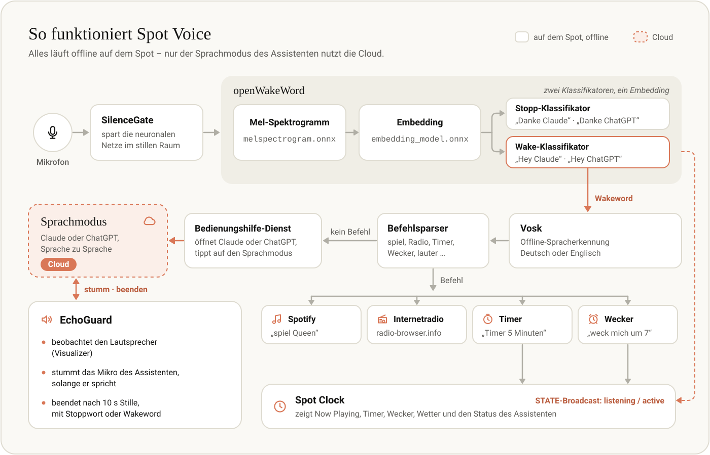
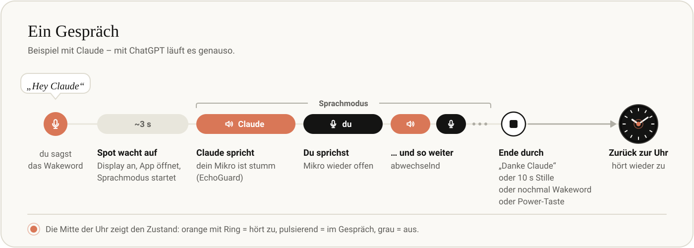
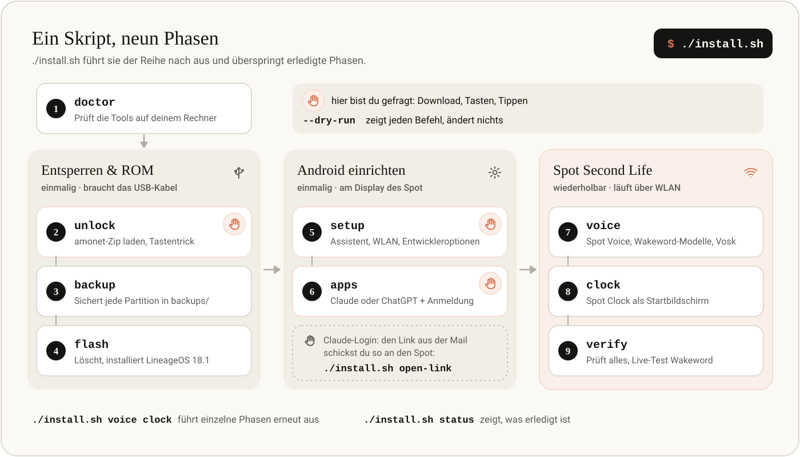

<sub>[English](../en/10-architecture.md) · **Deutsch**</sub>

# 10 · So funktioniert es

> **Ziel:** verstehen, wie die Teile zusammenspielen, damit du Fehler suchen, etwas erweitern oder mitmachen kannst · **Zeit:** etwa 20 Minuten Lesezeit · **Installer:** —

Dieses Kapitel ist für Neugierige und für Entwickler. Um den Spot zu benutzen, brauchst du es nicht.
Es beschreibt den Code so, wie er ist; die Verträge zwischen den Teilen stehen in [docs/SPEC.md](../SPEC.md) (englisch).

<p align="center">
  
</p>

<a id="the-big-picture"></a>

## Das große Ganze

| Teil | Ordner | Was es ist |
|---|---|---|
| **Spot Voice** | `apps/voice` | Android-App (Kotlin, Gradle), Paket `ai.pocket.heyclaude`. Hört auf das Wake-Word, führt Offline-Sprachbefehle aus, öffnet den Sprachmodus von Claude oder ChatGPT und begleitet das Gespräch. |
| **Spot Clock** | `apps/clock` | Android-App (Java 8, einfaches Build-Skript), Paket `ai.pocket.spotclock`. Startbildschirm, Bildschirmschoner, Timer und Wecker, Wetter, Musik-Anzeige. |
| **Installer** | `install.sh`, `scripts/` | Bash. Bringt den Spot in neun Phasen von Fire OS zur fertigen Installation. |
| **Training** | `training/` | Trainiert die Modelle für Wake-Word und Stoppwort auf einem Computer. |
| **Modelle** | `models/` | Trainierte `hey_<assistent>.onnx` und `danke_<assistent>.onnx` (CC BY-NC-SA 4.0). |

Was wo läuft:

- Auf dem Spot, **offline**: Wake-Word, Stoppwort, die Spracherkennung für Sprachbefehle, Timer und Wecker.
- **Online**, mit wenig Daten: die Suche nach Radiosendern (nur der gesprochene Name geht an radio-browser.info), das
  Wetter (nur die Koordinaten gehen an Open-Meteo), Spotify.
- **In der Cloud**: nur das Gespräch selbst, in der offiziellen App von Claude oder ChatGPT, nach dem Wake-Word.

## Spot Voice (`apps/voice`)

Paket `ai.pocket.heyclaude`, Name im Launcher „Spot Voice“, minSdk 26, targetSdk 30, nur `armeabi-v7a`.

| Datei | Aufgabe |
|---|---|
| `WakeWordService.kt` | Vordergrunddienst mit der Zuhör-Schleife |
| `wake/` | Portierung von openWakeWord: `SilenceGate`, `FeatureBuffer`, `OnnxFeatureModels`, `OpenWakeWordDetector` |
| `command/` | `VoiceCommands` (Vosk), `GermanParser` / `EnglishParser` → `Action`, `RadioBrowser`, `RadioService` |
| `launch/` | `AssistantLauncher` (öffnet die App), `VoiceModeA11yService` (tippt Buttons an, merkt das Verlassen), `LaunchState` |
| `EchoGuard.kt`, `MicMeter.kt` | halbduplexer Echo-Schutz und die Logik für das Gesprächsende |
| `Assistant.kt` | ein Profil pro Assistent: Paket, Beschriftungen, Namen, Modelldateien |
| `Prefs.kt` | Einstellungen (Assistent, Befehlssprache, Schwellen, Überschreibungen) in `shared_prefs/hey_claude.xml` |
| `MainActivity.kt` | Statusbildschirm: Start/Stopp, Wahl von Assistent und Sprache, Schwellen-Regler, Mikrofon-Test, Start-Test |
| `BootReceiver.kt`, `SettingsReceiver.kt` | Start nach dem Booten oder einem Update; speichern `SET_ASSISTANT` / `SET_LANG`, solange der Dienst nicht läuft |

<a id="wakewordservice-the-listening-loop"></a>

### WakeWordService: die Zuhör-Schleife

Ein Vordergrunddienst (Typ `microphone`) mit einem Partial Wake Lock. Sein Arbeits-Thread läuft in dieser Schleife:

1. Mikrofon öffnen: 16 kHz, mono, 16 Bit (`VOICE_RECOGNITION`, ersatzweise `MIC`).
2. Jeweils 1280 Samples (80 ms) lesen.
3. Das Fenster durch das `SilenceGate` schicken, dann an den Detektor, der einen Wert zwischen 0 und 1 liefert.
4. Nach jedem (Neu-)Start die ersten 12 Fenster (etwa 1 s) ignorieren.
5. Bleibt der Wert lange genug über der Schwelle (siehe [Auslöseregel](#auslöseregel)), das Mikrofon offen lassen und einen
   möglichen Sprachbefehl aufnehmen (`captureCommand`).
6. Entscheiden: ein Befehl → ausführen; mehr als zwei Wörter ohne Befehl → Fehlalarm, ignorieren; sonst → Mikrofon
   freigeben und den Assistenten öffnen. Der Zustand wird `PAUSED`.
7. Während `PAUSED` auf Stoppwort und Wake-Word hören (beide beenden das Gespräch) und EchoGuard laufen lassen.
8. Auf den Broadcast `RESUME` warten (kommt, wenn das Gespräch vorbei ist), höchstens 600 s, dann zurück zu Schritt 1.

Mikrofonfehler werden mit wachsender Wartezeit wiederholt, von 1 s bis 30 s. Ein Broadcast `SET_ASSISTANT` lässt den
Thread die Modelle verwerfen und für den neuen Assistenten neu laden, auch mitten in einem Gespräch.

### SilenceGate

Die neuronalen Netze kosten auf dem MT8163 Rechenzeit. `SilenceGate` berechnet für jedes Fenster nur den Pegel (RMS).
Solange es im Raum still ist, überspringt es die Netze. Beginnt ein Geräusch, spielt es die letzten 16 Fenster nach,
damit der Detektor warm ist und der Anfang des Wake-Words nicht verloren geht. Nach dem letzten Geräusch bleibt es etwa
3 s offen. Der Grundpegel passt sich an, ist aber gedeckelt: In einem lauten Raum (Fernseher, Musik) bleibt das Tor einfach offen.

<a id="openwakeword-pipeline"></a>

### Die openWakeWord-Pipeline

`FeatureBuffer` ist eine genaue Kotlin-Portierung des Streaming-Pfads von openWakeWord 0.6.0 und läuft mit ONNX Runtime:

| Schritt | Modell | Details |
|---|---|---|
| 1 | `melspectrogram.onnx` | die neuen 1280 Samples plus 480 Samples Vorlauf → Mel-Zeilen (32 Bänder), umgerechnet mit `x / 10 + 2`, angehängt an einen Puffer aus 76 Mel-Zeilen |
| 2 | `embedding_model.onnx` | die letzten 76 Mel-Zeilen → ein Embedding aus 96 Werten pro 80 ms |
| 3 | Klassifikator (`hey_claude.onnx` …) | die letzten 16 Embeddings (16 × 96) → Wert |

Der Wake-Klassifikator und der Stopp-Klassifikator **teilen sich** die Schritte 1 und 2: Während eines Gesprächs bewertet
das Stoppmodell (`danke_<assistent>.onnx`) dieselben Embeddings, es gibt also keinen zweiten Mel- oder Embedding-Durchlauf.
Der Wert bleibt 0, bis das Fenster nur echte Embeddings enthält.

Für den aktiven Assistenten wird das Modell in dieser Reihenfolge gesucht:

1. `/sdcard/Android/data/ai.pocket.heyclaude/files/hey_<assistent>.onnx` (vom Installer aufgespielt),
2. `assets/models/hey_<assistent>.onnx` in der APK,
3. `assets/models/alexa_v0.1.onnx`, das vortrainierte „Alexa“ von openWakeWord (nur Wake-Word).

Eine Datei, die da ist, sich aber nicht laden lässt, wird ins Log geschrieben und übersprungen. `apps/voice/tools/oww_reference.py`
vergleicht die Werte der App Fenster für Fenster mit dem offiziellen openWakeWord-Paket.

<a id="trigger-rule"></a>

### Auslöseregel

| | Wake-Word | Stoppwort (und Wake-Word während eines Gesprächs) |
|---|---|---|
| Wann | beim Warten auf das Wake-Word | nur während ein Gespräch läuft |
| Regel | Wert > Schwelle in **N Fenstern hintereinander** | Wert / eigene Schwelle > 1 in **2 Fenstern hintereinander** (ChatGPT: 3; `stopFrames` in `Assistant.kt`) |
| Standard vom Installer | Schwelle 0,6, N = 3 / 4 / 5 für `--sensitivity high / normal / low` | Stoppschwelle 0,5 |
| Eingebauter Standard (ohne Broadcast) | Schwelle 0,5, N = 4 | 0,5 |
| Nach einer Auslösung | Mikrofon für die Sitzung freigegeben | 4 s Pause |

Die Zahl der Fenster wirkt viel stärker als die Schwelle. Messwerte: [Kapitel 8](08-wakeword-training.md#empfindlichkeit-was-die-zahlen-auf-dem-spot-bedeuten).
Im laufenden Betrieb ändern: `SET_THRESHOLD --ef wake 0.6 --ef stop 0.5 --ei frames 4`.

<a id="after-the-wake-word-commands-with-vosk"></a>

### Nach dem Wake-Word: Befehle mit Vosk

`captureCommand` läuft, solange das Mikrofon noch offen ist:

1. Läuft Musik, wird sie pausiert, damit der Befehl verstanden wird.
2. Der Uhr `active` melden (ihre Mitte pulsiert) und einen kurzen Piepton spielen.
3. Das Audio an Vosk geben (`vosk-model-small-de-0.15` oder `vosk-model-small-en-us-0.15`, entpackt nach
   `files/vosk-de/` oder `files/vosk-en/`). Spricht innerhalb von 2 s niemand, kommt `""` zurück; nach spätestens 7 s ist Schluss.
4. Den Text mit `GermanParser` oder `EnglishParser` auswerten (dem `CommandParser` der Befehlssprache). Beide liefern dieselben
   `Action`s: abspielen/suchen, Radio, Radio aus, Pause, weiter, nächster, vorheriger, Lautstärke, Timer, Timer aus,
   Wecker, Wecker aus. Einzeln gesprochene Buchstaben und Ziffern werden zusammengezogen („s w r drei“ → „swr3“).
5. `VoiceCommands.execute` führt die Aktion aus: Medientasten für die Wiedergabe, ein Spotify-Intent „aus Suche abspielen“,
   `RadioService`, Lautstärkestufen oder ein Broadcast an Spot Clock für Timer und Wecker. Ein kurzer Bestätigungston heißt
   erledigt, ein tiefer Fehlerton heißt gescheitert.

Ohne Vosk-Modell sind die Sprachbefehle aus, und der Assistent öffnet sich direkt.

<a id="opening-the-assistant-assistantlauncher-and-voicemodea11yservice"></a>

### Den Assistenten öffnen: AssistantLauncher und VoiceModeA11yService

Einen offiziellen Direktlink in den Sprachmodus der Claude- oder ChatGPT-App gibt es nicht. Deshalb öffnet Spot Voice
die App und tippt den Button an, wie ein Mensch es tun würde, mit einer Bedienungshilfe.

1. `AssistantLauncher` weckt das Display (10 s Wake Lock), merkt sich ein ausstehendes Antippen und startet die App über ihren Launch-Intent.
2. `VoiceModeA11yService` wartet auf das Fenster der App und versucht es dann alle 400 ms (bis zu 8 Versuche innerhalb von 15 s):
   - Ist der Sprachmodus schon offen (ein Button zum Stummschalten oder Aufheben ist zu sehen), übernimmt er die Sitzung und hebt die Stummschaltung bei Bedarf auf.
   - Sonst bewertet er alle Knoten gegen den Regex für den Sprachmodus-Button aus dem Profil: Eine passende
     Inhaltsbeschreibung schlägt eine View-ID, die schlägt einen kurzen Text; sichtbare und anklickbare Knoten gewinnen;
     Knoten, die zum Ausschluss-Regex passen (Diktat, Vorlesen, Stummschalten …), werden nie angetippt.
   - Er klickt den Knoten an (oder einen anklickbaren Elternknoten bis zu 6 Ebenen darüber) oder tippt per Geste auf dessen Mitte.
   - Passt nichts, versucht er einmal den Button „neuer Chat“ und bekommt 4 weitere Versuche. Die Kandidaten landen im Log.
3. Er merkt, wenn der Assistent den Vordergrund verlässt (1,5 s Entprellung) oder das Display ausgeht. Dann löst er die
   Beenden-Aktion in der laufenden Benachrichtigung des Assistenten aus, falls er eine gesehen hat, und sendet `RESUME`.
4. Er bietet EchoGuard drei Helfer: das Mikrofon des Assistenten stummschalten und wieder freigeben, den Beenden-Button
   drücken, die sichtbaren Texte lesen.

Alle Beschriftungen stammen aus dem Profil `Assistant`. `DUMP_NODES` schreibt den ganzen Bedienungshilfe-Baum ins Log.

### EchoGuard

Das ROM hat keine akustische Echo-Unterdrückung, die Assistenten-Apps nehmen mit `VOICE_RECOGNITION` auf, und die Audio-HAL
des Spot ignoriert die Stummschaltung des Mikrofons durch das System. Im freihändigen Modus würde der Assistent sich selbst
hören und sich unterbrechen. EchoGuard läuft, solange der Zustand `PAUSED` ist:

| Aufgabe | Wie |
|---|---|
| Spricht der Assistent? | `Visualizer` auf dem Ausgabe-Mix (Session 0), Peak/RMS-Modus, alle 50 ms abgefragt. Lauter als −5500 mB = spricht. Ohne Visualizer ersatzweise `isMusicActive`. |
| Halbduplex | Während er spricht, den Stummschalt-Button der App antippen („Mikrofon stummschalten“); 700 ms nachdem er aufhört, die Stummschaltung aufheben. Eine Stummschaltung, die du selbst gesetzt hast, wird nie zurückgenommen. |
| Spricht der Nutzer? | `MicMeter` misst den Pegel im Raum in Fenstern von 20 ms (nur Pegel, nichts wird gespeichert). Liefert Android dabei nur Stille, wird stattdessen das Transkript benutzt. |
| Abschiedsformel | Etwa alle 500 ms werden neue Bildschirmtexte des Assistenten mit den Abschiedsformeln des Profils verglichen („danke Claude“, „thank you ChatGPT“, „Claude stopp“ …). |
| Stille | 10 s ohne Assistent, Nutzer oder neuen Transkripttext → Ende. 30 s, solange der Assistent noch auf deine letzte Frage antwortet. |
| Ende | Stummschaltung aufheben, den Beenden-Button drücken (Regex `endButton`). Gibt es keinen, zum Startbildschirm gehen. |
| Zurück zur Uhr | Ist der Sprachmodus-Bildschirm etwa 1,5 s weg → zum Startbildschirm. Die Bedienungshilfe sieht die App gehen und sendet `RESUME`. |

<p align="center">
  
</p>

### RadioService

Ein Vordergrunddienst (Typ `mediaPlayback`) mit einem `MediaPlayer` und einer `MediaSession`. Weil er eine Mediensitzung hat,
funktionieren die Medientasten (Pause, weiter) wie bei Spotify, und Spot Clock zeigt Sendername und Logo in ihrer
Musik-Anzeige. `RadioBrowser` sucht bei radio-browser.info nach dem Namen (zuerst im Land der Befehlssprache, dann weltweit).
„spiel X“ spielt nur einen Sender, dessen Name genau passt und der mindestens 20 Stimmen hat; sonst sucht Spotify nach X.

### Broadcasts

Alle Broadcasts nennen das Zielpaket. Von Spot Voice gesendet:

| Broadcast | An | Extras | Bedeutung |
|---|---|---|---|
| `ai.pocket.heyclaude.STATE` | `ai.pocket.spotclock` | `state` = `off` / `listening` / `active`, `assistant` = Anzeigename | Mitte der Uhr |
| `ai.pocket.spotclock.TIMER` | `ai.pocket.spotclock` | `seconds` (long, 0 = abbrechen) | Timer |
| `ai.pocket.spotclock.ALARM` | `ai.pocket.spotclock` | `hour`, `minute` (int, `hour -1` = abbrechen) | Wecker |
| `ai.pocket.spotclock.STOP_RINGING` | `ai.pocket.spotclock` | keine | klingelnden Timer oder Wecker stoppen |

Von Spot Voice empfangen (`adb shell am broadcast -p ai.pocket.heyclaude -a ai.pocket.heyclaude.<ACTION> …`):

| Action | Extras | Wirkung |
|---|---|---|
| `SET_ASSISTANT` | `--es assistant claude\|chatgpt` | Assistent wechseln, Wake- und Stoppmodell neu laden |
| `SET_LANG` | `--es lang de\|en` | Befehlssprache wechseln, `vosk-<lang>` laden |
| `SET_THRESHOLD` | `--ef wake 0.6 --ef stop 0.5 --ei frames 4` | Erkennungsschwellen und Zahl der Fenster |
| `COMMAND` | `--es text "…"` | einen Sprachbefehl auswerten und ausführen, als wäre er gesprochen |
| `RESUME` | – | wieder auf das Wake-Word hören |
| `QUERY_STATE` | – | `STATE` noch einmal an die Uhr schicken (die Uhr fragt das beim Start) |
| `MIC_MUTE` | `--ez on true\|false` | den Stummschalt-Button des Assistenten drücken (Test für EchoGuard) |
| `LEVEL_LOG` | `--ez on true\|false` | Pegel von Mikrofon und Lautsprecher ins Log schreiben |
| `DUMP_NODES` | – | den Bedienungshilfe-Baum aller Fenster ins Log schreiben |

Eine Sitzung ohne Sprechen starten:
`adb shell am start-foreground-service -n ai.pocket.heyclaude/.WakeWordService -a ai.pocket.heyclaude.TRIGGER_NOW`.

## Spot Clock (`apps/clock`)

Paket `ai.pocket.spotclock`, Name „Spot Clock“ (auf Deutsch „Spot-Uhr“). Sie ist Startbildschirm und Bildschirmschoner.

| Klasse | Aufgabe |
|---|---|
| `ClockView` | zeichnet jedes Zifferblatt in einem Koordinatenraum von 480 Einheiten: Tagesansicht mit vier Anzeigen (Sonne, Wetter, Regenring, Datum mit Mond), Nachtansicht, Musik-Anzeige, Ring für Timer und Wecker, Klingeln. Mitte = Zustand des Assistenten (grau aus, orange mit Ring hört zu, pulsierend aktiv). Meldet den Empfänger für `STATE` an, solange sie sichtbar ist, und sendet `QUERY_STATE`. |
| Lichtsensor (in `ClockView`) | Raumlicht in vier Stufen (Grenzen 4, 30, 250 Lux) → Display-Helligkeit 5 %, 25 %, 60 % oder die Systemeinstellung. Die dunkelste Stufe zeigt die Nachtansicht. Ohne Lichtsensor: Nachtansicht von 22:00 bis 07:00. |
| `Weather` | Vorhersage von Open-Meteo (ohne Schlüssel) für die gespeicherten Koordinaten; höchstens alle 15 Minuten, neuer Versuch nach 60 s, zwischengespeichert für Neustarts. WMO-Wettercode → Text und Symbol. Kein voreingestellter Ort. |
| `Moon` | Mondphase aus einem Bezugs-Neumond (2000-01-06 18:14 UTC) und dem mittleren synodischen Monat. |
| `NowPlayingService`, `NowPlaying` | ein Benachrichtigungs-Listener, weil Android das verlangt, um Mediensitzungen anderer Apps zu lesen. Liest nur Titel, Interpret, Cover und Position; Benachrichtigungen werden ignoriert. Die Anzeige bleibt nach einer Pause 20 s stehen. |
| `Timers`, `RingService` | ein Timer und ein Wecker, per Broadcast gesetzt, ausgelöst über `AlarmManager` (exakt, auch im Ruhezustand erlaubt). `RingService` spielt den Standard-Weckton höchstens 2 Minuten und holt die Uhr nach vorn. |
| `ClockDream` | dasselbe Zifferblatt als `DreamService` (Bildschirmschoner). |
| `ClockActivity` | die Uhr als Activity (Startbildschirm oder App), übernimmt den Ort (`--es lat --es lon --es place`), setzt die Helligkeit. Ein Tippen stoppt das Klingeln, öffnet die App-Liste (als Startbildschirm) oder schließt die Uhr (als App). |
| `AppsActivity` | App-Liste im Stil der Uhr; Favoriten zuerst (Claude, ChatGPT, Spotify, Spot Voice, Aurora, Einstellungen), Button „Zur Uhr“. |

Die Texte stehen in `res/values` (englisch) und `res/values-de` (deutsch) und folgen der Systemsprache; Uhrzeiten sind immer im 24-Stunden-Format.

<a id="the-installer-installsh"></a>

## Der Installer (`install.sh`)

<p align="center">
  
</p>

```
install.sh                  Einstieg: Optionen, Phasentabelle, Reihenfolge, Befehle
scripts/lib.sh              gemeinsame Helfer (Ausgabe, Fragen, adb-/fastboot-Wrapper, Downloads, Zustand)
scripts/doctor.sh           phase_doctor     ┐
scripts/unlock.sh           phase_unlock     │
scripts/backup.sh           phase_backup     │
scripts/flash.sh            phase_flash      │ eine Datei pro Phase,
scripts/setup.sh            phase_setup      │ jede definiert phase_<name>
scripts/apps.sh             phase_apps       │
scripts/voice.sh            phase_voice      │
scripts/clock.sh            phase_clock      │
scripts/verify.sh           phase_verify     ┘
scripts/build-apps.sh       build_apps (./install.sh build, --from-source)
scripts/reference/          unlock-rook-tested.sh, das auf dem Gerät getestete Entsperr-Skript
```

So läuft ein Durchgang ab:

1. `install.sh` findet das Repository über seinen eigenen Pfad (es funktioniert aus jedem Ordner) und lädt `lib.sh` und alle Phasendateien.
   Startest du eine Phasendatei direkt (`bash scripts/voice.sh`), läuft `./install.sh voice`.
2. Es liest `.state/config.env`, wendet die Optionen an und fragt nach fehlenden Werten (Sprache, Assistent, Wetter-Ort).
3. Die Phasen laufen in ihrer festen Reihenfolge. Ohne Phasen auf der Befehlszeile werden erledigte Phasen übersprungen, und
   vor jeder fragt der Installer `Phase "X" jetzt ausführen? [J/n/skip]`. Phasen, die du ausdrücklich nennst, laufen immer, ohne diese Frage.
4. Eine erfolgreiche Phase wird in `.state/done/<phase>` vermerkt. Eine fehlgeschlagene Phase hält den Durchgang an und zeigt,
   wie du sie noch einmal startest.

| Thema | Wie es gelöst ist |
|---|---|
| Zustand | `.state/config.env` enthält `ASSISTANT`, `LANG`, `PLACE`, `LAT`, `LON`, `DEVICE`, `SPOTIFY`, `TZ`, `SENSITIVITY` als `KEY="value"`. Die Datei wird Zeile für Zeile in `CFG_*`-Variablen gelesen, nie per `source` (so überschreiben `LANG` und `TZ` nie die Umgebung). `ESL_STATE_DIR` verlegt den Ordner. |
| Probelauf | Jede Aktion an Gerät, Netzwerk oder Build läuft über wenige Wrapper (`adbx`, `adb_q`, `adb_t`, `fb_t`, `run`, `download`). Mit `--dry-run` schreiben sie `+ befehl` und liefern Platzhalter zurück. Ein Probelauf berührt kein Gerät, lädt nichts herunter und schreibt keinen Zustand. |
| Sprachen | Jede Meldung gibt es auf Englisch und Deutsch: `L "English" "Deutsch"`. `--lang` wählt aus. |
| Sicherheit | Entsperren und Flashen verlangen ein getipptes `YES`/`JA` (`--yes` allein bestätigt sie nie). Rein lesende Vorprüfungen vor dem Entsperren und dem Flashen. `guard_write` verweigert jedes Schreiben auf ein Blockgerät und jedes flash, erase, format oder wipe, das `preloader`, `lk`, `tee` oder `boot0`/`boot1` nennt. Bedienungshilfe und Benachrichtigungszugriff erst nach `[j/N]`. `open-link` liest den Link verdeckt ein, gibt ihn per stdin an den Spot und speichert ihn nie. |
| Downloads | nach `downloads/`, per sha256 geprüft, wiederverwendet, wenn schon vorhanden, bei falscher Prüfsumme in `.bad` umbenannt. |
| Portabilität | bash 3.2 (Standard auf macOS): keine assoziativen Arrays, kein `mapfile`, kein `${var,,}`, `"${arr[@]+…}"` für leere Arrays. Ein eingebauter Ersatz, wenn GNU `timeout` fehlt. |

Ausschnitt aus einem echten Probelauf (`./install.sh --dry-run --yes --lang de --assistant claude --place Berlin --sensitivity low voice`):

```
==> Assistent, Sprache und Schwellen einstellen
+ adb shell am broadcast -a ai.pocket.heyclaude.SET_ASSISTANT -p ai.pocket.heyclaude --es assistant claude
+ adb shell am broadcast -a ai.pocket.heyclaude.SET_LANG -p ai.pocket.heyclaude --es lang de
+ adb shell am broadcast -a ai.pocket.heyclaude.SET_THRESHOLD -p ai.pocket.heyclaude --ef wake 0.6 --ef stop 0.5 --ei frames 5
[ok] Assistent=claude, Sprache=de, wake=0.6/5 Fenster (low), stop=0.5
+ adb shell am start-foreground-service -n ai.pocket.heyclaude/.WakeWordService
[ok] Spot Voice hört zu.
```

<a id="training-pipeline-training"></a>

## Trainings-Pipeline (`training/`)

`train.sh` erledigt alles mit einem Befehl; wie du es benutzt, steht in [Kapitel 8](08-wakeword-training.md).

| Teil | Aufgabe |
|---|---|
| `setup.sh` | uv-Umgebung mit Python 3.11 und genau den getesteten Versionen (`constraints.txt`); klont openWakeWord und piper-sample-generator auf festen Commits; spielt `patches/` ein; lädt Stimmen und Merkmalsmodelle (sha256). Darf beliebig oft laufen. |
| `patches/` | openWakeWord `data.py`: kein DeepPhonemizer (dessen Download gibt es nicht mehr), Aussprache aus der Wortdatei. `train.py`: DataLoader ohne Worker-Prozesse (macOS), kein versehentlicher TFLite-Export. |
| `piper_shim/` | lässt `train.py` von openWakeWord piper-sample-generator v3 mit einer englischen (904 Sprecher) und einer deutschen Stimme (236 Sprecher) benutzen; `german_words` entscheidet, welche Stimme einen Ausdruck liest. |
| `fetch_features.py`, `prep_data.py` | zwei je 4 GB große Teile der ACAV100M-Negativmerkmale per HTTP-Range-Requests; Raumimpulsantworten und Musik zum Verfremden. |
| `make_configs.py` | eine Konfiguration pro Modell aus der Wortdatei; löscht veraltete Clips und Merkmale. |
| `evaluate.py` | rechnet Mel → Embedding → Klassifikator genau wie die App und meldet Trefferquote, Verwechsler und Fehlalarme pro Stunde. |

<a id="build-and-signing"></a>

## Bauen und Signieren

| | Spot Voice | Spot Clock |
|---|---|---|
| Build | Gradle 8.10.2, Android Gradle Plugin 8.7.3, Kotlin 2.0.21, JDK 17 | `apps/clock/build.sh`: aapt2 → javac → d8 → zipalign → apksigner, ohne Gradle |
| Befehl | `cd apps/voice && ./gradlew testDebugUnitTest assembleRelease` | `cd apps/clock && VERSION_CODE=10 VERSION_NAME=1.0.0 bash build.sh` |
| Ergebnis | `app/build/outputs/apk/release/app-release.apk` | `build/spot-clock.apk` |
| Hinweise | Der erste Build lädt `melspectrogram.onnx`, `embedding_model.onnx`, `hey_jarvis_v0.1.onnx` und `alexa_v0.1.onnx` von openWakeWord nach `assets/models/` (CC BY-NC-SA 4.0, nicht eingecheckt). Abhängigkeiten: ONNX Runtime Android 1.20.0, Vosk Android 0.3.75. | Java-8-Syntax und **keine Lambdas oder Methodenreferenzen**: kompiliert mit javac gegen `android.jar`, dem mit dieser Toolchain `LambdaMetafactory` fehlt. Nimm anonyme Klassen. |

`./install.sh build` (oder `scripts/build-apps.sh`) baut beide nach `dist/spot-voice.apk`, `dist/spot-clock.apk` und
`dist/SHA256SUMS`. `--from-source` nimmt diese statt des Release-Downloads. Du brauchst JDK 17 oder neuer und das Android SDK
mit den Plattformen android-34 und android-30 sowie den build-tools.

**Signieren.** Sind alle vier Variablen `ESL_KEYSTORE`, `ESL_KEYSTORE_PASS`, `ESL_KEY_ALIAS` und `ESL_KEY_PASS` gesetzt,
signieren beide Builds mit diesem Schlüssel, sonst mit dem lokalen Debug-Schlüssel. Die Release-APKs auf GitHub
(`spot-voice.apk`, `spot-clock.apk`, `SHA256SUMS`) sind mit dem Release-Schlüssel des Projekts signiert. So prüfst du einen Download:

```bash
apksigner verify --print-certs spot-voice.apk
```

Die Zeile `Signer #1 certificate SHA-256 digest` muss
`4804b0ebd063a5828a38325adda7e893c506fe19c8c8e9964b46afdcdbb4a40e` lauten
(dasselbe wie `48:04:B0:EB:D0:63:A5:82:8A:38:32:5A:DD:A7:E8:93:C5:06:FE:19:C8:C8:E9:96:4B:46:AF:DC:DB:B4:A4:0E`).

> [!NOTE]
> Android aktualisiert eine App nur mit derselben Signatur. Wechselst du zwischen der Release-APK und einer selbst gebauten
> (Debug-Schlüssel), muss die App vorher deinstalliert werden. Der Installer bietet das an, aber die Einstellungen der App und
> ihre Bedienungshilfe-Freigabe gehen verloren und müssen neu gesetzt werden (`./install.sh voice` erledigt das).

<a id="android-11-constraints-and-how-we-deal-with-them"></a>

## Grenzen von Android 11 und wie wir damit umgehen

| Grenze | Was sie hier bedeutet | Was der Code tut |
|---|---|---|
| Sichtbarkeit von Paketen (Android 11) | Eine App kann andere Apps, die sie nicht angemeldet hat, weder sehen noch starten. | Spot Voice meldet `com.anthropic.claude` und `com.openai.chatgpt` in `<queries>` an. Spot Clock meldet den Launcher-Intent an, damit ihre App-Liste alle Apps zeigen kann. |
| Activity-Starts aus dem Hintergrund (ab Android 10) | Ein Dienst kann nicht einfach eine App nach vorn holen. | Erlaubt, weil Spot Voice eine gebundene Bedienungshilfe hat. Der Installer erteilt außerdem „Über anderen Apps einblenden“ (`appops set … SYSTEM_ALERT_WINDOW allow`). |
| Gerät mit wenig RAM (`ro.config.low_ram=true`) | Auf solchen Geräten bietet Android den Schalter „Über anderen Apps einblenden“ in den Einstellungen nicht an. | Der Installer setzt ihn per `appops` über adb; der Start per Wake-Word hängt nicht davon ab. |
| Mikrofon im Hintergrund (Android 11, „nur während der Nutzung“) | Ein aus dem Hintergrund gestarteter Mikrofondienst bekommt unter Umständen nur Stille. | Vordergrunddienst vom Typ `microphone`. Nach dem Booten startet `BootReceiver` den Dienst über `MainActivity`, wenn er Activities starten darf, sonst direkt. Die App warnt mit „Mikrofon liefert nur Stille“. |
| Implizite Broadcasts (ab Android 8) | Empfänger aus dem Manifest bekommen keine Broadcasts ohne Paketangabe. | Jeder Broadcast nennt sein Paket (`-p` auf der Befehlszeile, `setPackage` im Code). |
| Doze | Arbeit im Hintergrund wird gedrosselt. | Der Installer setzt Spot Voice auf die `deviceidle`-Ausnahmeliste; der Dienst hält einen Partial Wake Lock. |
| Nur 32 Bit (`armeabi-v7a`) | Apps, die es nur in 64 Bit gibt, laufen nicht. | Spot Voice gibt es nur als `armeabi-v7a`; der Aurora-Notweg warnt, wenn eine App keinen `armeabi-v7a`-Split hat. |
| Keine akustische Echo-Unterdrückung; System-Stummschaltung des Mikrofons wird ignoriert | Der Assistent hört sich selbst. | EchoGuard tippt den eigenen Stummschalt-Button der App an. |

<a id="add-another-assistant"></a>

## Einen weiteren Assistenten hinzufügen

1. Die App auf dem Spot installieren und ihre Beschriftungen herausfinden: `DUMP_NODES` einmal im Chat-Bildschirm und einmal
   im Sprachmodus ausführen (siehe [Sprachmodus-Button wird nicht gefunden](09-troubleshooting.md#sprachmodus-button-wird-nicht-gefunden)).
2. Einen Eintrag im Enum `Assistant` in `apps/voice/app/src/main/java/ai/pocket/heyclaude/Assistant.kt` anlegen:
   `id` (kleingeschrieben; wird in Einstellungen, Broadcasts und Modelldateinamen benutzt), `displayName`, `packageName` und die Regexe
   `voiceButton`, `voiceButtonExclude`, `newChatButton`, `micMuteLabel`, `micUnmuteLabel`, `endButton`,
   `endNotificationAction` und `nameRegex` (wie das Transkript der App den Namen schreibt, für die Abschiedsformeln).
3. Das Paket in `<queries>` in `apps/voice/app/src/main/AndroidManifest.xml` eintragen.
4. JVM-Tests in `AssistantTest.kt` ergänzen: Beschriftungen, die passen müssen, und solche, die nicht passen dürfen (Diktat darf
   nie zum Sprachmodus-Button passen). `./gradlew testDebugUnitTest` ausführen.
5. Die Modelle trainieren: eine Wortdatei mit den Modellen `hey_<id>` und `danke_<id>`
   ([Kapitel 8](08-wakeword-training.md#so-funktioniert-eine-wortdatei)); die Ergebnisse nach `models/` legen.
6. Dem Installer die neue ID beibringen: `assistant_label`, `assistant_pkg`, `assistant_wake_model` und
   `assistant_stop_model` in `scripts/lib.sh`, außerdem die Prüfungen auf `claude|chatgpt` und die Hilfetexte in `install.sh`.
7. Optional: das Paket zu den Favoriten in `apps/clock/src/ai/pocket/spotclock/AppsActivity.java` hinzufügen.
8. Auf einem echten Spot bauen und testen: `./install.sh apps voice --assistant <id> --from-source`, dann `./install.sh verify`.

Die Auswahl des Assistenten in der App Spot Voice und der Broadcast `SET_ASSISTANT` nutzen das Enum, dort ist also nichts zu ändern.

<a id="contributing"></a>

## Mitmachen

- Lies zuerst [docs/SPEC.md](../SPEC.md); dort sind die Verträge zwischen Installer, Apps und Doku festgelegt.
- **Shell:** bash-3.2-kompatibel und shellcheck-sauber bleiben, jede Aktion an Gerät oder Netzwerk über die Wrapper in
  `lib.sh` laufen lassen, damit `./install.sh --dry-run --yes` ohne Gerät weiter funktioniert, und jede Meldung in beiden
  Sprachen mit `L "…" "…"` schreiben.
- **Spot Voice:** die JVM-Tests ausführen (`./gradlew testDebugUnitTest`). Die Claude-Beschriftungen sind durch einen Test
  festgeschrieben, weil sie auf einem echten Spot abgestimmt wurden; ändere sie nur nach einem neuen Test mit `DUMP_NODES`.
- **Spot Clock:** Java 8, keine Lambdas, jeder sichtbare Text in `res/values` und `res/values-de`.
- **Doku:** `docs/en` und `docs/de` haben dieselben Dateien und denselben Aufbau. Screenshots dürfen keine privaten Chat-Inhalte zeigen.
- **Datenschutz:** nie `.state/`, `downloads/`, `backups/`, Keystores, WLAN-Daten, Seriennummern oder echte IP-Adressen
  einchecken (`.gitignore` deckt die Ordner ab).
- **Ehrlichkeit:** Sag, was du auf einem echten Spot getestet hast und was nicht.

<a id="what-the-installer-does-for-you"></a>

## Was der Installer für dich erledigt

Welche Phase welchen Teil einrichtet:

| Phase | Teile |
|---|---|
| `setup` | Sprache und Zeitzone, Anzeigedichte 120, Display aus nach 60 s, Aurora Store, adb über WLAN |
| `apps` | Claude oder ChatGPT (und Spotify) über Aurora, mit dem Split-APK-Notweg; Hilfe bei der Anmeldung |
| `voice` | installiert Spot Voice; Mikrofon-Recht; `appops SYSTEM_ALERT_WINDOW`; `deviceidle`-Ausnahmeliste; startet `WakeWordService`; kopiert `hey_/danke_<assistent>.onnx` und das Vosk-Modell; Bedienungshilfe nach `[j/N]`; sendet `SET_ASSISTANT`, `SET_LANG`, `SET_THRESHOLD` |
| `clock` | installiert Spot Clock; Benachrichtigungszugriff nach `[j/N]`; Startbildschirm; Einstellungen für den Bildschirmschoner; sucht den Wetter-Ort und startet `ClockActivity` mit `lat`, `lon`, `place` |
| `verify` | prüft alles oben Genannte und macht einen Live-Test |
| `build` / `--from-source` | baut beide Apps aus diesem Repository |
| `train` | startet `training/train.sh` |

<a id="check"></a>

## Prüfen

Jeden Teil kannst du einzeln prüfen (Spot per adb verbunden):

```bash
# der Zuhör-Dienst läuft
adb shell dumpsys activity services ai.pocket.heyclaude | grep WakeWordService
# eine Sitzung ohne Sprechen starten und das Log mitlesen
adb shell am start-foreground-service -n ai.pocket.heyclaude/.WakeWordService -a ai.pocket.heyclaude.TRIGGER_NOW
adb logcat -s HeyClaude OpenWakeWord
# die Mitte der Uhr: kurz pulsieren lassen
adb shell am broadcast -a ai.pocket.heyclaude.STATE -p ai.pocket.spotclock --es state active --es assistant Claude
# ein Timer über 10 Minuten auf der Uhr, dann wieder abbrechen
adb shell am broadcast -a ai.pocket.spotclock.TIMER -p ai.pocket.spotclock --el seconds 600
adb shell am broadcast -a ai.pocket.spotclock.TIMER -p ai.pocket.spotclock --el seconds 0
```

Nach dem Test mit `STATE` sorgt `adb shell am broadcast -a ai.pocket.heyclaude.QUERY_STATE -p ai.pocket.heyclaude` dafür, dass
Spot Voice seinen echten Zustand wieder schickt. Oder alles auf einmal: `./install.sh verify`.

<a id="if-something-goes-wrong"></a>

## Wenn etwas schiefgeht

- Logs und was sie bedeuten: [Logs sammeln](09-troubleshooting.md#logs-sammeln).
- Das automatische Antippen findet den Button nicht: [Sprachmodus-Button wird nicht gefunden](09-troubleshooting.md#sprachmodus-button-wird-nicht-gefunden).
- Der Assistent hört sich selbst: [Der Assistent unterbricht sich selbst](09-troubleshooting.md#der-assistent-unterbricht-sich-selbst).
- Das Bauen der Apps scheitert: Die Build-Skripte melden, was fehlt (JDK 17, Android-SDK-Plattformen 34 und 30,
  build-tools); `./install.sh build` erklärt, wie du sie installierst.
- Alles andere: [9 · Fehlerbehebung und FAQ](09-troubleshooting.md).

---
[← 9 · Fehlerbehebung und FAQ](09-troubleshooting.md) · [Übersicht](../../README.de.md)
