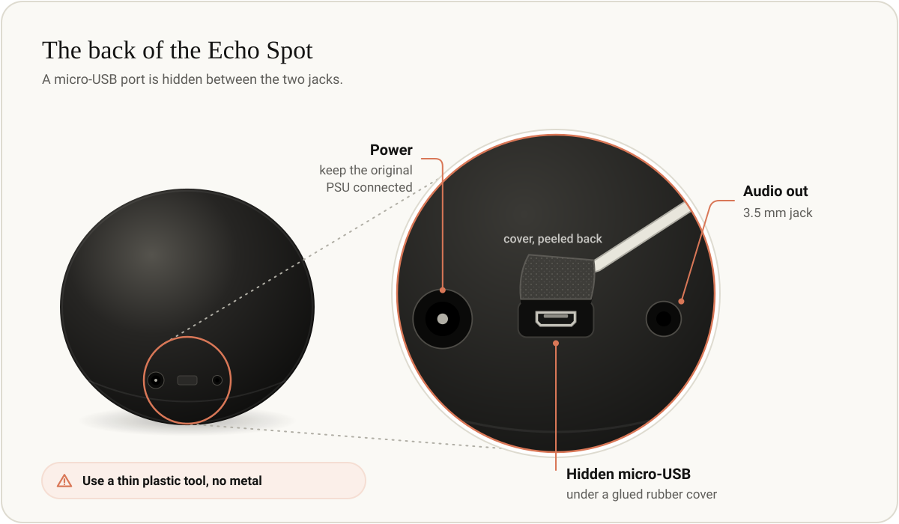
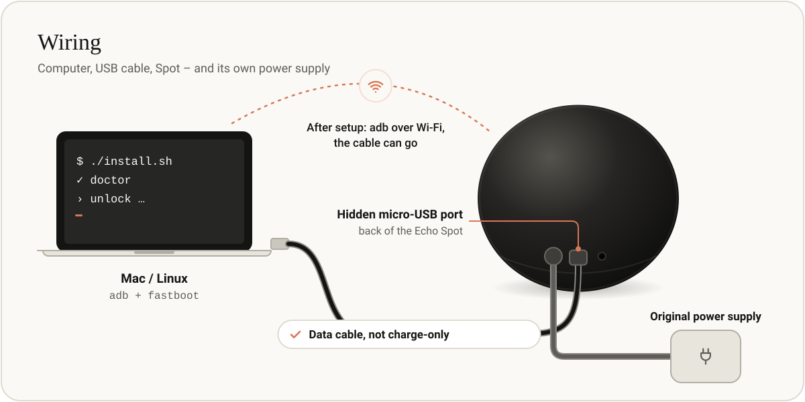

<sub>**English** · [Deutsch](../de/01-hardware.md)</sub>

# 1 · Hardware and what you need

> **Goal:** make sure you have the right Echo Spot, find its hidden USB port, and get your computer ready · **Time:** about 15 minutes (plus installing tools) · **Installer:** `./install.sh doctor`

This chapter changes nothing on the Spot. You check the model, open a small cover on the back, pick the right cable
and let the installer check your computer.

## Is this the right Echo Spot?

Only the **first generation** of the Echo Spot works. Its internal codename is `rook`.

| | Echo Spot 1st generation (2017/2018) | Echo Spot 2nd generation (2024) |
|---|---|---|
| Shape | ball-shaped | different housing |
| Screen | fully **round** | **half-round** |
| Camera | yes, above the screen | **no camera** |
| Works with this project | **yes** | no |

If you are not sure, go ahead anyway: in [chapter 2](02-unlock.md) the installer asks the Spot for its product
name before it writes anything. If the answer is not `ROOK`, it stops and nothing is changed.

> [!NOTE]
> The installer was tested with **Fire OS 5.5.6.9**. It reads the bootloader version in fastboot mode
> (`lk_build_desc` = `c1c79aa-20220824_171625`) and stops before writing anything if it finds a different one.

## What you need

| Item | Notes |
|---|---|
| Echo Spot, 1st generation | See the table above. |
| Its original power supply | The one with the round plug that came with the Spot. It must stay connected the whole time, even while the USB cable is plugged in. |
| A micro-USB **data** cable | Micro-USB, not USB-C. It must carry data, not only power. See [Data cable or charge-only cable?](#data-cable-or-charge-only-cable) |
| A thin plastic tool | A guitar pick or a plastic pry tool, to lift the cover over the USB port. A fingernail can work too. |
| A Mac or Linux computer | With about 5 GB of free disk space. macOS is tested; Linux should work but is untested. Windows is not supported by `install.sh`. |
| Wi-Fi | The Spot needs it from [chapter 4](04-setup.md) on. |
| A free XDA forum account | To download the unlock tool in [chapter 2](02-unlock.md). |
| A Claude or ChatGPT account | For the voice assistant in [chapter 5](05-voice-assistant.md). A Spotify account is optional. |

## The hidden USB port

The Echo Spot has a micro-USB port that Amazon hid under a small glued rubber cover on the back. It sits **between
the round power socket and the 3.5 mm audio socket**. Everything in chapters 2 and 3 runs through this port: it is
the only way your computer can talk to the Spot before Android is installed.

<p align="center">
  
</p>

To open the cover safely:

1. Unplug the power supply. Lay the Spot face down on a soft cloth so the screen does not get scratched.
2. Find the small rubber cover between the power socket and the audio socket.
3. Lift one edge of the cover with a fingernail or a thin plastic tool. **Do not use metal.** A screwdriver or a
   knife can slip, scratch the housing or bend the contacts in the port.
4. Peel the cover off slowly. The glue gives way; you do not need force.
5. Look into the opening: you should see a micro-USB socket.
6. Keep the cover. You can press it back on when you are done with the cable. After setup the Spot works over
   Wi-Fi ([chapter 4](04-setup.md)), so you only need the port again in rare cases.

## Wiring

<p align="center">
  
</p>

Two cables go into the Spot:

- the **original power supply** into the round power socket, and
- the **micro-USB data cable** from the hidden port **directly** to your computer.

The power supply stays connected during every step; do not count on the USB cable to power the Spot. When a step
says "unplug the power", it means the power supply. The USB cable can stay in.

## Data cable or charge-only cable?

Many micro-USB cables, especially the ones that came with lamps, power banks or toys, only have the two wires for
power. With such a cable the Spot gets nothing from your computer, and the installer waits forever for a device.

How to tell:

1. If you have an Android phone or another gadget with micro-USB, connect it to your computer with the cable.
   If the computer notices it (a file transfer prompt, a new drive, or the phone asks what to do with USB), the
   cable carries data.
2. The real test comes in [chapter 2](02-unlock.md): when the Spot is in fastboot mode, `fastboot devices` must
   list it. If the list stays empty, try another cable first.

> [!TIP]
> Keep the cable you know works with a small piece of tape on it. You will need it again if you ever restore the backup.

## USB hubs, docks and adapters

Plug the cable **directly into a port of your computer**. USB hubs, docks and the USB ports of monitors often cause
dropped connections or devices that do not show up. During the unlock this matters most: the exploit depends on a
clean USB connection, and a short drop can cost you a try.

If your Mac only has USB-C ports, use a simple USB-C to micro-USB data cable or a small single-port USB-C to USB-A
adapter. Avoid multi-port hubs.

## Your computer

`./install.sh` runs on **macOS** (tested, also with the old default bash 3.2) and on **Linux** (should work, but
untested). Windows is not supported by the installer. The unlock tool amonet ships its own Windows scripts, but
everything after the unlock would have to be done by hand.

The installer needs these tools. The `doctor` phase checks them and offers to install `adb` and `fastboot` for you.

| Tool | Needed for | macOS | Debian / Ubuntu |
|---|---|---|---|
| `adb`, `fastboot` | talking to the Spot | `brew install android-platform-tools` | `sudo apt install adb fastboot` |
| `curl` | downloads | preinstalled | `sudo apt install curl` |
| `unzip` | unpacking the unlock tool and the speech model | preinstalled | `sudo apt install unzip` |
| `python3` | small helpers | preinstalled (if it does not work: `xcode-select --install`) | `sudo apt install python3` |
| `shasum` or `sha256sum` | checking downloads | preinstalled | preinstalled |

Optional tools, which `doctor` reports but does not require:

| Tool | What it adds | macOS |
|---|---|---|
| `gtimeout` / `timeout` | time limits for commands (the installer has its own fallback) | `brew install coreutils` |
| `apksigner` | checks the signing certificate of Aurora Store, and is needed for an install fallback in [chapter 5](05-voice-assistant.md) | part of the Android SDK build-tools |
| `scrcpy` | shows the Spot's screen on your computer, with a real keyboard for logins | `brew install scrcpy` |

On macOS you need [Homebrew](https://brew.sh) for the `brew` commands. Install it first if you do not have it.

On Linux, if `adb` later says "no permissions", install the udev rules for Android devices (for example
`sudo apt install android-sdk-platform-tools-common`) and plug the cable in again.

### Get the project

```bash
git clone https://github.com/Nachtfux/Echo_spot_second_life.git
cd Echo_spot_second_life
```

### Run the check

```bash
./install.sh doctor
```

You do not need to connect the Spot for this. If a required tool is missing, `doctor` tells you how to install it.
On a Mac without `adb` it asks:

```
?? Install adb + fastboot now (brew install android-platform-tools)? [Y/n]
```

## What the installer does for you

`./install.sh doctor` (phase 1 of 9):

- shows your system (macOS or Linux, processor, bash version) and warns that Linux is untested;
- checks the required tools `adb`, `fastboot`, `curl`, `unzip`, `python3` and `shasum`/`sha256sum`;
- offers `brew install android-platform-tools` (macOS) or `sudo apt install adb fastboot` (Linux) if `adb` or `fastboot` is missing;
- reports the optional tools `gtimeout`/`timeout`, `apksigner` and `scrcpy`;
- warns if less than about 5 GB of disk space is free (LineageOS, backup, speech model);
- checks that the wake-word models are in `models/` (a sign that the repository is complete);
- reminds you of the USB rules: direct port, data cable, power supply stays connected;
- shows what is connected right now (read-only) and suggests the next phase.

It installs nothing without asking and does not change anything on the Spot.

## Check

At the end, `./install.sh doctor` should print these two lines:

```
[ok] This computer is ready.
[ok] Phase "doctor" done.
```

A typical run on a Mac looks like this (shortened):

```
==> Phase 1/9: doctor - check this computer (tools, USB)
     More help: docs/en/01-hardware.md
[..] Computer: Darwin 25.3.0 (arm64), bash 3.2.57(1)-release

==> Required tools
[ok] adb: /opt/homebrew/bin/adb
[ok] fastboot: /opt/homebrew/bin/fastboot
[ok] curl: /usr/bin/curl
[ok] unzip: /usr/bin/unzip
[ok] python3: /usr/bin/python3
[ok] sha256: shasum -a 256

==> Optional tools
[ok] timeout: /opt/homebrew/bin/gtimeout
[..] scrcpy not found (optional: shows the Spot's screen on your computer, handy for typing logins) - brew install scrcpy

==> Disk space and repository
[ok] Free disk space: 26 GB
[ok] Wake-word models: models/

==> USB
     Plug the Spot DIRECTLY into the computer (no USB hub, no dock, no monitor port) and use a micro-USB DATA cable - many cheap cables only charge.
     The Spot's original power supply must stay connected the whole time.
[..] No Spot connected right now - that is fine for this check.
     More help: docs/en/01-hardware.md  |  docs/images/wiring.en.svg
[ok] This computer is ready.
[ok] Phase "doctor" done.
```

You can also check the result later with `./install.sh status`: the line for `doctor` gets a check mark.

## If something goes wrong

| Problem | What to do |
|---|---|
| `[xx] adb not found` or `fastboot not found` | Accept the install offer, or install the platform tools by hand (table above), then run `./install.sh doctor` again. See [Troubleshooting: doctor reports missing tools](09-troubleshooting.md#doctor-reports-missing-tools). |
| `python3 does not work (on macOS: xcode-select --install)` | Run `xcode-select --install`, wait for it to finish, then run `doctor` again. |
| `Only N GB free` | Free some disk space. The LineageOS download is about 1 GB, the backup 1–2 GB. |
| `models/hey_claude.onnx or danke_claude.onnx missing` | The repository is incomplete. Clone it again with `git clone`. |
| The cover on the back does not come off | Work slowly around the edge with the plastic tool. Never pry with metal. |
| Later the Spot does not show up at all | Check the cable and the port. See [Troubleshooting: fastboot does not see the Spot](09-troubleshooting.md#fastboot-does-not-see-the-spot). |

---
[Overview](../../README.md) · [2 · Unlocking the Spot →](02-unlock.md)
