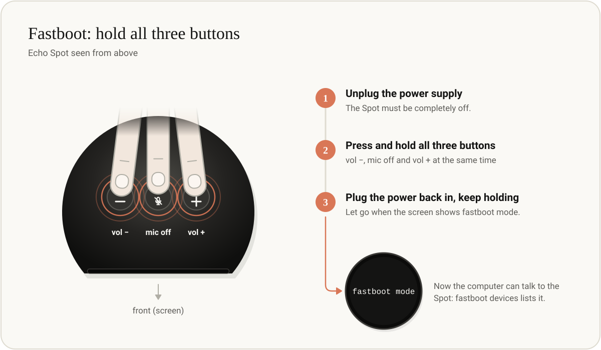

<sub>**English** · [Deutsch](../de/02-unlock.md)</sub>

# 2 · Unlocking the Spot

> **Goal:** unlock the Spot's bootloader with amonet so that it starts the recovery system TWRP · **Time:** about 30 minutes (the unlock itself takes a few minutes) · **Installer:** `./install.sh unlock`

Out of the box the Echo Spot only starts software signed by Amazon. To install LineageOS, the bootloader has to
be unlocked first. This chapter does that. At the end the Spot shows TWRP, a small recovery system from which you
make the backup and install LineageOS in [chapter 3](03-lineageos.md).

> [!WARNING]
> This is the risky step. The unlock uses an exploit. It can fail and, in the worst case, leave the Spot unusable
> ("bricked"). It voids the warranty. It was tested **once, on one Spot** (2026-11-23, macOS on Apple Silicon,
> Fire OS 5.5.6.9). Plan for losing everything that is on the Spot today: chapter 3 erases Fire OS and Alexa.

## What amonet does

[amonet](https://github.com/R0rt1z2/amonet) uses a weakness in the boot ROM of the Spot's MediaTek MT8163 chip.
The boot ROM is code that is burned into the chip and runs before anything else, so no software update can fix it.
The Echo Spot edition, **amonet-rook v2.0.0**, packs the whole exploit into one image file, `fastbrick.img`. The
installer sends this file with `fastboot flash brick`, that is, to a target called "brick". The locked bootloader
refuses the first attempt. The second attempt hangs: that is the exploit taking over. amonet then unlocks the
bootloader and installs TWRP, which appears on the screen about 30 seconds later. The only thing the installer writes
is that one image; the exploit does the rest. amonet for the Spot is the work of R0rt1z2 and contributors, building on
the original amonet by xyz\` and k4y0z. Thank you! (Licences: [THIRD_PARTY.md](../../THIRD_PARTY.md).)

## Risks and safety rails

| Risk | How the installer limits it |
|---|---|
| Wrong device | Before it writes anything, it checks in fastboot mode: exactly one fastboot device, product `ROOK`, `unlock_status` `false`. Otherwise it stops and nothing is changed. |
| Untested firmware | It only continues with the tested bootloader build `c1c79aa-20220824_171625` (Fire OS 5.5.6.9). |
| Wrong or damaged unlock file | It checks the SHA-256 of the zip and the exact size of `fastbrick.img` (114294816 bytes). |
| Starting by accident | You have to type `YES` in capitals. Pressing Enter or `--yes` is not enough. |
| Interrupting at the wrong moment | It tells you when not to unplug anything. **This is the one rule you must follow yourself.** |

> [!IMPORTANT]
> From the moment you type `YES` until TWRP appears (up to 6 minutes), do **not** unplug the USB cable or the
> power supply, and do not press any buttons on the Spot.

## Before you start

1. Run `./install.sh doctor` and make sure it reports `[ok] This computer is ready.` (see [chapter 1](01-hardware.md)).
2. Take the cover off the hidden USB port and have your micro-USB data cable ready (see [chapter 1](01-hardware.md#the-hidden-usb-port)).
3. Unplug other Android phones or tablets from your computer. The installer wants exactly one device in fastboot mode.
4. Optional: check the Fire OS version on the Spot under Settings → Device Options → Device Software Version.
   The installer was tested with 5.5.6.9 and checks this itself in fastboot mode, so this is only to know early.
5. Optional: if the Spot is still registered to your Amazon account, you can remove it in the Alexa app.
   After [chapter 3](03-lineageos.md) Alexa is gone from the Spot anyway.

## Step 1: Download amonet

The download is attached to a post in the XDA forum and needs a free XDA account, so you fetch it yourself.

1. Open the thread in your browser:
   [[UNLOCK][ROOT][TWRP][UNBRICK] Amazon Echo Spot 2017 (rook)](https://xdaforums.com/t/unlock-root-twrp-unbrick-amazon-echo-spot-2017-rook.4754878/)
2. Log in to XDA (or create a free account). Attachments can only be downloaded when you are logged in.
3. In the first post, download the attachment **`amonet-rook-v2.0.0.zip`**.
4. Put the zip, **not unpacked**, into the `downloads/` folder of the project:

   ```bash
   mkdir -p downloads
   mv ~/Downloads/amonet-rook-v2.0.0.zip downloads/
   ```

   If you skip this, the installer looks in your `Downloads` folder too and offers to copy the file.
5. Optional: check the checksum yourself. The installer does it anyway.

   ```bash
   shasum -a 256 downloads/amonet-rook-v2.0.0.zip
   ```

   On Linux use `sha256sum` instead of `shasum -a 256`. The result must be:

   ```
   be856ba4c880fc2b8664d326d7b9cbe8e2f74d2cc82718cc4aa6a895c0e2418f
   ```

   A different value means a different version or a broken download. The installer refuses other versions.

## Step 2: Put the Spot into fastboot mode

Fastboot mode is a small mode of the bootloader in which the computer can send commands to the Spot. You enter it
with all three buttons on top.

<p align="center">
  
</p>

1. Unplug the Spot's power supply. The Spot must be completely off.
2. Connect the micro-USB data cable from the hidden port directly to your computer.
3. Press and hold **all three buttons** on top: Volume −, the middle button (microphone off) and Volume +.
4. Keep holding them and plug the power supply back in.
5. Keep holding until the screen shows **"fastboot mode"**. Then let go.

If the Spot starts normally instead, you let go too early or one button was not pressed. Unplug the power and try again.

Check on your computer:

```bash
fastboot devices
```

You should see one line with a serial number and the word `fastboot`, for example `XXXXXXXXXXXXXXXX	fastboot`.
If the list is empty, see [If something goes wrong](#if-something-goes-wrong).

> [!TIP]
> You can also start `./install.sh unlock` first. It shows these steps on screen and waits up to 10 minutes for the
> Spot to appear in fastboot mode.

## Step 3: Run the unlock

```bash
./install.sh unlock
```

The installer works through five steps:

| Step | What happens | Your part |
|---|---|---|
| 1/5 get amonet-rook v2.0.0 | Finds the zip, checks its SHA-256, unpacks it to `downloads/amonet-rook-v2.0.0/` and checks the size of `fastbrick.img`. | Step 1 above |
| 2/5 fastboot mode | Shows the button trick and waits up to 10 minutes for the Spot. | Step 2 above |
| 3/5 safety checks | Reads (does not write) the number of fastboot devices, the product, the unlock status and the bootloader build. | — |
| 4/5 send the unlock payload | Asks you to type `YES`, then sends the payload: up to 15 attempts, each limited to 8 seconds. | Type `YES`, then hands off |
| 5/5 wait for TWRP | Waits up to 6 minutes until the Spot answers over adb in recovery mode, then checks that it is a `rook` running TWRP. | Wait. Do not unplug anything. |

Before step 4 you see this question:

```
!! This unlocks the Spot's bootloader with an exploit. It was tested once on one Spot; it can fail and in the worst case brick the device. From now on do NOT unplug the cable or the power until TWRP shows (up to 6 minutes).
   Type YES to continue, anything else stops:
```

Type `YES` and press Enter. Anything else stops here, and nothing is sent.

## What you will see

This is the expected sequence. The times are examples, and lines with `…` stand for output of `fastboot` that can
look a little different on your computer.

```
==> Step 3/5: safety checks (read-only)
[ok] exactly one fastboot device
[ok] product = ROOK
[ok] unlock_status = false
[ok] lk_build_desc = c1c79aa-20220824_171625 (Fire OS 5.5.6.9)

==> Step 4/5: send the unlock payload
   (the YES question from above)
[..] [14:02:11] Attempt 1: gtimeout 8 fastboot -S 1G flash brick bin/fastbrick.img
      …
      FAILED (remote: 'restricted on locked hw')
      exit=1
[..] [14:02:13] Attempt 2: gtimeout 8 fastboot -S 1G flash brick bin/fastbrick.img
      …
      exit=124
[ok] [14:02:21] Timeout while sending -> the exploit is most likely running. No further attempts.

==> Step 5/5: wait for TWRP
[!!] Waiting up to 6 minutes for TWRP. Do NOT unplug anything!
     On the screen: the Spot restarts and shows the blue TWRP recovery.
[ok] [14:02:53] TWRP is running: ro.product.device=rook, twrp=3.7.0_9-0
The Spot is unlocked. Leave it in TWRP for the next phase (backup).
```

What it means:

1. **Attempt 1 fails with `restricted on locked hw`.** This is normal. The locked bootloader refuses the command.
2. **Attempt 2 hangs and runs into the 8-second time limit (`exit=124`).** This is the good sign: the exploit is
   running. The installer stops sending.
3. **About 30 seconds later TWRP appears on the screen.** The installer sees it over adb and checks it.

> [!WARNING]
> Between attempt 2 and the TWRP screen it can look as if nothing is happening. That is expected. Do not unplug the
> Spot and do not press buttons. Give it the full 6 minutes.

Instead of `gtimeout` you may see `timeout` (Linux) or `(bash) timeout` (no GNU timeout installed). They do the same thing.

## Why `fastboot -S 1G` (the macOS detail)

amonet ships its own script, `fastbrick.sh`. On a Mac it cannot run as it is: it needs bash 4 (macOS comes with
bash 3.2), and the `fastboot` programs inside the zip are built for Linux. So the installer does the same steps
itself with the `fastboot` from Homebrew (or from your Linux packages). Current `fastboot` versions refuse
`fastbrick.img`, though: the file is 32 bytes larger than the maximum download size the Spot reports. The option
`-S 1G` makes `fastboot` send it anyway. Everything else follows amonet's own logic: up to 15 attempts, an 8-second
limit per attempt, and a time-out means the exploit is running. The exact sequence that was tested on the real Spot
is kept in `scripts/reference/unlock-rook-tested.sh`.

## What the installer does for you

`./install.sh unlock` (phase 2 of 9):

- shows where to download amonet and finds the zip in `downloads/` or in your `Downloads` folder;
- checks the zip's SHA-256 (`be856ba4…2418f`), unpacks it and checks the size of `fastbrick.img`;
- shows the numbered steps for the hidden port and the button trick, and waits up to 10 minutes for fastboot mode;
- runs the read-only checks (one device, `ROOK`, locked, bootloader build of Fire OS 5.5.6.9);
- if the Spot is already unlocked, sends nothing and offers to mark the phase as done;
- asks you to type `YES`, then sends `fastboot -S 1G flash brick bin/fastbrick.img` with amonet's retry logic;
- stops at once on the known fatal messages (worn-out storage, wrong payload, `fastboot` refusing the image);
- waits up to 6 minutes for TWRP and checks `ro.product.device=rook` and the TWRP version;
- if TWRP is already running when you start, it just marks the phase as done.

## Check

1. The Spot's screen shows TWRP.
2. On your computer:

   ```bash
   adb devices
   ```

   The Spot is listed with the state `recovery`, for example:

   ```
   List of devices attached
   XXXXXXXXXXXXXXXX	recovery
   ```

3. `./install.sh status` shows a check mark next to `unlock`.

Leave the Spot in TWRP and connected. The next phase, the backup, starts from here: [chapter 3](03-lineageos.md).

## Getting back into TWRP later

You will need TWRP again if you want to restore the backup or reinstall.

1. Unplug the Spot's power supply. The USB cable can stay connected.
2. Press and hold **Volume +**.
3. Keep holding and plug the power supply back in. Let go when TWRP appears.

## If something goes wrong

The installer stops with a clear message. Find it in this table.

| Message | What it means | What to do |
|---|---|---|
| `No fastboot device found.` | The computer does not see the Spot. | Check the cable (data cable?), use a port directly on the computer, try the three buttons again. See [Troubleshooting: fastboot does not see the Spot](09-troubleshooting.md#fastboot-does-not-see-the-spot). |
| `Expected exactly 1 fastboot device, found: N` | Another phone or tablet is in fastboot mode. | Unplug the other device, then run `./install.sh unlock` again. |
| `product='…' (expected ROOK)` | This is not a 1st-generation Echo Spot. | Nothing was changed. This device is not supported. |
| `unlock_status = true: this Spot is already unlocked` | The unlock was done before. | Nothing was sent. Answer `Y` to mark the phase as done, then start TWRP with Volume + (see above). |
| `Unexpected bootloader version lk_build_desc='…'` | A Fire OS version this installer was not tested with. | Nothing was changed. Ask in the XDA thread whether amonet supports your version. |
| `This is not the tested amonet-rook v2.0.0 zip.` | Wrong checksum. | Download the zip again from the first post of the thread. |
| `fastbrick.img has an unexpected size` | The zip is damaged or a different version. | Download it again. |
| `The eMMC is permanently read-only (hardware defect).` | The Spot's storage chip is worn out. | The Spot cannot be unlocked. It was not changed and is safe to restart. |
| `Device mismatch - wrong payload for this device.` | The payload does not fit this device. | Nothing was changed. Check that you downloaded the rook version. |
| `fastboot refuses the image (-S had no effect).` | Your `fastboot` does not understand `-S` as expected. | Update it: `brew upgrade android-platform-tools` (Linux: update the `fastboot` package), then try again. |
| `No success after 15 attempts. Do NOT cut the power` | The exploit did not start. | Look at the screen first. If it still shows "fastboot mode", run `./install.sh unlock` again. |
| `No TWRP visible over adb after 6 minutes.` | TWRP did not answer in time. | Look at the screen. See [Troubleshooting: the unlock stops or TWRP does not appear](09-troubleshooting.md#the-unlock-stops-or-twrp-does-not-appear). |

If you pressed Ctrl+C during the unlock, the installer warns you: do not unplug the Spot while its screen is busy.
Wait, look at the screen, and then decide.

> [!NOTE]
> **Windows:** `install.sh` does not run on Windows. The amonet zip contains `fastbrick.bat` and `fastbrick.ps1`
> for Windows. The rest of this guide assumes a Mac or Linux computer.

---
[← 1 · Hardware and what you need](01-hardware.md) · [Overview](../../README.md) · [3 · LineageOS: backup and install →](03-lineageos.md)
