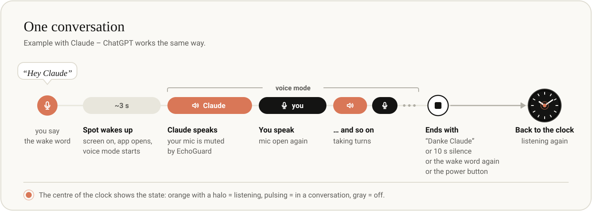
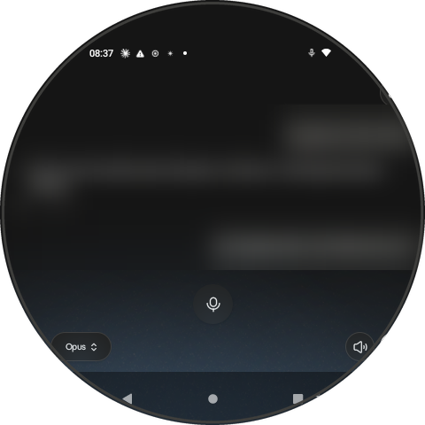

<sub>**English** · [Deutsch](../de/05-voice-assistant.md)</sub>

# 5 · Voice assistant: Claude or ChatGPT

> **Goal:** Say "Hey Claude" and talk to Claude (or ChatGPT) hands-free, in the assistant's own voice mode. · **Time:** about 20–30 minutes · **Installer:** `./install.sh apps voice`

This is the heart of the project. After this chapter your Spot works like this:

1. You say the wake word. The Spot recognises it on the device itself, without the internet.
2. The Spot turns its screen on, opens the Claude app (or ChatGPT) and taps the voice-mode button for you.
3. You talk to the assistant, and it talks back with its own voice, speech to speech, exactly as on a phone.
4. When you say "Danke Claude", stay silent for 10 seconds, or use one of the other ways to end, the Spot goes back to the clock and waits for the next wake word.

Two small Android apps from this project make that happen. **Spot Voice** listens for the wake word, starts voice mode and keeps the conversation running smoothly. **Spot Clock** is the round clock face (chapter 7). The conversation itself happens in the official Claude or ChatGPT app. This project does not replace or imitate them.

<p align="center">
  
</p>

---

## Claude or ChatGPT?

Both are supported, and you can switch at any time (see [Switching between Claude and ChatGPT](#switching-between-claude-and-chatgpt)). Pick the one you have an account for.

| | Claude | ChatGPT |
|---|---|---|
| App | Claude by Anthropic (`com.anthropic.claude`) | ChatGPT by OpenAI (`com.openai.chatgpt`) |
| Installed through | Aurora Store (no Google account needed) | Aurora Store (no Google account needed) |
| Log in with | e-mail magic link, opened on the Spot with `./install.sh open-link` | e-mail address plus the code from the e-mail, typed on the Spot |
| Wake word | "Hey Claude" | "Hey ChatGPT" |
| Stop word (on the Spot) | "Danke Claude", "Claude stopp" | "Danke ChatGPT", "ChatGPT stopp", "thanks ChatGPT" |
| Status | tested on a real Spot | new, tested less than Claude |

You need your own account with Anthropic or OpenAI. What the app's voice mode offers on your plan is what you get on the Spot.

> [!NOTE]
> **ChatGPT support is new and tested less than Claude.** The ChatGPT app installs and runs on the Spot. Spot Voice finds the buttons inside an assistant app by their on-screen labels: the voice-mode button, the mute button and the end button. The Claude labels were calibrated on a real Spot. The ChatGPT labels are still being calibrated on the device. If the voice button or the mute button is not found, see [Calibrating the ChatGPT labels](#calibrating-the-chatgpt-labels-dump_nodes) and please report what you see.

---

## Step 1 · Install the assistant app

The installer opens the app's page in **Aurora Store**, an open-source client for the Play Store that works without a Google account. Aurora was installed in chapter 4.

1. On your computer, in the project folder, run:

   ```bash
   ./install.sh apps
   ```

   To choose ChatGPT, add `--assistant chatgpt`. Without the option the installer asks you on the first run, and the default is Claude.
2. The first time, the installer asks: `Also install Spotify (for voice commands like "play ..."; needs a Spotify account)? [y/N]`. Answer `y` if you want music by voice (chapter 6). You can add it later with `./install.sh apps --spotify`. That run shows the login steps of your assistant again. If you are already logged in, just press Enter at `Press Enter when you are logged in ...` (with Claude, first answer `n` to `Paste the login link now?`).
3. Look at the Spot. Aurora Store opens on the app's page. If this is your first time in Aurora, go through its welcome screens and choose the **"Anonymous"** login.
4. Tap **"Install"**, then confirm the Android dialog with **"Install"**.
5. Wait. The installer notices the finished installation by itself (it waits up to 10 minutes) and prints `[ok] Claude installed`.
6. The installer asks whether it should allow the microphone for the app now. Answer `Y`. Otherwise the app asks you on first use.

> [!TIP]
> If Aurora does not show the app by itself after its welcome screens, just run `./install.sh apps` again.

**If Aurora's installer hangs.** On this ROM, Aurora's install confirmation sometimes never finishes. The installer then offers a verified fallback. It copies the files Aurora has already downloaded from the Spot, checks with `apksigner` that every part (split APK) has the same valid signature, and installs them with `adb install-multiple`. This fallback needs "Rooted debugging" (chapter 4) and `apksigner` from the Android SDK build-tools on your computer. The installer tells you if one of them is missing. How to get `apksigner`: [Aurora install hangs](09-troubleshooting.md#aurora-install-hangs).

## Step 2 · Log in

At the end of the `apps` phase the installer opens the assistant app on the Spot and shows the login steps. Login data never goes through the command line, and the installer stores none of it.

### Claude: the magic link

Claude logs you in with a link sent by e-mail. That link must be opened **on the Spot**, the device you log in on. Typing a long link on the small round screen is not practical, so the installer passes it over for you.

1. On the Spot, choose to continue with e-mail and type your e-mail address. (Typing is easier with `scrcpy`, see the tip below.)
2. On your computer, open the e-mail from Anthropic. Right-click the sign-in button and copy the link.
3. The installer asks `Paste the login link now? [Y/n]`. Press Enter. If you want to do it later, run:

   ```bash
   ./install.sh open-link
   ```

4. Paste the link and press Enter. **You will not see the text.** That is on purpose. The link is not stored, not logged, and does not appear in your computer's process list.
5. Look at the Spot. The Claude app opens the link and finishes the sign-in.
6. Allow the microphone if Claude asks for it.
7. Back on the computer, press Enter at `Press Enter when you are logged in ...`.

### ChatGPT: e-mail and code

1. On the Spot, the ChatGPT app is open. Log in with your e-mail address.
2. Type the code from the e-mail on the Spot.
3. Allow the microphone if ChatGPT asks for it.
4. Back on the computer, press Enter.

"Continue with Google" needs Google services, which this ROM does not have, so it will not work. Sign-in with Apple may not work either. Use e-mail.

> [!TIP]
> Typing on a 2.5-inch round screen is fiddly. `scrcpy` mirrors the Spot to a window on your computer, and then your keyboard and mouse work:
>
> ```bash
> brew install scrcpy
> scrcpy                       # over Wi-Fi: scrcpy -s 192.168.x.y:5555
> ```

## Step 3 · Install Spot Voice

```bash
./install.sh voice
```

This phase runs on its own. It asks you one question, about the accessibility service. [What the installer does for you](#what-the-installer-does-for-you) lists every step it takes.

### The accessibility service: why it is needed

The Claude and ChatGPT apps have no official way for another app to start voice mode. There is no link, intent or setting for it. The only way to press the voice-mode button for you is an Android **accessibility service**, the same mechanism screen readers use. Spot Voice brings one, called "Spot Voice Auto-Tap".

An accessibility service is powerful. It can read what is on the screen and tap anywhere. That is why the installer asks first, and the default answer is **No**:

```text
==> Accessibility service
Spot Voice needs its accessibility service to tap the voice-mode button inside the Claude app for you.
     An accessibility service can read the screen and tap. Spot Voice only acts inside the assistant app; the code is open (apps/voice/.../launch/VoiceModeA11yService.kt).
?? Enable the accessibility service for Spot Voice now via adb? [y/N]
```

- Answer `y` and the installer switches it on with adb.
- Answer `N` (or just press Enter) and the installer opens the accessibility settings on the Spot. Then:
  1. Tap **"Spot Voice Auto-Tap"** (under downloaded apps or services). The installer calls it just "Spot Voice".
  2. Switch on **"Use Spot Voice Auto-Tap"** and confirm with **"Allow"**.

  The installer waits up to 5 minutes and notices the switch by itself.

**What the service does.** It acts only inside the selected assistant app:

- After the wake word it taps "New chat", so every session starts a fresh conversation, and then the voice-mode button. If no "New chat" button is visible (for example because an empty chat is already open), it taps the voice-mode button right away.
- It taps the app's own mute button while the assistant speaks, and taps unmute when it stops (see [EchoGuard](#echoguard-why-you-cannot-interrupt)).
- It reads the transcript text on the screen to notice a spoken goodbye such as "thank you Claude".
- It taps "End" when the conversation is over.
- It notices when you leave the app or when the screen goes off, and then lets Spot Voice listen again.

**What it does not do.** It taps nothing in other apps. It sends nothing anywhere and stores no transcripts. To notice that the assistant app was left, it receives window-change events from all apps, but it only acts in the assistant app. For troubleshooting, the on-screen labels it looked at end up in the Spot's local system log (logcat). The code is open: `apps/voice/app/src/main/java/ai/pocket/heyclaude/launch/VoiceModeA11yService.kt`.

Without the accessibility service, the wake word still opens the assistant app, but nobody taps the voice-mode button and EchoGuard cannot work.

---

## A conversation, step by step

The example uses Claude. ChatGPT works the same way.

<p align="center">
  
</p>
<p align="center"><sub>Claude voice mode on the Spot (German UI, transcript blurred for privacy).</sub></p>

1. **The Spot is waiting.** The clock shows an orange centre with a thin halo. That means "listening for the wake word".
2. **Say "Hey Claude"** towards the Spot, then pause. Say only the wake word.
3. **You hear a short beep.** For about 2 seconds the Spot now listens for an offline voice command such as "timer five minutes" (chapter 6). If you say nothing, it continues with the next step.
4. **The Spot wakes up.** The screen turns on, the Claude app opens, and Spot Voice taps the voice-mode button. This takes about 3 seconds.
5. **Talk.** Ask your question in normal sentences.
6. **Claude answers out loud.** While it speaks, Claude's microphone is muted by EchoGuard. You can see the mute button change in the app. About 0.7 seconds after Claude stops, the microphone opens again.
7. **Your turn again.** Keep taking turns as long as you like.
8. **End.** Say **"Danke Claude"** (or one of the other ways in the next section). Claude's voice mode closes, the Spot returns to the clock, and the orange halo shows it is listening again.

> [!IMPORTANT]
> **Say the wake word on its own, then wait for voice mode.** Whatever you say right after the wake word is checked for an offline voice command. It is **not** passed on to Claude. If you say more than two words that are not a command (for example "Hey Claude, what's the weather tomorrow"), the Spot treats it as a false alarm from room conversation. It plays a low error tone and does not open Claude. One or two extra words ("Hey Claude, hello") do open Claude, but those words are lost. Wait for the voice-mode screen, then ask your question.

---

## Wake words and stop words

| Assistant | Wake word (starts) | Stop word (ends, detected on the Spot) | Goodbyes recognised in the transcript |
|---|---|---|---|
| Claude | "Hey Claude" | "Danke Claude", "Claude stopp" | "thank you Claude", "thanks Claude", "bye Claude", "tschüss Claude", "Claude stopp", "Claude, that's all", … |
| ChatGPT | "Hey ChatGPT" | "Danke ChatGPT", "ChatGPT stopp", "thanks ChatGPT" | "thanks ChatGPT", "stop ChatGPT", "danke ChatGPT", … |

- The **wake word** and the **stop word** are small neural-network models ([openWakeWord](https://github.com/dscripka/openWakeWord)) that run on the Spot itself. The trained models for Claude and ChatGPT ship with this project in `models/`. They were trained on synthetic German and English voices. Chapter 8 shows how to train your own.
- The **goodbyes** work differently. EchoGuard reads the new transcript lines in the assistant's window and looks for a farewell word next to the assistant's name. Words before the name: danke, dankeschön, stopp, tschüss, ciao, ende, beenden, auf wiedersehen, bye, thank you, thanks, goodbye, see you. Words after the name: stopp, danke, tschüss, ende, beenden, aus, bye, goodbye, that's all. Common mis-hearings of the name, such as "Cloud" or "Klaud", count too. This check only works if the assistant app shows a transcript on screen.

> [!NOTE]
> **Fallback "Alexa".** If no trained wake-word model exists for the selected assistant, Spot Voice uses openWakeWord's built-in **"Alexa"** model, which fits the Echo Spot. The installer then warns you: `models/hey_chatgpt.onnx or models/danke_chatgpt.onnx is missing - Spot Voice uses its built-in wake word "Alexa" for ChatGPT until a trained model exists.` Without a stop-word model, saying the wake word again ends the conversation.

---

## Ending a conversation

Any of these works. Afterwards the Spot returns to the clock and listens for the wake word again.

| You do | What happens |
|---|---|
| Say **"Danke Claude"** or **"Claude stopp"** | The stop-word model on the Spot hears it and EchoGuard presses the app's end button. |
| Say a goodbye such as **"thank you Claude"** | The transcript check finds it and EchoGuard presses the end button. |
| Say the **wake word again** ("Hey Claude") | Spot Voice ends the conversation. |
| Stay **silent for 10 seconds** after the assistant's last answer | EchoGuard presses the end button. While the assistant is still working on an answer to your question, it waits up to 30 seconds. |
| Tap the app's own **End** button ("Beenden" in German) | Voice mode closes normally. |
| Press the **power button** (the middle button on top; under LineageOS it is the power button) | The screen goes off, the session is ended and the clock comes to the front. |
| Go **home** (leave the app) | Leaving the app ends the voice session through the app's own notification, so it does not keep talking in the background. |

Spot Voice keeps listening for the wake word and the stop word on its own while the assistant talks. So "Danke Claude" is designed to work even in the middle of an answer. If nothing at all tells Spot Voice that the session ended, it starts listening again after 10 minutes anyway.

---

## EchoGuard: why you cannot interrupt

On a phone, the hardware cancels the assistant's own voice from the microphone (acoustic echo cancellation). **The Spot's ROM has no echo cancellation.** In hands-free voice mode the assistant would hear itself through the speaker, take that as you talking, and interrupt itself again and again.

EchoGuard, part of Spot Voice, solves this with **half duplex**, like a walkie-talkie:

1. It measures what comes out of the speaker (Android's Visualizer on the audio output).
2. As soon as the assistant speaks, it taps the **mute button inside the assistant's voice mode**. The Spot's system-wide mic mute is ignored by its audio driver, so the app's own button is used.
3. When the speaker has been quiet for about 0.7 seconds, it taps **unmute**.

What this means for you:

- **You cannot talk over the assistant.** Wait until it has finished, then speak. If answers are too long for you, ask for short answers ("please keep your answers short").
- If **you** mute the microphone by hand, EchoGuard leaves it muted.
- Ending still works while the assistant talks: the wake word and "Danke Claude" go to Spot Voice, not to the assistant.

> [!WARNING]
> Hands-free voice mode answers **anyone** who speaks in the room, not only you. While a conversation runs, the assistant hears and transcribes everything that is said near the Spot.

---

## The clock shows what is happening

The centre cap of the clock (chapter 7) shows the state of Spot Voice:

| Centre cap | Meaning |
|---|---|
| Orange with a thin halo | Listening for the wake word. |
| Orange with pulsing rings | Active: listening for a voice command right after the wake word, or a conversation is running. |
| Gray | Off: Spot Voice is stopped or has an error. Open Spot Voice to see why. |

On the dim night face the dot is dim orange while Spot Voice listens and gray when it is off.

---

## Sensitivity: fewer false wakes or better hearing

Every 80 milliseconds the wake-word model gives a score between 0 and 1 for "was that 'Hey Claude'?". The Spot wakes up only when the score stays above the **threshold** for several **consecutive frames** (80 ms each). The number of frames matters far more than the threshold itself.

Measured with `training/evaluate.py` on the `hey_claude` v2 and `hey_chatgpt` v1 models:

| Sensitivity (`--sensitivity`) | Threshold / frames | "Hey Claude": recall¹ | false wakes per hour² | "Hey ChatGPT": recall¹ | false wakes per hour² |
|---|---|---|---|---|---|
| `high` | 0.6 / 3 | 63 % | 0.93 | 79 % | 0.65 |
| `normal` (default) | 0.6 / 4 | 55 % | 0.28 (about once every 3.5 h) | 73 % | 0.19 (about once every 5 h) |
| `low` | 0.6 / 5 | 45 % | 0 in 10.7 h | 67 % | 0.09 (once in 10.7 h) |

¹ Share of fresh synthetic clips that woke the model: 400 "Hey Claude" clips, 2000 "Hey ChatGPT" test clips that were generated during training but never trained on. The two test sets differ, so compare settings rather than the two models. This is an upper bound: real rooms with distance, echo and noise are harder, so expect to repeat the wake word now and then.<br>
² Measured on 10.7 hours of real-world audio (the openWakeWord validation set): speech, music, TV.

Why frames? An earlier setting of 0.7 / 2 frames heard you better (70 %), but it woke up 1.9 times an hour, and the Spot "switched itself on" in a room with voices. Requiring the score to stay high for a little longer filters out most of those. The stop word only listens during a conversation, where a false trigger just ends the conversation early. Its frame count is fixed per assistant: "Danke Claude" (0.5 / 2 frames) has 0.47 false triggers per hour, "Danke ChatGPT" (0.5 / 3 frames) has 0.84 and hears 69 % of the test clips. With 2 frames "Danke ChatGPT" would end a conversation 2.8 times an hour by mistake.

The installer uses the same thresholds for both assistants.

### How to change it

**With the installer** (the setting is saved and applied again on every later `./install.sh voice`):

```bash
./install.sh voice --sensitivity low      # fewer false wakes
./install.sh voice --sensitivity high     # hears you better, wakes up more often by mistake
```

**Without reinstalling**, with a broadcast. It needs `adb` and a running Spot Voice. The values are saved on the Spot:

```bash
adb shell am broadcast -a ai.pocket.heyclaude.SET_THRESHOLD -p ai.pocket.heyclaude \
  --ef wake 0.6 --ef stop 0.5 --ei frames 4
```

| Extra | Meaning | Allowed range |
|---|---|---|
| `--ef wake` | threshold of the wake word | 0.05–0.99 |
| `--ef stop` | threshold of the stop word | 0.05–0.99 |
| `--ei frames` | consecutive 80 ms frames the wake score must stay above the threshold | 1–10 |
| `--ez new_chat` | `true` (default): every wake-word session starts a new chat. `false`: continue the last chat. | true / false |

Each extra is optional, so you can change only one. Check the result with `adb logcat -d -s HeyClaude | grep Thresholds`, which shows a line like `Thresholds: wake=0.6 stop=0.5 frames=4 newChat=true`.

**On the Spot** in the Spot Voice app: the **Threshold** slider (0.20–0.90) changes the wake threshold. The **Mic test** shows the live microphone level and the wake score. It only runs while listening is stopped, so tap "Stop listening" first. Say "Hey Claude" from where you usually sit and watch how high the score goes.

> [!TIP]
> - Speak towards the Spot, and make a short pause after "Hey Claude".
> - A TV or radio near the Spot causes most false wakes. Move the Spot away from it, or use `--sensitivity low`.
> - The best fix for both problems is a wake word trained with your own voice: [chapter 8](08-wakeword-training.md).

---

## Switching between Claude and ChatGPT

There are three ways to switch. The installer is the complete one.

**1. With the installer (recommended).** It installs and logs in the other app, copies its wake-word models to the Spot and switches Spot Voice over:

```bash
./install.sh apps voice --assistant chatgpt
./install.sh apps voice --assistant claude     # and back
```

**2. In the Spot Voice app.** Tap the clock to open the apps screen, then open **Spot Voice**. Under **Assistant**, choose **Claude** or **ChatGPT**. The switch takes effect at once, without a reinstall.

<p align="center">
  
</p>
<p align="center"><sub>Spot Voice (German UI): status, "Zuhören stoppen" (Stop listening), assistant picker.</sub></p>

**3. With a broadcast** from your computer:

```bash
adb shell am broadcast -a ai.pocket.heyclaude.SET_ASSISTANT -p ai.pocket.heyclaude --es assistant chatgpt
```

Ways 2 and 3 only switch. They do not install anything. The other app must already be installed and logged in, and its wake-word model must already be on the Spot, otherwise the wake word is "Alexa". The sensitivity setting applies to both assistants.

---

## Privacy: what stays on the Spot

| Part | Runs | What leaves the Spot |
|---|---|---|
| Wake word and stop word | on the Spot (openWakeWord) | nothing |
| Voice commands (chapter 6) | on the Spot (Vosk) | nothing, except the station name for a radio search (radio-browser.info) and the search text you give Spotify |
| Conversation | in the Claude or ChatGPT app | your voice and the conversation, exactly as when you use voice mode on a phone |
| Accessibility service | on the Spot | nothing |
| Weather on the clock | Spot Clock | only the coordinates of your weather place (Open-Meteo) |

Only the assistant's voice mode uses the cloud. Spot Voice itself does not record conversations and has no account or server.

---

## The Spot Voice app

Open it from the apps screen (tap the clock, then **Spot Voice**). From top to bottom:

| Part | What it shows or does |
|---|---|
| Status | `Listening · 0.00` (state and live wake score), the wake-word model in use (for example `hey_claude (external)`), and yes/no lines for microphone permission, accessibility service, overlay permission, the assistant app and `Voice commands (vosk-en)`. |
| Buttons for missing permissions | "Allow microphone", "Enable accessibility service", "Grant overlay permission". Each appears only while that permission is missing. |
| Start listening / Stop listening | Switches the wake-word listener on or off. It stays off after a reboot if you switched it off here. |
| Assistant | Claude or ChatGPT. |
| Command language | Deutsch or English (chapter 6). |
| Threshold | The wake threshold slider. |
| Mic test | Live level and wake score, while listening is stopped. |
| Test: open Claude now | Starts voice mode as if you had said the wake word. |

Spot Voice starts by itself after a reboot.

---

## What the installer does for you

### Phase `apps`

1. Asks whether Spotify should be installed too, and saves the answer.
2. Opens `market://details?id=<app>` in Aurora Store on the Spot and waits until you have tapped Install (up to 10 minutes).
3. If Aurora's installer hangs: pulls the downloaded split APKs, checks their signatures with `apksigner`, and installs them with `adb install-multiple`.
4. Grants the app the microphone permission (after `[Y/n]`).
5. Installs Spotify the same way, if you wanted it.
6. Opens the app and shows the login steps. For Claude it runs `open-link` for the magic link.

### Phase `voice`

1. Downloads `spot-voice.apk` from the latest GitHub release, checks its SHA-256 against `SHA256SUMS` and installs it. With `--from-source` it builds the app instead.
2. Grants the microphone permission, allows "display over other apps" (so Spot Voice may bring the assistant to the front) and removes Spot Voice from battery optimisation.
3. Starts the listening service.
4. Copies the wake-word and stop-word models of your assistant from `models/` to the Spot. If they are missing, it warns that "Alexa" is used.
5. Downloads the small offline Vosk speech model for your language (about 50 MB), checks its SHA-256 and copies it to the Spot. It skips this when the model is already there (`--force` copies it again).
6. Switches on the accessibility service, after your `[y/N]`.
7. Selects assistant, command language and sensitivity by broadcast, then starts listening.

`./install.sh --dry-run voice` prints every command instead of running it. The last steps look like this:

```text
==> Select assistant, language and thresholds
+ adb shell am broadcast -a ai.pocket.heyclaude.SET_ASSISTANT -p ai.pocket.heyclaude --es assistant claude
+ adb shell am broadcast -a ai.pocket.heyclaude.SET_LANG -p ai.pocket.heyclaude --es lang en
+ adb shell am broadcast -a ai.pocket.heyclaude.SET_THRESHOLD -p ai.pocket.heyclaude --ef wake 0.6 --ef stop 0.5 --ei frames 4
[ok] assistant=claude, language=en, wake=0.6/4 frames (normal), stop=0.5
+ adb shell am start-foreground-service -n ai.pocket.heyclaude/.WakeWordService
[ok] Spot Voice is listening.
```

---

## Check

### Quick self-test

```bash
./install.sh verify
```

It checks everything that matters for voice. Every line should show a green ✓; a ✗ comes with a fix hint after `->`. The voice-related checks are: Spot Voice installed, your assistant installed, accessibility service enabled, wake-word models on the Spot, Vosk speech model on the Spot, WakeWordService running, and the assistant probably logged in. Then it offers a **live test**: it opens voice mode as if you had said the wake word and waits up to 25 seconds for the button tap. On success it prints:

```text
==> Live test
Spot Voice now opens Claude voice mode as if you had said the wake word.
?? Run the live test now? [Y/n]
     Look at the Spot: Claude opens and its voice mode starts.
   ✓ voice-mode button tapped - talk to Claude now, or say the stop word to end
```

### By voice

1. Make sure the clock shows the orange centre with a halo.
2. Say "Hey Claude", wait for voice mode, and ask something short.
3. While Claude answers, look at its mute button: it should switch to muted, then back.
4. Say "Danke Claude". The Spot should return to the clock.

### In the log

```bash
adb logcat -s HeyClaude OpenWakeWord
```

Lines you should see during a conversation:

```text
Wake word detected (score=…, threshold=0.6, frames=4)
A11y: voice-mode button tapped
EchoGuard: Claude speaks -> mic muted
EchoGuard: Claude done -> mic open
Wake/stop word during conversation (score=…) -> end it
EchoGuard: end conversation (wake word) -> end button
```

The reason in brackets shows what ended the conversation: `wake word` (the wake word or the stop-word model, for example "Danke Claude"), `stop phrase` (a goodbye found in the transcript), `10 s silence` or `30 s silence`.

---

## Useful adb commands

For tests and tuning from your computer. First check that `adb` sees the Spot: `adb devices`. If the list is empty (for example after your computer restarted), connect with `adb connect 192.168.x.y:5555`, using the address that `./install.sh status` shows under "Device". If it lists more than one device, add `-s 192.168.x.y:5555` after `adb`. Broadcasts reach Spot Voice only while its listening service runs. The exceptions are `SET_ASSISTANT` and `SET_LANG`, which are saved even when it is stopped, and `DUMP_NODES`, which the accessibility service handles.

| What | Command | Effect |
|---|---|---|
| Start a conversation without speaking | `adb root` then<br>`adb shell am start-foreground-service -n ai.pocket.heyclaude/.WakeWordService -a ai.pocket.heyclaude.TRIGGER_NOW` | Same as a detected wake word, without the command check. Needs "Rooted debugging" (`adb root`), because the service is not exported. |
| Listen again | `adb shell am broadcast -a ai.pocket.heyclaude.RESUME -p ai.pocket.heyclaude` | Ends the "paused" state and listens for the wake word. |
| Switch assistant | `adb shell am broadcast -a ai.pocket.heyclaude.SET_ASSISTANT -p ai.pocket.heyclaude --es assistant chatgpt` | `claude` or `chatgpt`. Reloads the wake and stop models; send it again after copying new model files. |
| Command language | `adb shell am broadcast -a ai.pocket.heyclaude.SET_LANG -p ai.pocket.heyclaude --es lang en` | `de` or `en`; loads `vosk-de` or `vosk-en`. |
| Sensitivity | `adb shell am broadcast -a ai.pocket.heyclaude.SET_THRESHOLD -p ai.pocket.heyclaude --ef wake 0.6 --ef stop 0.5 --ei frames 4` | See [Sensitivity](#sensitivity-fewer-false-wakes-or-better-hearing). |
| Test a voice command | `adb shell am broadcast -a ai.pocket.heyclaude.COMMAND -p ai.pocket.heyclaude --es text "set a timer for five minutes"` | Parses and runs the text as if it had been spoken. The log shows `Test command '…' (en) -> Timer(300s)`. |
| Dump screen labels | `adb shell am broadcast -a ai.pocket.heyclaude.DUMP_NODES -p ai.pocket.heyclaude` | Writes the accessibility tree of every window to the log. Needs the accessibility service. |
| Level log | `adb shell am broadcast -a ai.pocket.heyclaude.LEVEL_LOG -p ai.pocket.heyclaude --ez on true` | Logs the microphone level, and during a conversation the speaker level EchoGuard measures. `--ez on false` switches it off. |
| Press the assistant's mute button | `adb shell am broadcast -a ai.pocket.heyclaude.MIC_MUTE -p ai.pocket.heyclaude --ez on true` | Tests EchoGuard's mute tap (`false` = unmute). |

Read the results with `adb logcat -d -s HeyClaude`.

### Calibrating the ChatGPT labels (DUMP_NODES)

Spot Voice finds buttons by their accessibility labels, for example "Mikrofon stummschalten" (mute microphone) or "Beenden" (end) in the German Claude app. For ChatGPT these labels are best guesses until they are confirmed on the device. To check them:

1. Make sure the accessibility service is on (`./install.sh verify`).
2. Open ChatGPT on the Spot so that its chat screen is visible.
3. On your computer:

   ```bash
   adb logcat -c
   adb shell am broadcast -a ai.pocket.heyclaude.DUMP_NODES -p ai.pocket.heyclaude
   adb logcat -d -s HeyClaude > chatgpt-chat.txt
   ```

4. Start voice mode in ChatGPT by hand and repeat step 3, saving to `chatgpt-voice.txt`.
5. In the files, look for the button entries with `desc="…"`: the voice-mode button, the mute and unmute buttons, and the end button.

When the auto-tap fails, the log also shows `A11y: try 1/8: no node matches …` and a list of `cand[…]` candidate buttons. Please open an issue on [GitHub](https://github.com/Nachtfux/Echo_spot_second_life/issues) with the relevant lines and the app version.

> [!WARNING]
> A node dump contains everything on the screen, including chat text. Remove personal content before you share it.

---

## If something goes wrong

| Symptom | See |
|---|---|
| Aurora's install never finishes | [Aurora Store hangs while installing](09-troubleshooting.md#aurora-store-hangs-while-installing) |
| `Could not download the app release from GitHub` | [The app release cannot be downloaded](09-troubleshooting.md#the-app-release-cannot-be-downloaded) |
| The login link does nothing on the Spot | [The login link does not open](09-troubleshooting.md#the-login-link-does-not-open) |
| `adb` cannot reach the Spot after a reboot | [adb over Wi-Fi is gone after a reboot](09-troubleshooting.md#adb-over-wi-fi-is-gone-after-a-reboot) |
| Saying the wake word does nothing | [The wake word does not react](09-troubleshooting.md#the-wake-word-does-not-react) |
| The Spot wakes up by itself | [The Spot wakes up by itself](09-troubleshooting.md#the-spot-wakes-up-by-itself) |
| The app opens but voice mode does not start | [Voice mode does not start](09-troubleshooting.md#voice-mode-does-not-start) |
| The assistant interrupts itself or hears itself | [The assistant hears itself](09-troubleshooting.md#the-assistant-hears-itself) |
| ChatGPT buttons are not tapped | [ChatGPT buttons are not found](09-troubleshooting.md#chatgpt-buttons-are-not-found) |

---
[← 4 · Android setup](04-setup.md) · [Overview](../../README.md) · [6 · Voice commands →](06-voice-commands.md)
