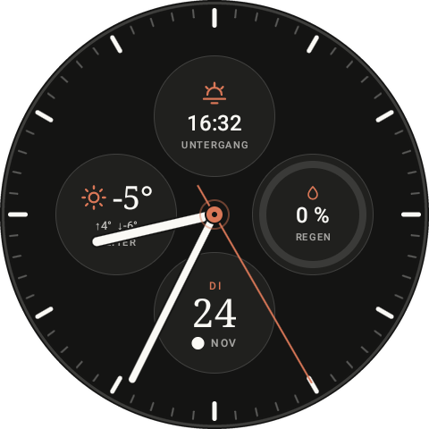
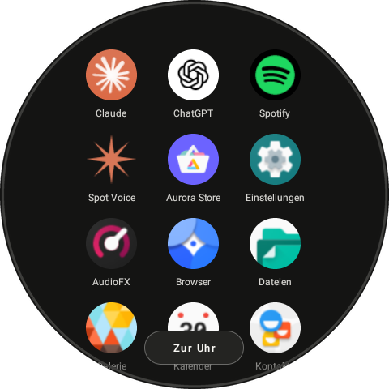

<sub>**English** · [Deutsch](../de/07-clock.md)</sub>

# 7 · The clock

> **Goal:** Understand everything the round clock shows, and set the place for its weather. · **Time:** about 5 minutes · **Installer:** `./install.sh clock`

**Spot Clock** turns the round 480 × 480 screen into a calm analog clock with weather, sun times, date and moon phase. It is the Spot's **home screen** and its **screensaver**, so you see it whenever no app is open. It dims itself in a dark room, shows the cover of the music that is playing, and displays your timers and alarms. Its centre shows what the voice assistant is doing.

---

## The day face

<p align="center">
  
</p>
<p align="center"><sub>The day face (German UI: UNTERGANG = SUNSET, REGEN = RAIN, DI = TUE).</sub></p>

Four round "complications" sit around the centre:

| Position | Shows | Details |
|---|---|---|
| Top | **Sun** | The next sun event: before sunrise **SUNRISE** with today's time, during the day **SUNSET**, after sunset tomorrow's **SUNRISE**. |
| Left | **Weather now** | Icon and current temperature; below, today's high and low (`↑4°  ↓-6°`) and a short description: CLEAR, MAINLY CLEAR, PARTLY CLOUDY, OVERCAST, FOG, DRIZZLE, RAIN, SNOW, SHOWERS, SNOW SHOWERS, THUNDERSTORM. |
| Right | **Rain** | Today's highest probability of precipitation, as a number and as an orange ring that fills up (0 % = no ring, 100 % = full circle). |
| Bottom | **Date** | Weekday (orange), day of the month, month, and a small **moon** disc showing the lit part of the moon today (as seen from the northern hemisphere). |
| Centre | **Assistant state** | See the next section. |

The hands: white hour and minute hands and a thin orange **second hand** that ticks once a second. Times are always shown in 24-hour format.

Without weather data the complications show `—`. The weather line then reads **NO LOCATION** (no weather place set yet) or **LOADING …** (waiting for the first answer). See [The weather place](#the-weather-place).

---

## The centre cap: what the assistant is doing

The small round cap where the hands meet shows the state of Spot Voice (chapter 5):

| Centre cap | Meaning |
|---|---|
| **Orange with a thin halo** | Listening for the wake word. Say "Hey Claude". |
| **Orange with pulsing rings** | Active: the Spot is listening for a voice command right after the wake word, or a conversation is running. |
| **Gray** | Off: Spot Voice is stopped or has a problem. Open Spot Voice from the apps screen to see why. |

On the night face the centre is a small dot: dim orange while Spot Voice listens, gray when it is off.

---

## Night face and brightness

The Spot has a **light sensor**. Spot Clock reads it and sets the screen brightness in four levels:

| Room light | Face | Screen brightness |
|---|---|---|
| Dark (below about 4 lux: a dark bedroom) | **Night face** | 5 % |
| Dim (about 4–30 lux) | Day face | 25 % |
| Normal (about 30–250 lux) | Day face | 60 % |
| Bright (above about 250 lux) | Day face | your Android brightness setting |

To avoid flicker, the level only changes when the light is clearly past a boundary (by about 40 %) and stays there for 4 seconds. A hand moving past the sensor does not change anything.

The **night face** is made for a dark bedroom: a black background, dim orange hour dots and hands, the current temperature, and no second hand. It only updates every 30 seconds.

If a Spot reports no light sensor, the clock shows the night face from 22:00 to 07:00 instead. A ringing timer or alarm always uses the day face at your normal Android brightness, so you can see it.

---

## Now playing

While music plays on the Spot, the clock switches to the **now-playing face**. This works with any app that offers standard media controls: Spotify, and the internet radio of Spot Voice (chapter 6).

- The **cover** (or the station logo) fills the round screen.
- **Title** and **artist** at the bottom, the current time at the top.
- A **progress ring** along the rim, for tracks with a known length. Live radio has no length, so there is no progress.
- **PAUSED** under the title while playback is paused. 20 seconds after a pause the clock returns to the normal face.

This face needs **notification access** for Spot Clock. Android only lets an app see other apps' media sessions (title, artist, cover, position) through notification access. Notification access could technically read all notifications; Spot Clock ignores them and reads only the media session. The code is open: `apps/clock/src/ai/pocket/spotclock/NowPlayingService.java`. The installer asks before it allows it ([What the installer does for you](#what-the-installer-does-for-you)). Without it the clock works normally; only the now-playing face stays off.

---

## Timer and alarm on the face

Timers and alarms are set by voice (chapter 6) and live in Spot Clock.

<p align="center">
  
</p>
<p align="center"><sub>Timer with 4:53 left and an alarm at 06:30 (German UI: WECKER = ALARM).</sub></p>

- **Timer:** an orange **arc along the rim** that shrinks as time runs out, and the **remaining time** at the top (`4:53`, or `1:05:00` for longer timers).
- **Alarm:** a line at the bottom, **ALARM 06:30**.
- When one goes off, Spot Clock brings its face to the front. It shows **pulsing orange rings**, the word **TIMER** or **ALARM**, the time and **"Tap to stop"**. The Spot's default alarm sound plays in a loop for at most **2 minutes**. A notification says "Timer finished" or "Alarm" with the hint "Tap the clock or say “Hey Claude, stop”". If you use ChatGPT, it says "Hey ChatGPT".
- **To stop it:** tap the screen, or say the wake word and "stop" ("stopp" in German).

There is one timer and one alarm at a time. Both keep working when the clock is not on screen.

---

## The apps screen

<p align="center">
  
</p>
<p align="center"><sub>The apps screen (German UI: "Zur Uhr" = "Back to clock").</sub></p>

The Spot has no app drawer of its own. Spot Clock brings one in the same look:

1. **Tap the clock.** The apps screen opens.
2. Your most-used apps come first: **Claude, ChatGPT, Spotify, Spot Voice, Aurora Store, Settings** (each only if installed). All other apps follow in alphabetical order. Scroll for more.
3. **Tap an app** to open it. When you leave that app (Home), you are back at the clock.
4. **"Back to clock"** at the bottom returns to the clock.

What a tap on the clock does:

| Situation | A tap … |
|---|---|
| The clock is the home screen (normal case) | opens the apps screen |
| A timer or alarm is ringing | stops it |
| You opened Spot Clock from the app list as a normal app | closes it |

---

## Home screen and screensaver

The installer makes Spot Clock both:

- **Home screen.** After a conversation, after pressing Home and after a reboot you land on the clock. The screen stays on while the clock is in front. As the home screen, Back does nothing, because there is nothing to go back to. The first time it runs as home screen, it also sets a plain dark wallpaper (seen behind the lock screen) to match.
- **Screensaver.** When the Spot is idle, Android's screensaver shows the same clock face, with the same automatic brightness. A tap ends the screensaver.

---

## The weather place

Weather and sun times come from [Open-Meteo](https://open-meteo.com/), a free weather service without account or API key. The clock asks for new data at most every 15 minutes and keeps the last answer, so it has data right after a restart. The request contains only the coordinates of your weather place.

There is **no default place**. Until you set one, the clock shows no weather.

### Set or change it with the installer

1. Run the `clock` phase with your town:

   ```bash
   ./install.sh clock --place "Berlin"
   ```

2. The installer looks the name up with Open-Meteo. If several places have that name, it lists them:

   ```text
   [..] Looking up "Berlin" (Open-Meteo) ...
   Several places are called "Berlin":
       1) Berlin, Berlin, Stadt, State of Berlin, Germany
       2) Berlin, City of Berlin, Coos, New Hampshire, United States
       3) Berlin, Borough of Berlin, Camden, New Jersey, United States
      ...
   ?? Which one? Number 1-10 (0 = none of these) [1]:
   ```

3. Type the number of your place and press Enter.
4. Confirm the place and its coordinates with `Y`.
5. The installer sends the place to the clock on the Spot. The weather appears a few seconds later.

**Tips for the name:**

- Use the **town name, not a postal code**. Open-Meteo finds places by name. If you type digits, the installer says: `Open-Meteo finds places by name, not by postal code. Type the town name, e.g. "Neustadt, Holstein".`
- Add the region after a comma to narrow the list: `"<town>, <region>"`, for example `--place "Neustadt, Holstein"` or `--place "Hamburg, Germany"`. The part after the comma is matched against state, district and country.
- If nothing fits, answer `0`. The installer then lets you try another name (up to 5 tries). An empty answer means no weather; the clock then simply runs without it.

### Set it by hand

If you know the coordinates (latitude and longitude, as decimal numbers), send them directly:

```bash
adb shell am start -n ai.pocket.spotclock/.ClockActivity --es lat 52.52 --es lon 13.40 --es place Berlin
```

Both `lat` and `lon` are needed. `place` is optional and only stored for reference. A new place clears the cached weather.

To forget the place completely, clear the app's data. This also deletes a set timer and alarm:

```bash
adb shell pm clear ai.pocket.spotclock
```

---

## Languages

Spot Clock speaks **English** or **German**. It follows the Spot's system language, which the installer sets with `--lang` during `setup` (chapter 4). The labels, weather descriptions and weekday and month names change with it:

| English | German |
|---|---|
| SUNRISE / SUNSET | AUFGANG / UNTERGANG |
| RAIN | REGEN |
| NO LOCATION / LOADING … | ORT FEHLT / LÄDT … |
| PAUSED | PAUSE |
| ALARM 06:30 | WECKER 06:30 |
| Tap to stop | Tippen zum Beenden |
| Back to clock | Zur Uhr |

Times are always in 24-hour format, in both languages. The screenshots in this guide show the German UI.

---

## Broadcasts the clock accepts

For tests and automation from your computer. If `adb devices` lists more than one device, add `-s 192.168.x.y:5555` after `adb`.

| Action | Command | Effect |
|---|---|---|
| Set a timer | `adb shell am broadcast -a ai.pocket.spotclock.TIMER -p ai.pocket.spotclock --el seconds 600` | Starts a 10-minute timer and replaces a running one. `seconds` must be a **long** (`--el`); `0` cancels. |
| Cancel the timer | `adb shell am broadcast -a ai.pocket.spotclock.TIMER -p ai.pocket.spotclock --el seconds 0` | Cancels the countdown. |
| Set an alarm | `adb shell am broadcast -a ai.pocket.spotclock.ALARM -p ai.pocket.spotclock --ei hour 6 --ei minute 30` | Alarm at the next 06:30, today or tomorrow. |
| Cancel the alarm | `adb shell am broadcast -a ai.pocket.spotclock.ALARM -p ai.pocket.spotclock --ei hour -1` | Cancels the alarm. |
| Stop ringing | `adb shell am broadcast -a ai.pocket.spotclock.STOP_RINGING -p ai.pocket.spotclock` | Silences a ringing timer or alarm. |
| Show an assistant state | `adb shell am broadcast -a ai.pocket.heyclaude.STATE -p ai.pocket.spotclock --es state active --es assistant ChatGPT` | `state` = `off`, `listening` or `active`. Spot Voice normally sends this itself; the assistant name is used in the ringing notification. |
| Set the weather place | `adb shell am start -n ai.pocket.spotclock/.ClockActivity --es lat 52.52 --es lon 13.40 --es place Berlin` | See [Set it by hand](#set-it-by-hand). |

> [!IMPORTANT]
> Always include `-p ai.pocket.spotclock`. Android does not deliver these broadcasts to the app without it. Also watch the type: `--ei seconds 600` (an int instead of a long) is read as "no value" and **cancels** the timer.

The clock logs to `adb logcat -s SpotClock`.

---

## What the installer does for you

The `clock` phase:

1. Downloads `spot-clock.apk` from the latest GitHub release, checks its SHA-256 and installs it. With `--from-source` it builds the app instead.
2. Allows notification access for the now-playing face, **after asking `[y/N]`**. If you answer No, it opens the settings on the Spot instead. Tap **"Spot Clock"**, switch on **"Allow notification access"** and confirm with **"Allow"**. The installer waits up to 5 minutes for the switch.
3. Makes Spot Clock the home screen and the screensaver.
4. Looks up your weather place with Open-Meteo, lets you pick and confirm it, and saves it in `.state/config.env`.
5. Starts the clock with the coordinates.

`./install.sh --dry-run clock` shows the commands:

```text
==> Home screen and screensaver
+ adb shell cmd package set-home-activity ai.pocket.spotclock/.ClockActivity
+ adb shell settings put secure screensaver_components ai.pocket.spotclock/ai.pocket.spotclock.ClockDream
+ adb shell settings put secure screensaver_enabled 1
+ adb shell settings put secure screensaver_activate_on_sleep 1
+ adb shell settings put secure screensaver_activate_on_dock 1
[ok] Spot Clock is the home screen and the screensaver
     On the Spot: tap the clock to open the app list; "Back to clock" returns.
```

---

## Check

1. Run the checks:

   ```bash
   ./install.sh verify
   ```

   These lines must show ✓: `Spot Clock installed`, `Spot Clock is the home screen`, `Spot Clock is the screensaver`. `Notification access for Spot Clock` is only needed for the now-playing face.
2. On the Spot, press Home: the clock appears.
3. The weather complication shows a temperature and a description, not `—` and NO LOCATION. Right after setting the place, wait a few seconds.
4. The centre cap is orange with a halo (Spot Voice listening).
5. Tap the clock: the apps screen opens. Tap "Back to clock".
6. Play some music: the now-playing face appears with cover and title.

---

## If something goes wrong

| Symptom | See |
|---|---|
| The weather shows `—` / NO LOCATION | [No weather on the clock](09-troubleshooting.md#no-weather-on-the-clock) |
| No cover or title while music plays | [The now-playing face does not appear](09-troubleshooting.md#the-now-playing-face-does-not-appear) |
| Home shows another launcher, or the clock does not come back | [The clock is not the home screen](09-troubleshooting.md#the-clock-is-not-the-home-screen) |
| The centre cap stays gray | [The wake word does not react](09-troubleshooting.md#the-wake-word-does-not-react) |

---
[← 6 · Voice commands](06-voice-commands.md) · [Overview](../../README.md) · [8 · Train your own wake word →](08-wakeword-training.md)
