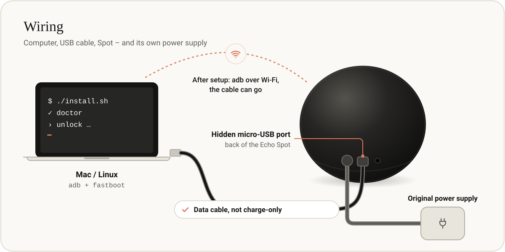
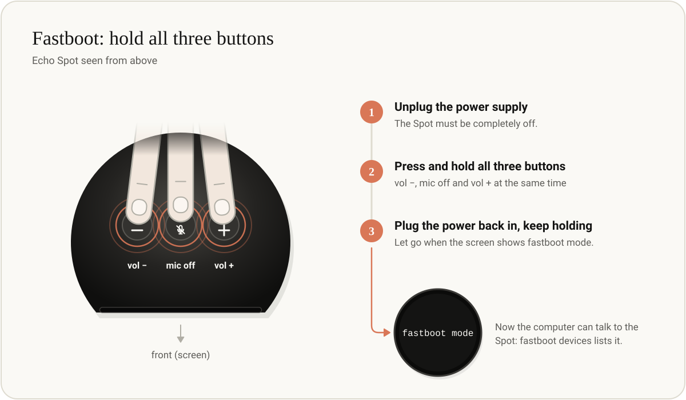

<sub>**English** · [Deutsch](../de/09-troubleshooting.md)</sub>

# 9 · Troubleshooting and FAQ

> **Goal:** find and fix a problem quickly, by installer phase and by symptom · **Time:** 5–30 min per problem · **Installer:** `./install.sh verify`

This chapter is sorted like the installation: computer, unlock, LineageOS, Android setup, apps, voice
assistant, voice commands, clock. Each problem has a heading you can link to. At the end you find the FAQ,
how to restore a backup and how to uninstall.

| Area | Problems |
|---|---|
| [Quick checks](#quick-checks) · [Collect logs](#collect-logs) · [Verify output explained](#verify-output-explained) | start here |
| [Computer and USB](#computer-and-usb) | [doctor reports missing tools](#doctor-reports-missing-tools) · [USB hubs and cables](#usb-hubs-and-cables) · [Linux: adb or fastboot says no permissions](#linux-adb-or-fastboot-says-no-permissions) |
| [Unlock](#unlock) | [fastboot does not see the Spot](#fastboot-does-not-see-the-spot) · [The safety checks stop the unlock](#the-safety-checks-stop-the-unlock) · [Exploit timeout](#exploit-timeout) · [TWRP does not appear](#twrp-does-not-appear) |
| [Backup and LineageOS](#backup-and-lineageos) | [sha256 mismatch](#sha256-mismatch) · [TWRP is not found](#twrp-is-not-found) · [First boot loops](#first-boot-loops) |
| [Android setup](#android-setup) | [adb unauthorized](#adb-unauthorized) · [Rooted debugging is off](#rooted-debugging-is-off) · [adb over Wi-Fi lost after reboot](#adb-over-wi-fi-lost-after-reboot) · [More than one device](#more-than-one-device) |
| [Apps and login](#apps-and-login) | [Aurora install hangs](#aurora-install-hangs) · [Login problems](#login-problems) · [The app release cannot be downloaded](#the-app-release-cannot-be-downloaded) |
| [Voice assistant](#voice-assistant) | [Accessibility service turned off by Android](#accessibility-service-turned-off-by-android) · [Voice button not found](#voice-button-not-found) · [The Spot wakes up by itself](#the-spot-wakes-up-by-itself) · [Wake word not recognised](#wake-word-not-recognised) · [The Spot beeps but nothing opens](#the-spot-beeps-but-nothing-opens) · [Assistant interrupts itself](#assistant-interrupts-itself) · [Conversation does not end](#conversation-does-not-end) · [Spot Voice stopped listening](#spot-voice-stopped-listening) |
| [Voice commands](#voice-commands) | [Voice commands misunderstood](#voice-commands-misunderstood) · [Radio station not found](#radio-station-not-found) · [Spotify does not play](#spotify-does-not-play) |
| [Clock](#clock) | [Weather missing](#weather-missing) · [Clock not shown after wake](#clock-not-shown-after-wake) · [Now playing is not shown](#now-playing-is-not-shown) |
| [Wake-word training](#wake-word-training) · [FAQ](#faq) · [Restore from backup](#restore-from-backup) · [Uninstall and back to stock](#uninstall-and-back-to-stock) | |

## Quick checks

1. Show the settings, the finished phases and what is connected:

   ```bash
   ./install.sh status
   ```

2. Check the whole installation (needs the Spot running LineageOS and reachable over adb):

   ```bash
   ./install.sh verify
   ```

3. If a phase failed, fix the cause shown above the error and run that phase again, for example
   `./install.sh voice`. Every phase can be run again safely. `./install.sh` alone continues with the
   first phase that is not done yet.

## Collect logs

Spot Voice logs with the tag `HeyClaude`, its wake-word detector with `OpenWakeWord`, and Spot Clock with `SpotClock`.

1. Watch the log live (stop with Ctrl+C):

   ```bash
   adb logcat -s HeyClaude OpenWakeWord SpotClock
   ```

2. Or record one attempt into a file: clear the log, reproduce the problem, then save it.

   ```bash
   adb logcat -c
   # now reproduce the problem on the Spot
   adb logcat -d -s HeyClaude OpenWakeWord SpotClock > spot-log.txt
   ```

These commands talk to the Spot through `adb`. If `adb devices` lists nothing, connect first with
`adb connect 192.168.x.y:5555` (the address is shown by `./install.sh status` under "Device"). If it lists the Spot
twice (over USB and over Wi-Fi), add `-s 192.168.x.y:5555` after `adb`, see [More than one device](#more-than-one-device).

Useful lines:

| Log line | Meaning |
|---|---|
| `State -> LISTENING` | Spot Voice waits for the wake word. |
| `Detector ready for claude, model=hey_claude (external)` | The wake-word model is loaded. `alexa_v0.1 (fallback)` = no own model found, the wake word is "Alexa". |
| `Wake word detected (score=0.83, threshold=0.6, frames=4)` | The wake word fired. |
| `Command heard: '…'` | What the offline speech recognition understood after the wake word. |
| `No command in '…' -> probably a false alarm, not opening the assistant` | Room talk after the wake word: ignored. |
| `Launcher: started com.anthropic.claude (autoTap=true, a11y=true)` | The assistant app was opened. `a11y=false` = accessibility service not running. |
| `A11y: voice-mode button tapped` | The auto-tap worked. |
| `EchoGuard on (claude, visualizer=true)` | The echo guard watches the speaker. |
| `EchoGuard: Claude speaks -> mic muted` / `EchoGuard: Claude done -> mic open` | The echo guard at work. |
| `EchoGuard: end conversation (10 s silence) -> end button` | Why a conversation ended (`stop phrase`, `wake word`, `10 s silence`, `30 s silence`). |
| `A11y: sending RESUME (…)` | The conversation is over; Spot Voice listens again. |
| `Voice commands off: no Vosk model in …` | The speech model for voice commands is missing. |
| `room light 12 lux -> level 1` (tag `SpotClock`) | The clock adapts its brightness. |

> [!WARNING]
> Logs can contain private text. `Command heard` shows what you said after the wake word, and `DUMP_NODES`
> (see [Voice button not found](#voice-button-not-found)) lists texts on the screen, which can include parts of
> your chat or your account name. Read a log before you post it anywhere and remove what is private.

## Verify output explained

`./install.sh verify` prints one row per check. `✓` = ok, `✗` = failed (with a fix after `->`),
`?` = could not tell for sure (never counts as a failure), `·` = not checked (dry run). With at least one `✗`
it stops with `N check(s) failed - see the hints (->) above.` and skips the live test. A failed row looks like this:

```
==> Checks
   ✓ Spot Voice installed (ai.pocket.heyclaude)
   ✓ Spot Clock installed (ai.pocket.spotclock)
   ✓ Claude installed (com.anthropic.claude)
   ✗ Accessibility service enabled
       -> ./install.sh voice, or on the Spot: Settings > Accessibility > Spot Voice
```

| Row | What is checked | If it fails |
|---|---|---|
| Spot Voice installed (ai.pocket.heyclaude) | the package exists | `./install.sh voice` |
| Spot Clock installed (ai.pocket.spotclock) | the package exists | `./install.sh clock` |
| Claude installed (com.anthropic.claude) or ChatGPT installed (com.openai.chatgpt) | the assistant app exists | `./install.sh apps`, see [Aurora install hangs](#aurora-install-hangs) |
| Spotify installed | only if you chose Spotify | `./install.sh apps --spotify` |
| Accessibility service enabled | Spot Voice's service is in the list of enabled accessibility services, and accessibility is on | `./install.sh voice`, see [Accessibility service turned off by Android](#accessibility-service-turned-off-by-android) |
| Notification access for Spot Clock | the clock may read media sessions | `./install.sh clock`. Only needed for the now-playing face. |
| Spot Clock is the home screen | the HOME intent opens the clock | `./install.sh clock` |
| Spot Clock is the screensaver | the screensaver is the clock | `./install.sh clock` |
| Wake-word models on the Spot (hey_claude.onnx, danke_claude.onnx) | the wake model is in the app's files folder | `./install.sh voice`. Shows `?` with `No trained hey_chatgpt.onnx - the wake word is "Alexa"` when `models/` has no model for your assistant: [chapter 8](08-wakeword-training.md). |
| Vosk speech model on the Spot (vosk-de or vosk-en) | the speech model for voice commands is there | `./install.sh voice --force` |
| WakeWordService running | the listening service runs | `./install.sh voice`, or open Spot Voice and tap "Start listening" |
| Claude logged in (heuristic) | the app keeps at least 10 MB of data (needs Rooted debugging) | Never fails. `?` = open the app on the Spot and look. Claude: `./install.sh open-link`. |
| Live test: voice-mode button tapped | opens voice mode as if you had said the wake word, waits up to 25 s for `voice-mode button tapped` in the log | Is the assistant logged in? Is the accessibility service on? See [Voice button not found](#voice-button-not-found). |

When everything is fine, verify ends with `All checks passed.` (11 rows without Spotify, plus the live test).

## Computer and USB

### doctor reports missing tools

`./install.sh doctor` checks your computer and prints `[xx] <tool> not found` for everything that is missing.
It offers to install adb and fastboot for you (Homebrew on macOS, apt on Linux).

| Tool | Needed for | Install |
|---|---|---|
| `adb`, `fastboot` | everything that talks to the Spot | macOS: `brew install android-platform-tools` (needs [Homebrew](https://brew.sh)). Linux: `sudo apt install adb fastboot` |
| `curl`, `unzip` | downloads | `brew install curl unzip` or `sudo apt install curl unzip` |
| `python3` | reading the weather place search (JSON) | macOS: `xcode-select --install`. Linux: `sudo apt install python3` |
| `shasum` or `sha256sum` | checksums | part of macOS and of most Linux systems |
| `gtimeout` (optional) | time limits | `brew install coreutils`; without it the installer uses its own |
| `apksigner` (optional) | signature check of Aurora Store and the [Aurora fallback](#aurora-install-hangs) | Android SDK build-tools |
| `scrcpy` (optional) | shows the Spot's screen on your computer | `brew install scrcpy` |

Doctor also warns when less than about 5 GB of disk space is free (LineageOS, backup, speech model).
After installing, run `./install.sh doctor` again until it says `This computer is ready.`

### USB hubs and cables

Most connection problems are the cable or a hub.

1. Plug the cable **directly** into the computer. No USB hub, no dock, no monitor port.
2. Use a micro-USB **data** cable. Many cheap cables can only charge. If the computer does not react at all
   when you plug in the Spot, try another cable.
3. Keep the Spot's original power supply connected the whole time. The USB port does not power the Spot.
4. Run `./install.sh doctor`. It checks the tools and prints these hints too.

<p align="center">
  
</p>

### Linux: adb or fastboot says no permissions

Linux is untested. If `adb devices` or `fastboot devices` shows `no permissions`, install the udev rules and
plug the Spot in again, for example:

```bash
sudo apt install android-sdk-platform-tools-common
```

## Unlock

### fastboot does not see the Spot

The unlock phase waits up to 10 minutes and prints `No fastboot device found.` if nothing appears.

1. Unplug the Spot's power supply. The Spot must be completely off.
2. Press and hold **all three** top buttons (Volume −, the middle button, Volume +).
3. Keep holding and plug the power back in. Let go when the screen shows **"fastboot mode"**.
4. Check on the computer:

   ```bash
   fastboot devices
   ```

   You should see one line with a serial number and `fastboot`.
5. Still empty? Check [USB hubs and cables](#usb-hubs-and-cables). On a Mac, install or update the platform tools:
   `brew install android-platform-tools` (or `brew upgrade android-platform-tools`). Run `./install.sh unlock` again.

<p align="center">
  
</p>

### The safety checks stop the unlock

Before anything is written, the installer reads four values. If one does not match, it stops and **nothing is changed**.

| Message | Meaning and fix |
|---|---|
| `Expected exactly 1 fastboot device, found: N` | Unplug other phones and tablets. |
| `product='…' (expected ROOK) - this is not an Echo Spot 1st gen` | Only the 1st generation Echo Spot (2017/2018, "rook") is supported. |
| `unlock_status = true: this Spot is already unlocked - the payload is NOT sent again.` | Good news. Answer `Y` to mark the unlock as done. Start TWRP: unplug power, hold Volume + while plugging it back in. |
| `Unexpected bootloader version lk_build_desc='…'` | Only Fire OS 5.5.6.9 (bootloader `c1c79aa-20220824_171625`) was tested. Ask in the [XDA thread](https://xdaforums.com/t/unlock-root-twrp-unbrick-amazon-echo-spot-2017-rook.4754878/) before you try anything else. |

### Exploit timeout

A timeout is **expected**. This is what a successful unlock looked like on the tested Spot:

1. Attempt 1 prints `restricted on locked hw`. That is normal.
2. Attempt 2 hangs and times out after 8 seconds (`exit=124`). That means the exploit is running.
   The installer says `Timeout while sending -> the exploit is most likely running.` and sends nothing more.
3. About 30 seconds later TWRP appears. The installer waits up to 6 minutes for it.

> [!WARNING]
> From the moment you type `YES` until TWRP appears, do **not** unplug the cable or the power.

Other messages:

| Message | What to do |
|---|---|
| `eMMC-RO` … `permanently read-only (hardware defect)` | The Spot's storage is defective. The device is unchanged; the unlock cannot work on it. |
| `Device mismatch - wrong payload for this device.` | The payload does not fit this device. Stop and ask in the XDA thread. |
| `fastboot refuses the image (-S had no effect)` | Your fastboot is too old: `brew upgrade android-platform-tools`, then run `./install.sh unlock` again. |
| `No success after 15 attempts. Do NOT cut the power - look at the screen first.` | Look at the Spot. If it still shows "fastboot mode", nothing is running: unplug power, enter fastboot mode again and run `./install.sh unlock` again. If it shows anything else, wait a few minutes before you touch it. |

<a id="the-unlock-stops-or-twrp-does-not-appear"></a>

### TWRP does not appear

After the timeout the installer waits up to 6 minutes for TWRP (`adb get-state` = `recovery`).

1. Wait the full 6 minutes. Do not unplug anything.
2. TWRP is on the screen, but the installer does not see it? Check the cable and run `adb devices`.
   Then run `./install.sh unlock` again: it notices `TWRP is already running - the Spot is unlocked.`
3. The screen stays black or shows something else after 6 minutes: unplug the power, hold **Volume +** and
   plug it back in. If the unlock worked, TWRP starts.
4. Not sure whether the unlock worked? Enter fastboot mode (three buttons) and run `./install.sh unlock` again.
   The read-only checks report `unlock_status = true` if the Spot is unlocked; the payload is then **not** sent again.
5. Neither fastboot nor TWRP starts: the [XDA thread](https://xdaforums.com/t/unlock-root-twrp-unbrick-amazon-echo-spot-2017-rook.4754878/)
   of amonet describes how to unbrick a Spot.

## Backup and LineageOS

### sha256 mismatch

Every download and every copy is checked with sha256.

| Where | Message | What to do |
|---|---|---|
| A download (LineageOS, Aurora, Vosk, app release) | `Checksum mismatch for …` with `expected` / `got` | The file was renamed to `….bad`. Run the same command again; it downloads the file fresh. |
| amonet zip | `This is not the tested amonet-rook v2.0.0 zip.` | Download `amonet-rook-v2.0.0.zip` again from the XDA thread. Other versions are not supported by the installer. |
| LineageOS on the Spot (flash) | `sha256 on the Spot is wrong (…) - the copy is damaged.` | Nothing was installed yet. Check the cable, then `./install.sh flash`. |
| Backup | `size mismatch` or `sha256 mismatch`, then `… partition(s) failed verification` | Run `./install.sh backup` again **before** you flash anything. |
| App release | `… is not listed in SHA256SUMS of the release` | Try again later, or build the apps yourself: `./install.sh voice clock --from-source`. |

Check a backup later at any time:

```bash
(cd backups/<date> && shasum -a 256 -c MANIFEST.sha256)
```

### TWRP is not found

Backup and flash need TWRP. If the installer says `TWRP not found.`:

1. Unplug the Spot's power. Keep the USB cable connected.
2. Hold **Volume +** and plug the power back in.
3. Let go when the blue TWRP screen appears, then run the phase again.

<a id="lineageos-does-not-start"></a>

### First boot loops

The first start of LineageOS takes **about 5 minutes**. The boot animation may run for a long time. That is normal.

If the Spot still shows the boot animation after about 15 minutes, or restarts again and again:

1. Unplug the power, hold **Volume +** and plug it back in to start TWRP.
2. Run the flash phase again. It wipes cache, data and system, copies and checks LineageOS again and installs it:

   ```bash
   ./install.sh flash
   ```

3. If the installation in TWRP reports an error, the installer says so and the Spot stays in TWRP.
   Do not reboot it; copy the TWRP output and ask for help (see [If something goes wrong](#if-something-goes-wrong)).

## Android setup

<a id="adb-shows-unauthorized-or-no-device"></a>

### adb unauthorized

`adb devices` shows `unauthorized`, or the installer says
`The Spot asks for permission: tap "Allow" in the "Allow USB debugging?" dialog`.

1. Look at the Spot's screen. In the dialog **"Allow USB debugging?"**, tick
   **"Always allow from this computer"** and tap **"Allow"**.
2. No dialog? Unplug the USB cable and plug it in again.
3. Still nothing? On the Spot open Settings > System > Advanced > Developer options and tap
   **"Revoke USB debugging authorizations"**. Then restart adb on the computer and plug in again:

   ```bash
   adb kill-server
   adb devices
   ```

After a new LineageOS installation you have to allow the computer again.

**No device at all** (`adb devices` lists nothing, or the setup phase ends with
`The Spot did not show up with USB debugging.` after waiting up to 30 minutes):

1. LineageOS must be running (not TWRP, not the boot animation).
2. Developer options must be on: Settings > About tablet, tap **"Build number"** 7 times.
3. In Settings > System > Advanced > Developer options, switch on **"USB debugging"** (LineageOS may call it
   "Android debugging") and **"Rooted debugging"**.
4. Check the cable and the port: [USB hubs and cables](#usb-hubs-and-cables). Then run `./install.sh setup` again.

### Rooted debugging is off

Message: `adb could not switch to root`. Several steps need adb as root: language and time zone, starting the
listening service, the Aurora fallback and the login check.

1. On the Spot: Settings > System > Advanced > Developer options.
2. Switch on **"Rooted debugging"**.
3. Run the phase again.

<a id="adb-over-wi-fi-is-gone-after-a-reboot"></a>

### adb over Wi-Fi lost after reboot

`adb tcpip 5555` only lasts until the Spot restarts. The Spot's IP address can also change.
The installer notices this: `The Spot does not answer at 192.168.x.y:5555.`

1. Connect the USB cable (hidden port on the back).
2. Wait until the Spot shows its clock.
3. Answer `Y` to `Switch adb over Wi-Fi on again (cable can be removed afterwards)?`. The new address is saved.

By hand:

```bash
adb tcpip 5555
adb connect 192.168.x.y:5555
```

> [!TIP]
> Give the Spot a fixed IP address in your router (DHCP reservation), so the saved address stays valid.
> LineageOS also has an **"ADB over network"** switch in Developer options as an alternative.

### More than one device

Message: `More than one Android device is connected.` Unplug the others, or choose the Spot with
`--device <serial>` (USB) or `--device 192.168.x.y:5555` (Wi-Fi). `adb devices -l` lists what is connected.

This also happens with **one** Spot: after the setup phase it can be connected twice, over USB and over Wi-Fi.
`adb devices` then shows two lines, a serial number with `device` and `192.168.x.y:5555` with `device`. Your own
`adb shell …` commands then stop with `adb: more than one device/emulator`, and phases that start on USB (such as
`setup`) wait with the message above. Any of these fixes it:

1. Unplug the USB cable (the power supply stays in). Everything after setup works over Wi-Fi.
2. Or drop the Wi-Fi connection for now: `adb disconnect 192.168.x.y:5555`.
3. Or name the device in your own commands: `adb -s 192.168.x.y:5555 shell …`.

## Apps and login

<a id="aurora-store-hangs-while-installing"></a>

### Aurora install hangs

On this ROM, Aurora Store's install confirmation sometimes hangs. The installer waits up to 10 minutes for the
app, then offers a fallback: it takes the files Aurora has already downloaded and installs them directly with adb.

1. Answer `Y` to `Try the fallback now?`.
2. The fallback needs **Rooted debugging** ([see above](#rooted-debugging-is-off)) and `apksigner` from the
   Android SDK build-tools, to check that all parts of the app have the same valid signature.

| Message | What to do |
|---|---|
| `Aurora has not downloaded <pkg> yet.` | Tap "Install" in Aurora, wait until the download has finished, then run `./install.sh apps` again. |
| `The fallback needs apksigner (Android SDK build-tools)` | Install `apksigner` as described below, then run `./install.sh apps` again. |
| `No armeabi-v7a split found` | The app version may not run on the Spot (32-bit ARM). Try again later, a newer version may have it. |
| `The split APKs do not all have the same valid signer - not installing them.` | The files cannot be trusted, so nothing was installed. Try again later; if it happens again, ask for help. |

First time in Aurora: go through its welcome screens and choose the **anonymous** login. No Google account is needed.

**Getting `apksigner`.** The installer looks for `apksigner` on your path, or in the newest `build-tools/<version>/`
folder of an Android SDK in `ANDROID_HOME`, `ANDROID_SDK_ROOT`, `~/Library/Android/sdk` (macOS) or `~/Android/Sdk`
(Linux). That SDK folder must also contain a `platforms/` folder. `apksigner` is a Java program, so you also need
JDK 17 or newer. Two ways on a Mac (neither was tried on a clean Mac for this guide):

1. **With Android Studio** (easiest): install [Android Studio](https://developer.android.com/studio), start it once
   and let its setup wizard download the SDK. It goes to `~/Library/Android/sdk` and includes build-tools and a
   platform. Then install Java: `brew install openjdk@17`.
2. **Without Android Studio**, in one terminal window:

   ```bash
   brew install openjdk@17
   brew install --cask android-commandlinetools
   export JAVA_HOME="$(brew --prefix openjdk@17)"
   export ANDROID_HOME="$(brew --prefix)/share/android-commandlinetools"
   sdkmanager "build-tools;36.0.0" "platforms;android-30"
   ./install.sh apps
   ```

   `ANDROID_HOME` only lasts for this terminal window. In a new window, set it again before you run the installer.

`./install.sh doctor` shows `[ok] apksigner: …` when it is found.

<a id="the-login-link-does-not-open"></a>

### Login problems

**Claude** signs in with a link from an e-mail ("magic link"). The link must be opened **on the Spot**:

1. On the Spot, in the Claude app, continue with e-mail and type your address.
2. On your computer, open the e-mail. Right-click the sign-in button and copy the link. Do not click it.
3. Run:

   ```bash
   ./install.sh open-link
   ```

4. Paste the link and press Enter. You will not see the text. The link is not saved anywhere.
5. Look at the Spot: the app opens and finishes the sign-in.

| Problem | What to do |
|---|---|
| `That does not look like a link (must start with https://).` | Copy the whole link, starting with `https://`. |
| The app says the link is invalid or expired | Request a new e-mail and use the new link right away. |

**ChatGPT** signs in with e-mail and a code that you type on the Spot. "Continue with Google" needs Google
services and does not work. Typing on the small round screen is fiddly; `scrcpy` shows the Spot on your
computer so you can use your keyboard:

```bash
brew install scrcpy
scrcpy                          # over Wi-Fi: scrcpy -s 192.168.x.y:5555
```

**Microphone:** if the assistant app asks for the microphone, allow it. The apps phase can also grant it for you.

### The app release cannot be downloaded

The `voice` and `clock` phases download `spot-voice.apk`, `spot-clock.apk` and `SHA256SUMS` from the latest
[GitHub release](https://github.com/Nachtfux/Echo_spot_second_life/releases) of this project. If that fails, the
installer stops with:

```
[xx] Could not download the app release from GitHub: https://github.com/Nachtfux/Echo_spot_second_life/releases/latest/download
     No internet, or no release published yet. You can build the apps yourself: add --from-source
```

1. Check your computer's internet connection and run the same phase again.
2. Open the releases page in your browser. If it lists no release yet, build the apps yourself. This needs JDK 17
   and the Android SDK; `./install.sh build` tells you what is missing and how to get it:

   ```bash
   ./install.sh voice clock --from-source
   ```

3. If you have built the apps before (`dist/spot-voice.apk`), the installer offers to use them:
   `Use the locally built dist/spot-voice.apk instead? [Y/n]`.

## Voice assistant

### Accessibility service turned off by Android

Spot Voice needs its accessibility service (shown in Settings as **"Spot Voice Auto-Tap"**) to tap the voice-mode
button, to mute the assistant's microphone while it talks and to notice when a conversation is over.

**Symptoms:** the assistant opens but voice mode does not start; the Spot does not go back to the clock;
verify shows `✗ Accessibility service enabled`; the Spot Voice app shows "Accessibility service: no";
the log says `a11y=false`.

**Why Android switches it off:**

- Spot Voice was **force-stopped** (Settings > Apps > Spot Voice > Force stop, or `am force-stop`).
- Spot Voice was **uninstalled and installed again**, for example after the installer said
  `An older ai.pocket.heyclaude with a different signature is installed.` and you answered `Y` to
  `Uninstall it (its settings are lost) and install again?` (this happens when you switch between the release APK
  and a self-built one).
- The service **crashed**. Settings then marks it as not working.

**Fix:**

1. Run the voice phase. It notices the missing service and asks `Enable the accessibility service for Spot Voice now via adb? [y/N]`:

   ```bash
   ./install.sh voice
   ```

2. Or on the Spot: Settings > Accessibility > **Spot Voice Auto-Tap** > switch on and confirm with "Allow".
3. Check:

   ```bash
   adb shell settings get secure enabled_accessibility_services
   ```

   The output must contain `ai.pocket.heyclaude/ai.pocket.heyclaude.launch.VoiceModeA11yService`.

<a id="voice-mode-does-not-start"></a><a id="chatgpt-buttons-are-not-found"></a>

### Voice button not found

The assistant opens, but voice mode does not start. In the log you see lines like these:

```
A11y: try 1/8: no node matches (?i)voice|sprach|stimm|sound ?wave|audio
A11y: 42 candidate nodes (of 180):
  cand[0] ImageView desc="…" [click] [0,0][48,48]
A11y: giving up auto-tap after 8 tries; set claude_voice_button_pattern to a label above
```

Spot Voice looks for the voice-mode button by its label. If the app was updated and the label changed, or a
dialog (update hint, login) covers the chat screen, the search fails.

1. Open the assistant on the Spot and check that its normal chat screen is visible (no dialog, logged in).
2. Dump the labels of everything on the screen:

   ```bash
   adb logcat -c
   adb shell am broadcast -a ai.pocket.heyclaude.DUMP_NODES -p ai.pocket.heyclaude
   adb logcat -d -s HeyClaude > nodes.txt
   ```

3. In `nodes.txt`, find the voice-mode button and its `desc="…"`.
4. Do the same once more while voice mode is open, to see the labels of the mute, unmute and end buttons.

> [!NOTE]
> **ChatGPT support is new and tested less than Claude.** The ChatGPT labels in `Assistant.kt` are still being
> calibrated on the device. If voice mode, mute or end do not work with ChatGPT, please open an issue with the
> relevant `desc="…"` lines from the dump (remove private text first).

**Quick test with your own label (advanced, needs Rooted debugging).** Spot Voice reads three overrides from its
settings file `shared_prefs/hey_claude.xml`: `<id>_voice_button_pattern`, `<id>_new_chat_pattern` and
`<id>_package`, where `<id>` is `claude` or `chatgpt`. The value is a regular expression.

1. Stop the app and copy its settings file to the computer:

   ```bash
   adb root
   adb shell am force-stop ai.pocket.heyclaude
   adb pull /data/data/ai.pocket.heyclaude/shared_prefs/hey_claude.xml
   ```

2. Open `hey_claude.xml` and add a line before `</map>`, with the label you found:

   ```xml
   <string name="chatgpt_voice_button_pattern">(?i)sprachmodus|voice mode</string>
   ```

   In XML, write `&` as `&amp;` and `<` as `&lt;`.
3. Write the file back into the existing file (this keeps its owner and security label), then run the voice phase:

   ```bash
   adb push hey_claude.xml /data/local/tmp/hey_claude.xml
   adb shell 'cat /data/local/tmp/hey_claude.xml > /data/data/ai.pocket.heyclaude/shared_prefs/hey_claude.xml && rm /data/local/tmp/hey_claude.xml'
   ./install.sh voice
   ```

   The force-stop switched the accessibility service off; answer `y` when the voice phase asks to enable it.
4. Test without speaking:

   ```bash
   adb shell am start-foreground-service -n ai.pocket.heyclaude/.WakeWordService -a ai.pocket.heyclaude.TRIGGER_NOW
   ```

Limits of the override: the built-in exclusion list (dictation, read aloud, mute, end …) still applies, and the
mute, unmute and end labels cannot be overridden. For those, change the profile in
`apps/voice/app/src/main/java/ai/pocket/heyclaude/Assistant.kt` and build the app yourself
(`./install.sh voice --from-source`), see [chapter 10](10-architecture.md#add-another-assistant).

### The Spot wakes up by itself

The screen turns on and the assistant opens although nobody said the wake word. Usually the TV, a radio or a
conversation in the room contained something that sounded similar.

**What already protects you:**

- The score must stay above the threshold for **4 frames in a row** (320 ms, setting "normal").
- After the wake word, the offline speech recognition listens briefly. If it hears **more than two words that
  are not a command**, Spot Voice treats it as room talk: you hear a low error tone and the assistant does **not**
  open. This needs the Vosk speech model ([check](#verify-output-explained)).

**What you can do:**

1. Find out what happened. Look for these lines:

   ```bash
   adb logcat -d -s HeyClaude | grep -E "Wake word detected|Command heard|false alarm"
   ```

2. Make the wake word less sensitive. This re-runs the voice phase and keeps the setting for later runs:

   ```bash
   ./install.sh voice --sensitivity low
   ```

   Or change it right away without the installer (the listening service must be running):

   ```bash
   adb shell am broadcast -a ai.pocket.heyclaude.SET_THRESHOLD -p ai.pocket.heyclaude --ef wake 0.6 --ef stop 0.5 --ei frames 5
   ```

3. Move the Spot away from the TV or the loudspeaker. Most false wakes come from there.
4. Spot Voice shows `alexa_v0.1 (fallback)`? Then the wake word is **"Alexa"**, which is said a lot on TV.
   Run `./install.sh voice` again to copy the trained models; see [chapter 8](08-wakeword-training.md).
5. A word in your home keeps triggering it? Add it as a negative phrase and train your own model
   ([chapter 8](08-wakeword-training.md#negative-phrases)).
6. To stop listening for a while: open Spot Voice and tap **"Stop listening"**, or tap **"Stop"** in its
   notification. Tap "Start listening" to turn it on again.

Measured for "Hey Claude" and "Hey ChatGPT" (false wakes on 10.7 h of real-world audio; recall on synthetic clips):

| `--sensitivity` | Threshold / frames | Hey Claude: recall | false wakes/h | Hey ChatGPT: recall | false wakes/h |
|---|---|---|---|---|---|
| `high` | 0.6 / 3 | 63 % | 0.93 | 79 % | 0.65 |
| `normal` (default) | 0.6 / 4 | 55 % | 0.28 (about once every 3.5 h) | 73 % | 0.19 (about once every 5 h) |
| `low` | 0.6 / 5 | 45 % | 0 in 10.7 h | 67 % | 0.09 |

More about these numbers: [chapter 8](08-wakeword-training.md#sensitivity-what-the-numbers-mean-on-the-spot).

<a id="the-wake-word-does-not-react"></a>

### Wake word not recognised

1. Is Spot Voice listening? The centre of the clock is **orange with a halo**, and the Spot Voice notification
   says "Listening – say the wake word". Gray = off, see [Spot Voice stopped listening](#spot-voice-stopped-listening).
2. Which word does it expect? Spot Voice shows `Model: hey_claude (external)`. If it shows `alexa_v0.1 (fallback)`,
   the wake word is "Alexa": run `./install.sh voice` (and for ChatGPT see [chapter 8](08-wakeword-training.md)).
3. Speak towards the Spot, from a normal distance, and make a short pause after "Hey Claude".
4. Make it more sensitive (more false wakes, see the table above):

   ```bash
   ./install.sh voice --sensitivity high
   ```

5. Test the microphone: open Spot Voice, tap "Stop listening", then use **Mic test** > "Start test". It shows the
   level and the wake score while you speak. Tap "Start listening" afterwards.
6. Spot Voice says "Mic delivers only silence – open the app once and restart listening": do exactly that.
7. Still bad with your voice? Train your own model and test it with recordings of your voice
   ([chapter 8](08-wakeword-training.md#test-with-your-own-voice)).

### The Spot beeps but nothing opens

After the wake word Spot Voice listens about two seconds for an offline voice command. What happens next:

| You hear | Meaning |
|---|---|
| a short beep, then the assistant opens | Nothing was said or only a short reply: voice mode starts. |
| a short confirmation tone | A voice command was understood and done. |
| a low error tone | Either more than two words without a command (treated as room talk), or a command failed (station not found, Spotify missing). |

So: say **"Hey Claude"**, wait for voice mode, then talk to Claude. If you say "Hey Claude, what is the weather
tomorrow?" in one breath, Spot Voice hears a sentence that is not a command and ignores it.
`Command heard: '…'` in the [log](#collect-logs) shows what it understood.

<a id="the-assistant-hears-itself"></a>

### Assistant interrupts itself

The Spot has no hardware echo cancellation. Without help the assistant would hear its own voice from the speaker
and interrupt itself. **EchoGuard** prevents that: it watches the speaker output and taps the assistant's mute
button while the assistant talks, then unmutes it.

1. Look for these log lines:

   ```bash
   adb logcat -s HeyClaude | grep EchoGuard
   ```

   - `EchoGuard on (claude, visualizer=true)` at the start of a conversation.
   - `EchoGuard: Claude speaks -> mic muted` and `EchoGuard: Claude done -> mic open` while it works.
2. No `EchoGuard on`? The accessibility service is off, see [above](#accessibility-service-turned-off-by-android).
3. `EchoGuard on` but never `mic muted`? The mute button label was not found. For ChatGPT the labels are still
   being calibrated; dump them as in [Voice button not found](#voice-button-not-found) while voice mode is open.
4. `visualizer=false`: Spot Voice cannot read the speaker level and falls back to a coarser signal. Lower the
   volume a bit.
5. You muted the microphone yourself in the app: EchoGuard never undoes that. Tap unmute.

> [!NOTE]
> EchoGuard is half duplex: while the assistant talks, it cannot hear you. Wait until it has finished, then speak.
> See also [Can I interrupt the assistant?](#can-i-interrupt-the-assistant)

### Conversation does not end

A conversation ends when one of these happens:

| Way | Details |
|---|---|
| 10 s of silence | after the assistant's last answer. While the assistant is still thinking about your question, 30 s. |
| Stop phrase | "Danke Claude", "Claude stopp", "Thank you Claude", "Thanks ChatGPT", "Bye ChatGPT" … (seen in the app's transcript), or the stop-word model. |
| The wake word again | saying "Hey Claude" during a conversation ends it. |
| Power button | the middle top button turns the screen off and ends the conversation. |
| The assistant's own End button, or going home | the Spot goes back to the clock. |

If it does not end:

1. Press the **middle top button** (power) or say the wake word again.
2. Sound in the room (TV, music, people talking) counts as "not silent". Turn it down or use the stop phrase.
3. Check the [log](#collect-logs) for `EchoGuard: end conversation (…) -> end button`. If that line appears
   but voice mode stays open, the End button label was not found (likely with ChatGPT): see
   [Voice button not found](#voice-button-not-found).
4. Safety net: after 10 minutes without an end, Spot Voice listens for the wake word again anyway.

### Spot Voice stopped listening

The centre of the clock is gray, or verify shows `✗ WakeWordService running`.

1. Open **Spot Voice** on the Spot (tap the clock, then the app) and tap **"Start listening"**.
2. Or from the computer (needs Rooted debugging):

   ```bash
   adb shell am start-foreground-service -n ai.pocket.heyclaude/.WakeWordService
   ```

3. After a reboot Spot Voice starts by itself, **unless** you stopped it with "Stop" in its notification or
   "Stop listening". That choice is remembered; tap "Start listening" once.

## Voice commands

<a id="voice-commands-are-not-recognised"></a>

### Voice commands misunderstood

Voice commands are recognised offline on the Spot with a small Vosk model (German or English). They are short:
wait for the beep after the wake word, start within about 2 seconds, and keep them under about 7 seconds.
All commands: [chapter 6](06-voice-commands.md).

1. See what was understood:

   ```bash
   adb logcat -s HeyClaude | grep -E "Command heard|Voice command"
   ```

2. Check the command language. Spot Voice shows "Command language", and the status line
   "Voice commands (vosk-de): yes". To switch the Spot and the commands to English:

   ```bash
   ./install.sh setup voice --lang en
   ```

   Only the command language, without the installer:

   ```bash
   adb shell am broadcast -a ai.pocket.heyclaude.SET_LANG -p ai.pocket.heyclaude --es lang en
   ```

   The Vosk model of that language must be on the Spot (`./install.sh voice` puts it there).
3. `Voice commands off: no Vosk model in …`: run `./install.sh voice --force`.
4. Test the text parser without speaking. This really runs the command (here: a 5-minute timer):

   ```bash
   adb shell am broadcast -a ai.pocket.heyclaude.COMMAND -p ai.pocket.heyclaude --es text "timer five minutes"
   ```

   The log shows `Test command 'timer five minutes' (en) -> Timer(300s)`.
5. Speak clearly and simply. Spelled letters are joined: "s w r drei" becomes "swr3".

### Radio station not found

You hear a low error tone and the log says `No station for '…'`. Stations are looked up by name on
[radio-browser.info](https://www.radio-browser.info): German commands search German stations first, English
commands the country of the Spot's language setting, then worldwide.

1. Say "radio" before the name ("radio BBC one", "spiel Radio SWR drei"). With just "play <name>" a station is
   only chosen if its name matches exactly and it has enough votes; otherwise Spotify searches for it.
2. Use the name as it is listed on radio-browser.info. Spell letters if needed ("s w r drei").
3. Test with text and look at the log:

   ```bash
   adb shell am broadcast -a ai.pocket.heyclaude.COMMAND -p ai.pocket.heyclaude --es text "radio bbc one"      # English commands
   adb shell am broadcast -a ai.pocket.heyclaude.COMMAND -p ai.pocket.heyclaude --es text "radio s w r drei"   # German commands
   adb logcat -d -s HeyClaude | grep -i radio
   ```

   A station that is found starts playing; `Radio: <name> (<votes> votes) <stream>` in the log shows which one.

4. `radio-browser search failed`: the Spot has no internet connection, or the directory is not reachable.

### Spotify does not play

1. Spotify must be installed and logged in: `./install.sh apps --spotify`, then open Spotify once on the Spot and log in.
2. "play <something>" opens a Spotify search and starts playing. The clock comes back after a few seconds.
3. `Spotify search failed` in the log: Spotify is missing or could not start.

## Clock

<a id="no-weather-on-the-clock"></a>

### Weather missing

| On the clock | Meaning | What to do |
|---|---|---|
| `—` and **NO LOCATION** | No weather place is set. | `./install.sh clock --place "Berlin"` |
| **LOADING …** for a long time | No answer from Open-Meteo yet. | Check the Spot's Wi-Fi. The clock retries after a minute and refreshes every 15 minutes. |
| The weather of the wrong place | Another place with the same name. | `./install.sh clock --place "Neustadt, Holstein"` (name plus region) and pick the right entry. |

Open-Meteo finds places by **name**, not by postal code. The installer lists several places with the same name and
lets you choose. You can also set the coordinates directly:

```bash
adb shell am start -n ai.pocket.spotclock/.ClockActivity --es lat 52.52 --es lon 13.40 --es place Berlin
```

Logs: `adb logcat -s SpotClock`.

<a id="the-clock-is-not-the-home-screen"></a>

### Clock not shown after wake

After a conversation, or when the screen turns on, the Spot should show the clock. If it shows the LineageOS home
screen, the assistant app or a black screen:

1. Run `./install.sh verify`. The rows `Spot Clock is the home screen` and `Spot Clock is the screensaver` must be `✓`.
2. If not, run:

   ```bash
   ./install.sh clock
   ```

   By hand: `adb shell cmd package set-home-activity ai.pocket.spotclock/.ClockActivity`. If Android asks which
   home app to use, choose Spot Clock ("Always").
3. A lock screen appears first? Set Settings > Security > Screen lock to **None** (recommended in
   [chapter 4](04-setup.md)).
4. The assistant stays in front after a conversation? Press the middle top button (power): the conversation ends
   and the clock comes back. If that happens often, see [Conversation does not end](#conversation-does-not-end).

<a id="the-now-playing-face-does-not-appear"></a>

### Now playing is not shown

The now-playing face needs notification access for Spot Clock (it only reads media sessions, not your notifications).

1. Run `./install.sh clock` and answer `y`, or on the Spot allow notification access for "Spot Clock".
2. The face appears while music plays and for 20 seconds after a pause.

## Wake-word training

Problems while training on your computer (`uv`, path length, pronunciations, disk space) are listed in
[chapter 8: If something goes wrong](08-wakeword-training.md#if-something-goes-wrong).

## FAQ

### Why does the camera not work?

The Spot has a front camera (GC0312 sensor), and the LineageOS kernel even has its driver. But LineageOS 18.1 for
the Spot has **no camera HAL**, the piece of software Android needs to use a camera. Android therefore sees
0 cameras. The MediaTek camera libraries that would fit exist only for Fire OS 5 (Android 5.1) and do not work with
Android 11. This cannot be fixed in this project, so video calls and camera features in Claude or ChatGPT are not possible.

### Can I interrupt the assistant?

No. Because the Spot has no echo cancellation, EchoGuard mutes the assistant's microphone while it talks
(half duplex). Wait until it has finished, then talk. To stop it completely, press the middle top button or say
the wake word again.

### Who can talk to the assistant?

Anyone in the room. Hands-free voice mode answers every voice it hears, and anybody can say the wake word.
The conversation runs in **your** Claude or ChatGPT account.

### What runs offline, what goes to the internet?

| Part | Where |
|---|---|
| Wake word, stop word | offline on the Spot |
| Voice commands (speech recognition) | offline on the Spot (Vosk) |
| Radio station lookup | only the station name goes to radio-browser.info |
| Weather | only the coordinates go to Open-Meteo |
| The conversation itself | the Claude or ChatGPT app, in the cloud, after the wake word |

Spot Voice does not store or send audio itself.

### Does it work on Windows?

`install.sh` runs on macOS (tested) and Linux (should work, untested). Windows is not supported. amonet itself
ships Windows scripts for the unlock, but the other phases need the installer.

### Which wake word do I have without trained models?

"Alexa". Spot Voice falls back to openWakeWord's built-in "Alexa" model when `hey_<assistant>.onnx` is missing.
The repository contains the Claude models; for ChatGPT see [chapter 8](08-wakeword-training.md).

<a id="restore-a-backup"></a>

## Restore from backup

The backup phase saved every partition of the Spot in `backups/<date>/`: one file per partition
(`mmcblk0p<N>_<name>.img`, plus `mmcblk0boot0.img` and `mmcblk0boot1.img`), `PARTITIONS.txt` (which number is
which partition) and `MANIFEST.sha256`.

> [!WARNING]
> Restoring is **not automated** and was **not tested** in this project. Writing the wrong image to the wrong
> partition can brick the Spot for good. The installer never writes images to partitions itself: its safety guard
> refuses any `dd` to a block device and any command that would flash or wipe the boot chain.

High level, if you need it:

1. Keep a copy of the backup folder in a safe place. It contains device-unique data: never upload or share it.
2. Check that it is complete: `(cd backups/<date> && shasum -a 256 -c MANIFEST.sha256)`.
3. Start TWRP (hold **Volume +** while plugging in the power).
4. Read the instructions and recent posts in the amonet [XDA thread](https://xdaforums.com/t/unlock-root-twrp-unbrick-amazon-echo-spot-2017-rook.4754878/)
   before you write anything. It explains which partitions are safe to write on an unlocked Spot and how to unbrick it.
5. Never write `preloader`, `lk`, `tee` or `boot0`/`boot1` unless those instructions explicitly tell you to.

## Uninstall and back to stock

**Remove Spot Voice and Spot Clock, keep LineageOS:**

```bash
adb uninstall ai.pocket.heyclaude
adb uninstall ai.pocket.spotclock
```

Android then uses the LineageOS home screen again; it may ask which home app to use. Choose another screensaver
(or none) in Settings > Display > Screen saver. The assistant apps can be removed in Settings > Apps.

**Back to Fire OS:** in principle this is possible by writing the Fire OS partitions from your backup back in TWRP
(see [Restore from backup](#restore-from-backup)). It is **not automated** and was not tested in this project.
The bootloader stays unlocked either way.

## What the installer does for you

- `./install.sh verify` runs all the checks above, prints a fix for each `✗` and does a live test that opens voice mode.
- `./install.sh status` shows the settings (`.state/config.env`), the finished phases, the latest backup and the connected devices.
- When a phase fails, the installer stops, says which command runs it again and points to this chapter.
- Several problems are handled automatically: the Wi-Fi connection is switched on again after a reboot (with
  your OK), Aurora's hanging installer gets a fallback, a damaged download is renamed to `….bad` so the next run
  fetches it fresh, and an app with a different signature can be replaced after asking you.

## Check

After a fix, run:

```bash
./install.sh verify
```

It ends with `All checks passed.` and the live test reports `voice-mode button tapped`.

## If something goes wrong

If you are stuck, open an issue on [GitHub](https://github.com/Nachtfux/Echo_spot_second_life/issues) with:

1. which phase or chapter, and the exact command you ran,
2. the installer output around the error,
3. a log ([Collect logs](#collect-logs)), with private text removed,
4. your computer (macOS or Linux) and the assistant (Claude or ChatGPT).

Never attach your backup, login links, Wi-Fi details or serial numbers.

---
[← 8 · Train your own wake word](08-wakeword-training.md) · [Overview](../../README.md) · [10 · How it works →](10-architecture.md)
