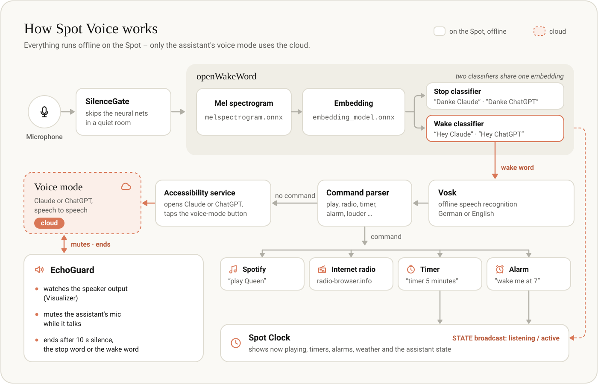
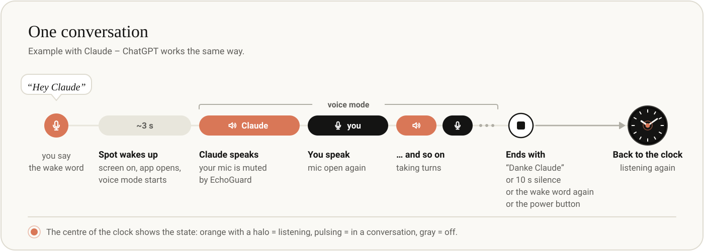
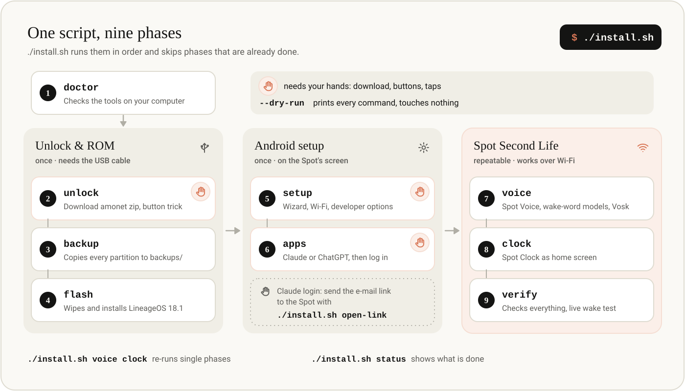

<sub>**English** · [Deutsch](../de/10-architecture.md)</sub>

# 10 · How it works

> **Goal:** understand how the parts fit together, so you can debug, extend or contribute · **Time:** about 20 minutes of reading · **Installer:** —

This chapter is for the curious and for developers. You do not need it to use the Spot.
It describes the code as it is; the contracts between the parts are in [docs/SPEC.md](../SPEC.md).

<p align="center">
  
</p>

## The big picture

| Part | Folder | What it is |
|---|---|---|
| **Spot Voice** | `apps/voice` | Android app (Kotlin, Gradle), package `ai.pocket.heyclaude`. Listens for the wake word, runs offline voice commands, opens Claude or ChatGPT voice mode and guards the conversation. |
| **Spot Clock** | `apps/clock` | Android app (Java 8, plain build script), package `ai.pocket.spotclock`. Home screen, screensaver, timers and alarms, weather, now playing. |
| **Installer** | `install.sh`, `scripts/` | Bash. Takes the Spot from Fire OS to a finished installation, in nine phases. |
| **Training** | `training/` | Trains the wake-word and stop-word models on a computer. |
| **Models** | `models/` | Trained `hey_<assistant>.onnx` and `danke_<assistant>.onnx` (CC BY-NC-SA 4.0). |

What runs where:

- On the Spot, **offline**: the wake word, the stop word, the speech recognition for voice commands, timers and alarms.
- **Online**, with little data: the radio station lookup (only the spoken name goes to radio-browser.info), the
  weather (only the coordinates go to Open-Meteo), Spotify.
- **In the cloud**: only the conversation itself, inside the official Claude or ChatGPT app, after the wake word.

## Spot Voice (`apps/voice`)

Package `ai.pocket.heyclaude`, launcher label "Spot Voice", minSdk 26, targetSdk 30, `armeabi-v7a` only.

| File | Role |
|---|---|
| `WakeWordService.kt` | foreground service with the listening loop |
| `wake/` | openWakeWord port: `SilenceGate`, `FeatureBuffer`, `OnnxFeatureModels`, `OpenWakeWordDetector` |
| `command/` | `VoiceCommands` (Vosk), `GermanParser` / `EnglishParser` → `Action`, `RadioBrowser`, `RadioService` |
| `launch/` | `AssistantLauncher` (opens the app), `VoiceModeA11yService` (taps buttons, notices leaving), `LaunchState` |
| `EchoGuard.kt`, `MicMeter.kt` | half-duplex echo guard and the end-of-conversation logic |
| `Assistant.kt` | one profile per assistant: package, labels, names, model files |
| `Prefs.kt` | settings (assistant, command language, thresholds, overrides) in `shared_prefs/hey_claude.xml` |
| `MainActivity.kt` | status screen: start/stop, assistant and language choice, threshold slider, mic test, launch test |
| `BootReceiver.kt`, `SettingsReceiver.kt` | start after boot or update; store `SET_ASSISTANT` / `SET_LANG` while the service is stopped |

### WakeWordService: the listening loop

A foreground service (type `microphone`) with a partial wake lock. Its worker thread runs this loop:

1. Open the microphone: 16 kHz, mono, 16 bit (`VOICE_RECOGNITION`, falling back to `MIC`).
2. Read 1280 samples (80 ms) at a time.
3. Pass the frame through the `SilenceGate`, then to the detector, which returns a score between 0 and 1.
4. Ignore the first 12 frames (about 1 s) after every (re)start.
5. When the score stays above the threshold long enough (see [Trigger rule](#trigger-rule)), keep the microphone
   open and capture a possible voice command (`captureCommand`).
6. Decide: a command → run it; more than two words without a command → false alarm, ignore it; otherwise →
   release the microphone and open the assistant. The state becomes `PAUSED`.
7. While `PAUSED`, listen for the stop word and the wake word (both end the conversation) and run EchoGuard.
8. Wait for the `RESUME` broadcast (sent when the conversation is over), at most 600 s, then go back to step 1.

Microphone errors are retried with a back-off from 1 s up to 30 s. A `SET_ASSISTANT` broadcast makes the worker drop
and reload the models for the new assistant, also in the middle of a conversation.

### SilenceGate

The neural networks cost CPU on the MT8163. `SilenceGate` computes only the level (RMS) of each frame. While the room
is quiet it skips the networks. When sound starts, it replays the last 16 frames, so the detector is warm and the
beginning of the wake word is not lost. It stays open about 3 s after the last sound. The noise floor adapts, but is
capped: in a loud room (TV, music) the gate simply stays open.

### openWakeWord pipeline

`FeatureBuffer` is a faithful Kotlin port of the streaming path of openWakeWord 0.6.0, run with ONNX Runtime:

| Step | Model | Details |
|---|---|---|
| 1 | `melspectrogram.onnx` | the new 1280 samples plus 480 samples of history → mel frames (32 bins), transformed `x / 10 + 2`, appended to a 76-frame window |
| 2 | `embedding_model.onnx` | the last 76 mel frames → one 96-value embedding per 80 ms |
| 3 | classifier (`hey_claude.onnx` …) | the last 16 embeddings (16 × 96) → score |

The wake classifier and the stop classifier **share** steps 1 and 2: during a conversation the stop model
(`danke_<assistant>.onnx`) scores the same embeddings, so there is no second mel or embedding run.
The score is 0 until the window holds only real embeddings.

Model lookup for the active assistant, in this order:

1. `/sdcard/Android/data/ai.pocket.heyclaude/files/hey_<assistant>.onnx` (pushed by the installer),
2. `assets/models/hey_<assistant>.onnx` inside the APK,
3. `assets/models/alexa_v0.1.onnx`, openWakeWord's pre-trained "Alexa" (wake word only).

A file that exists but does not load is logged and skipped. `apps/voice/tools/oww_reference.py` compares the app's
scores with the official openWakeWord package frame by frame.

### Trigger rule

| | Wake word | Stop word (and wake word during a conversation) |
|---|---|---|
| When | listening for the wake word | only while a conversation runs |
| Rule | score > threshold on **N consecutive frames** | score / own threshold > 1 on **2 consecutive frames** |
| Defaults set by the installer | threshold 0.6, N = 3 / 4 / 5 for `--sensitivity high / normal / low` | stop threshold 0.5 |
| Built-in defaults (no broadcast) | threshold 0.5, N = 4 | 0.5 |
| After a trigger | microphone released for the session | 4 s cooldown |

The number of frames matters much more than the threshold. Measurements: [chapter 8](08-wakeword-training.md#sensitivity-what-the-numbers-mean-on-the-spot).
Change at runtime: `SET_THRESHOLD --ef wake 0.6 --ef stop 0.5 --ei frames 4`.

### After the wake word: commands with Vosk

`captureCommand` runs while the microphone is still open:

1. If music is playing, pause it, so the command can be understood.
2. Tell the clock `active` (its centre pulses) and play a short beep.
3. Feed the audio to Vosk (`vosk-model-small-de-0.15` or `vosk-model-small-en-us-0.15`, unpacked to
   `files/vosk-de/` or `files/vosk-en/`). Return `""` if nobody speaks within 2 s; stop after 7 s at most.
4. Parse the text with `GermanParser` or `EnglishParser` (the `CommandParser` of the command language). Both produce
   the same `Action`s: play/search, radio, radio off, pause, resume, next, previous, volume, timer, cancel timer,
   alarm, cancel alarm. Spelled letters and digits are joined ("s w r drei" → "swr3").
5. `VoiceCommands.execute` runs the action: media keys for playback, a Spotify play-from-search intent, `RadioService`,
   volume steps, or a broadcast to Spot Clock for timers and alarms. A short confirmation tone means done; a low error tone means it failed.

Without a Vosk model the voice commands are off and the assistant opens directly.

### Opening the assistant: AssistantLauncher and VoiceModeA11yService

There is no official deep link into the voice mode of the Claude or ChatGPT app. So Spot Voice opens the app and
taps the button, like a person would, with an accessibility service.

1. `AssistantLauncher` wakes the screen (10 s wake lock), marks a pending tap and starts the app's launch intent.
2. `VoiceModeA11yService` waits for the app's window, then every 400 ms (up to 8 tries, within 15 s):
   - If voice mode is already open (a mute or unmute button is visible), it takes over the session and unmutes if needed.
   - Otherwise it scores all nodes against the profile's voice-button regex: a matching content description beats a
     view id, which beats a short text; visible and clickable nodes win; nodes that match the exclusion regex
     (dictation, read aloud, mute …) are never tapped.
   - It clicks the node (or a clickable parent up to 6 levels up), or taps its centre with a gesture.
   - If nothing matches, it tries the "new chat" button once and gets 4 more tries. The candidates are logged.
3. It notices when the assistant leaves the foreground (1.5 s debounce) or the screen goes off. Then it fires the
   end action of the assistant's ongoing notification, if one was seen, and sends `RESUME`.
4. It offers EchoGuard three helpers: mute/unmute the assistant's mic, press the end button, read the visible texts.

Every label comes from the `Assistant` profile. `DUMP_NODES` writes the whole accessibility tree to logcat.

### EchoGuard

The ROM has no acoustic echo cancellation, the assistant apps record with `VOICE_RECOGNITION`, and the Spot's audio HAL
ignores the system microphone mute. In hands-free mode the assistant would hear itself and interrupt itself.
EchoGuard runs while the state is `PAUSED`:

| Task | How |
|---|---|
| Is the assistant speaking? | `Visualizer` on the output mix (session 0), peak/RMS mode, polled every 50 ms. Louder than −5500 mB = speaking. Without a Visualizer it falls back to `isMusicActive`. |
| Half duplex | while it speaks, tap the app's mute button ("Mikrofon stummschalten"); 700 ms after it stops, tap unmute. A mute you set yourself is never undone. |
| Is the user speaking? | `MicMeter` measures the room level in 20 ms frames (levels only, nothing stored). If Android hands it silence, the transcript is used instead. |
| Stop phrase | about every 500 ms, new on-screen texts of the assistant are matched against the profile's stop phrases ("danke Claude", "thank you ChatGPT", "Claude stopp" …). |
| Silence | 10 s without the assistant, the user or new transcript text → end. 30 s while the assistant is still answering your last question. |
| End | unmute, press the end button (`endButton` regex). If there is none, go home. |
| Back to the clock | voice-mode screen gone for about 1.5 s → go home. The accessibility service sees the app leave and sends `RESUME`. |

<p align="center">
  
</p>

### RadioService

A foreground service (type `mediaPlayback`) with a `MediaPlayer` and a `MediaSession`. Because it has a media session,
the media keys (pause, resume) work as for Spotify, and Spot Clock shows the station name and logo on its now-playing
face. `RadioBrowser` searches radio-browser.info by name (country of the command language first, then worldwide).
"play X" only plays a station whose name matches exactly and that has at least 20 votes; otherwise Spotify searches for X.

### Broadcasts

All broadcasts name the target package. Sent by Spot Voice:

| Broadcast | To | Extras | Meaning |
|---|---|---|---|
| `ai.pocket.heyclaude.STATE` | `ai.pocket.spotclock` | `state` = `off` / `listening` / `active`, `assistant` = display name | centre cap of the clock |
| `ai.pocket.spotclock.TIMER` | `ai.pocket.spotclock` | `seconds` (long, 0 = cancel) | timer |
| `ai.pocket.spotclock.ALARM` | `ai.pocket.spotclock` | `hour`, `minute` (int, `hour -1` = cancel) | alarm |
| `ai.pocket.spotclock.STOP_RINGING` | `ai.pocket.spotclock` | none | stop a ringing timer or alarm |

Received by Spot Voice (`adb shell am broadcast -p ai.pocket.heyclaude -a ai.pocket.heyclaude.<ACTION> …`):

| Action | Extras | Effect |
|---|---|---|
| `SET_ASSISTANT` | `--es assistant claude\|chatgpt` | switch assistant, reload wake and stop models |
| `SET_LANG` | `--es lang de\|en` | switch command language, load `vosk-<lang>` |
| `SET_THRESHOLD` | `--ef wake 0.6 --ef stop 0.5 --ei frames 4` | detection thresholds and frame count |
| `COMMAND` | `--es text "…"` | parse and run a voice command as if spoken |
| `RESUME` | – | listen for the wake word again |
| `QUERY_STATE` | – | send `STATE` to the clock again (the clock asks this when it starts) |
| `MIC_MUTE` | `--ez on true\|false` | press the assistant's mute button (EchoGuard test) |
| `LEVEL_LOG` | `--ez on true\|false` | log microphone and speaker levels |
| `DUMP_NODES` | – | dump the accessibility tree of all windows to logcat |

Start a session without speaking:
`adb shell am start-foreground-service -n ai.pocket.heyclaude/.WakeWordService -a ai.pocket.heyclaude.TRIGGER_NOW`.

## Spot Clock (`apps/clock`)

Package `ai.pocket.spotclock`, label "Spot Clock" (German "Spot-Uhr"). It is the home screen and the screensaver.

| Class | Role |
|---|---|
| `ClockView` | draws every face in a 480-unit coordinate space: day face with four complications (sun, weather, rain ring, date with moon), night face, now playing, timer/alarm ring, ringing. Centre cap = assistant state (gray off, orange with halo listening, pulsing active). Registers the `STATE` receiver while visible and sends `QUERY_STATE`. |
| light sensor (in `ClockView`) | room light in four levels (bounds 4, 30, 250 lux) → screen brightness 5 %, 25 %, 60 % or the system setting. The darkest level shows the night face. Without a light sensor: night face from 22:00 to 07:00. |
| `Weather` | Open-Meteo forecast (no key) for the stored coordinates; at most every 15 minutes, retry after 60 s, cached for restarts. WMO weather code → label and icon. No default location. |
| `Moon` | moon phase from a reference new moon (2000-01-06 18:14 UTC) and the mean synodic month. |
| `NowPlayingService`, `NowPlaying` | a notification listener, because that is what Android requires to read other apps' media sessions. Reads title, artist, cover and position only; notifications are ignored. The face stays for 20 s after a pause. |
| `Timers`, `RingService` | one timer and one alarm, set by broadcast, fired by `AlarmManager` (exact, allowed while idle). `RingService` plays the default alarm sound for at most 2 minutes and brings the clock to the front. |
| `ClockDream` | the same face as a `DreamService` (screensaver). |
| `ClockActivity` | the clock as an activity (home or app), takes the location (`--es lat --es lon --es place`), sets the brightness. A tap stops ringing, opens the apps screen (as home) or closes the clock (as app). |
| `AppsActivity` | apps screen in the clock's look; favourites first (Claude, ChatGPT, Spotify, Spot Voice, Aurora, Settings), "Back to clock" button. |

Texts are in `res/values` (English) and `res/values-de` (German) and follow the system language; times are always 24-hour.

## The installer (`install.sh`)

<p align="center">
  
</p>

```
install.sh                  entry point: options, phase table, run order, commands
scripts/lib.sh              shared helpers (output, prompts, adb/fastboot wrappers, downloads, state)
scripts/doctor.sh           phase_doctor     ┐
scripts/unlock.sh           phase_unlock     │
scripts/backup.sh           phase_backup     │
scripts/flash.sh            phase_flash      │ one file per phase,
scripts/setup.sh            phase_setup      │ each defines phase_<name>
scripts/apps.sh             phase_apps       │
scripts/voice.sh            phase_voice      │
scripts/clock.sh            phase_clock      │
scripts/verify.sh           phase_verify     ┘
scripts/build-apps.sh       build_apps (./install.sh build, --from-source)
scripts/reference/          unlock-rook-tested.sh, the unlock script tested on the device
```

How a run works:

1. `install.sh` finds the repository from its own path (it works from any folder) and loads `lib.sh` and all phase files.
   Running a phase file directly (`bash scripts/voice.sh`) runs `./install.sh voice`.
2. It reads `.state/config.env`, applies the options and asks for missing values (language, assistant, weather place).
3. Phases run in their fixed order. Without phases on the command line, finished phases are skipped and you are asked
   `Run phase "X" now? [Y/n/skip]` before each one. Phases you name explicitly always run, without that question.
4. A phase that returns success is marked in `.state/done/<phase>`. A failed phase stops the run and prints how to
   run it again.

| Topic | How it is done |
|---|---|
| State | `.state/config.env` holds `ASSISTANT`, `LANG`, `PLACE`, `LAT`, `LON`, `DEVICE`, `SPOTIFY`, `TZ`, `SENSITIVITY` as `KEY="value"`. It is read line by line, never sourced, into `CFG_*` variables (so `LANG` and `TZ` never clobber the environment). `ESL_STATE_DIR` moves the folder. |
| Dry run | every device, network and build action goes through a few wrappers (`adbx`, `adb_q`, `adb_t`, `fb_t`, `run`, `download`). With `--dry-run` they print `+ command` and return placeholders. A dry run touches no device, downloads nothing and writes no state. |
| Languages | every message exists in English and German: `L "English" "Deutsch"`. `--lang` chooses. |
| Safety | unlock and flash need a typed `YES`/`JA` (`--yes` alone never confirms them). Read-only pre-checks before unlock and flash. `guard_write` refuses every write to a block device and every flash, erase, format or wipe that names `preloader`, `lk`, `tee` or `boot0`/`boot1`. Accessibility and notification access only after `[y/N]`. `open-link` reads the link hidden, sends it to the Spot via stdin and never stores it. |
| Downloads | to `downloads/`, sha256-checked, reused when present, renamed to `.bad` when wrong. |
| Portability | bash 3.2 (macOS default): no associative arrays, no `mapfile`, no `${var,,}`, `"${arr[@]+…}"` for empty arrays. A built-in fallback when GNU `timeout` is missing. |

Excerpt of a real dry run (`./install.sh --dry-run --yes --lang en --assistant claude --place Berlin --sensitivity low voice`):

```
==> Select assistant, language and thresholds
+ adb shell am broadcast -a ai.pocket.heyclaude.SET_ASSISTANT -p ai.pocket.heyclaude --es assistant claude
+ adb shell am broadcast -a ai.pocket.heyclaude.SET_LANG -p ai.pocket.heyclaude --es lang en
+ adb shell am broadcast -a ai.pocket.heyclaude.SET_THRESHOLD -p ai.pocket.heyclaude --ef wake 0.6 --ef stop 0.5 --ei frames 5
[ok] assistant=claude, language=en, wake=0.6/5 frames (low), stop=0.5
+ adb shell am start-foreground-service -n ai.pocket.heyclaude/.WakeWordService
[ok] Spot Voice is listening.
```

## Training pipeline (`training/`)

`train.sh` runs everything in one command; [chapter 8](08-wakeword-training.md) explains how to use it.

| Piece | Role |
|---|---|
| `setup.sh` | uv venv with Python 3.11 and the exact tested versions (`constraints.txt`); clones openWakeWord and piper-sample-generator at pinned commits; applies `patches/`; downloads voices and feature models (sha256). Idempotent. |
| `patches/` | openWakeWord `data.py`: no DeepPhonemizer (its download is gone), pronunciations from the word file. `train.py`: DataLoader without worker processes (macOS), no accidental TFLite export. |
| `piper_shim/` | lets openWakeWord's `train.py` use piper-sample-generator v3 with an English (904 speakers) and a German (236 speakers) voice; `german_words` decides which voice reads a phrase. |
| `fetch_features.py`, `prep_data.py` | two 4 GB parts of the ACAV100M negative features via HTTP range requests; room impulse responses and music for augmentation. |
| `make_configs.py` | one config per model from the word file; removes outdated clips and features. |
| `evaluate.py` | runs mel → embedding → classifier exactly like the app and reports recall, near-miss and false alarms per hour. |

## Build and signing

| | Spot Voice | Spot Clock |
|---|---|---|
| Build | Gradle 8.10.2, Android Gradle Plugin 8.7.3, Kotlin 2.0.21, JDK 17 | `apps/clock/build.sh`: aapt2 → javac → d8 → zipalign → apksigner, no Gradle |
| Command | `cd apps/voice && ./gradlew testDebugUnitTest assembleRelease` | `cd apps/clock && VERSION_CODE=10 VERSION_NAME=1.0.0 bash build.sh` |
| Output | `app/build/outputs/apk/release/app-release.apk` | `build/spot-clock.apk` |
| Notes | the first build downloads openWakeWord's `melspectrogram.onnx`, `embedding_model.onnx`, `hey_jarvis_v0.1.onnx` and `alexa_v0.1.onnx` into `assets/models/` (CC BY-NC-SA 4.0, not committed). Dependencies: ONNX Runtime Android 1.20.0, Vosk Android 0.3.75. | Java 8 syntax and **no lambdas or method references**: compiled with javac against `android.jar`, which lacks `LambdaMetafactory` with this toolchain. Use anonymous classes. |

`./install.sh build` (or `scripts/build-apps.sh`) builds both into `dist/spot-voice.apk`, `dist/spot-clock.apk` and
`dist/SHA256SUMS`. `--from-source` uses that instead of the release download. You need JDK 17 or newer and the Android
SDK with platforms android-34 and android-30 plus build-tools.

**Signing.** With all four variables `ESL_KEYSTORE`, `ESL_KEYSTORE_PASS`, `ESL_KEY_ALIAS` and `ESL_KEY_PASS` set, both
builds sign with that key; otherwise with the local debug key. The release APKs on GitHub (`spot-voice.apk`,
`spot-clock.apk`, `SHA256SUMS`) are signed with the project's release key. Check a download:

```bash
apksigner verify --print-certs spot-voice.apk
```

The line `Signer #1 certificate SHA-256 digest` must read
`4804b0ebd063a5828a38325adda7e893c506fe19c8c8e9964b46afdcdbb4a40e`
(the same as `48:04:B0:EB:D0:63:A5:82:8A:38:32:5A:DD:A7:E8:93:C5:06:FE:19:C8:C8:E9:96:4B:46:AF:DC:DB:B4:A4:0E`).

> [!NOTE]
> Android only updates an app with the same signature. Switching between the release APK and a self-built one
> (debug key) needs an uninstall first; the installer offers it, but the app's settings and its accessibility
> permission are lost and must be set again (`./install.sh voice` does that).

## Android 11 constraints and how we deal with them

| Constraint | What it means here | What the code does |
|---|---|---|
| Package visibility (Android 11) | An app cannot see or launch other apps it has not declared. | Spot Voice declares `com.anthropic.claude` and `com.openai.chatgpt` in `<queries>`. Spot Clock declares the launcher intent, so its apps screen can list all apps. |
| Background activity starts (Android 10+) | A service cannot simply bring an app to the front. | Allowed because Spot Voice hosts a bound accessibility service. The installer also grants "display over other apps" (`appops set … SYSTEM_ALERT_WINDOW allow`). |
| Low-RAM device (`ro.config.low_ram=true`) | Android does not offer the "display over other apps" switch in Settings on low-RAM devices. | The installer sets it with `appops` over adb; the wake-word launch does not depend on it. |
| Microphone in the background (Android 11 "while-in-use") | A microphone service started from the background can receive silence. | Foreground service of type `microphone`. After boot, `BootReceiver` starts the service through `MainActivity` when it may start activities, otherwise directly. The app warns "Mic delivers only silence". |
| Implicit broadcasts (Android 8+) | Manifest receivers do not get broadcasts without a package. | Every broadcast names its package (`-p` on the command line, `setPackage` in code). |
| Doze | Background work is throttled. | The installer puts Spot Voice on the `deviceidle` whitelist; the service holds a partial wake lock. |
| 32-bit only (`armeabi-v7a`) | 64-bit-only apps do not run. | Spot Voice ships `armeabi-v7a` only; the Aurora fallback warns when an app has no `armeabi-v7a` split. |
| No acoustic echo cancellation; system mic mute ignored | The assistant hears itself. | EchoGuard taps the app's own mute button. |

## Add another assistant

1. Install the app on the Spot and find its labels: run `DUMP_NODES` once on the chat screen and once in voice mode
   (see [Voice button not found](09-troubleshooting.md#voice-button-not-found)).
2. Add an entry to the `Assistant` enum in `apps/voice/app/src/main/java/ai/pocket/heyclaude/Assistant.kt`:
   `id` (lower case; used in prefs, broadcasts and model file names), `displayName`, `packageName`, and the regexes
   `voiceButton`, `voiceButtonExclude`, `newChatButton`, `micMuteLabel`, `micUnmuteLabel`, `endButton`,
   `endNotificationAction` and `nameRegex` (how the app's transcript spells the name, for stop phrases).
3. Add the package to `<queries>` in `apps/voice/app/src/main/AndroidManifest.xml`.
4. Add JVM tests to `AssistantTest.kt`: labels that must match and labels that must not (dictation must never match
   the voice button). Run `./gradlew testDebugUnitTest`.
5. Train the models: a word file with the models `hey_<id>` and `danke_<id>`
   ([chapter 8](08-wakeword-training.md#how-a-word-file-works)); put the results into `models/`.
6. Teach the installer the new id: `assistant_label`, `assistant_pkg`, `assistant_wake_model` and
   `assistant_stop_model` in `scripts/lib.sh`, and the `claude|chatgpt` checks and help texts in `install.sh`.
7. Optional: add the package to the favourites in `apps/clock/src/ai/pocket/spotclock/AppsActivity.java`.
8. Build and test on a real Spot: `./install.sh apps voice --assistant <id> --from-source`, then `./install.sh verify`.

The Spot Voice app's assistant picker and the `SET_ASSISTANT` broadcast use the enum, so they need no change.

## Contributing

- Read [docs/SPEC.md](../SPEC.md) first; it defines the contracts between installer, apps and docs.
- **Shell:** keep bash 3.2 compatible, keep it shellcheck-clean, route every device or network action through the
  `lib.sh` wrappers so that `./install.sh --dry-run --yes` keeps working without a device, and write every message
  in both languages with `L "…" "…"`.
- **Spot Voice:** run the JVM tests (`./gradlew testDebugUnitTest`). The Claude labels are pinned by a test because they
  were calibrated on a real Spot; change them only after re-testing with `DUMP_NODES`.
- **Spot Clock:** Java 8, no lambdas, every visible text in `res/values` and `res/values-de`.
- **Docs:** `docs/en` and `docs/de` have the same files and structure. Screenshots must not show private chat content.
- **Privacy:** never commit `.state/`, `downloads/`, `backups/`, keystores, Wi-Fi details, serial numbers or real IP
  addresses (`.gitignore` covers the folders).
- **Honesty:** say what you tested on a real Spot and what you did not.

## What the installer does for you

Which phase sets up which part:

| Phase | Components |
|---|---|
| `setup` | language and time zone, display density 120, screen-off after 60 s, Aurora Store, adb over Wi-Fi |
| `apps` | Claude or ChatGPT (and Spotify) through Aurora, with the split-APK fallback; login help |
| `voice` | installs Spot Voice; microphone permission; `appops SYSTEM_ALERT_WINDOW`; `deviceidle` whitelist; starts `WakeWordService`; pushes `hey_/danke_<assistant>.onnx` and the Vosk model; accessibility service after `[y/N]`; sends `SET_ASSISTANT`, `SET_LANG`, `SET_THRESHOLD` |
| `clock` | installs Spot Clock; notification access after `[y/N]`; home activity; screensaver settings; looks up the weather place and starts `ClockActivity` with `lat`, `lon`, `place` |
| `verify` | checks all of the above and runs a live test |
| `build` / `--from-source` | builds both apps from this repository |
| `train` | runs `training/train.sh` |

## Check

Each part can be checked on its own (Spot connected over adb):

```bash
# the listening service runs
adb shell dumpsys activity services ai.pocket.heyclaude | grep WakeWordService
# start a session without speaking, watch the log
adb shell am start-foreground-service -n ai.pocket.heyclaude/.WakeWordService -a ai.pocket.heyclaude.TRIGGER_NOW
adb logcat -s HeyClaude OpenWakeWord
# the clock's centre cap: pulse for a moment
adb shell am broadcast -a ai.pocket.heyclaude.STATE -p ai.pocket.spotclock --es state active --es assistant Claude
# a 10-minute timer on the clock, then cancel it
adb shell am broadcast -a ai.pocket.spotclock.TIMER -p ai.pocket.spotclock --el seconds 600
adb shell am broadcast -a ai.pocket.spotclock.TIMER -p ai.pocket.spotclock --el seconds 0
```

After the `STATE` test, `adb shell am broadcast -a ai.pocket.heyclaude.QUERY_STATE -p ai.pocket.heyclaude` makes Spot Voice
send its real state again. Or run everything at once: `./install.sh verify`.

## If something goes wrong

- Logs and their meaning: [Collect logs](09-troubleshooting.md#collect-logs).
- The auto-tap does not find the button: [Voice button not found](09-troubleshooting.md#voice-button-not-found).
- The assistant hears itself: [Assistant interrupts itself](09-troubleshooting.md#assistant-interrupts-itself).
- Building the apps fails: the build scripts print what is missing (JDK 17, Android SDK platforms 34 and 30,
  build-tools); `./install.sh build` explains how to install them.
- Everything else: [9 · Troubleshooting and FAQ](09-troubleshooting.md).

---
[← 9 · Troubleshooting and FAQ](09-troubleshooting.md) · [Overview](../../README.md)
